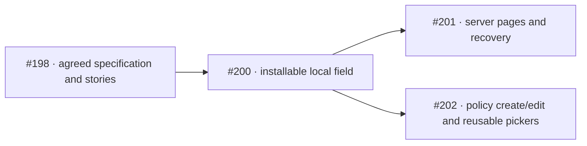

# Datagrid selection delivery plan

Updated October 30, 2026. The native composition and consumer simplifications are agreed; public exports and production
behavior are implemented locally, with evidence in the [acceptance record](datagrid-selection-acceptance.md). This plan
updates the existing issue graph and does not add another renderer, prerequisite interface ticket or final testing
ticket.

Start with the [short specification](datagrid-selection-design-spec.md),
[complete consumer examples](datagrid-selection-code-examples.md) and
[composition ADR](../../adr/0002-datagrid-selection-composition.md). The
[detailed reference](datagrid-selection-reference.md) preserves async, availability, reset and historical evidence.

## Existing work and current checkpoint

- [#198](https://github.com/wghglory/ngx-lift-workspace/issues/198) is the parent specification and story inventory. Its
  October 30 revision supersedes earlier rendering proposals, preserves stories 1–47 and adds stories 48–55 for the
  agreed native composition, projected label/alert, minimal consumer code, localization and evidence boundaries.
- [PR #199](https://github.com/wghglory/ngx-lift-workspace/pull/199) is already merged. It records the older design; do
  not treat it as the next implementation task or claim the current local document changes were part of that merge.
- The current branch contains revised design, ADR, codebook and reference files. Keep these reviewed files available to
  the implementation workspace; do not start from a clean checkout that silently drops uncommitted design changes.
- Seven declaration-candidate hosts/provider setup compile strictly, with 12 negative cases and 11-locale dictionary
  parity recorded locally. Narrow Chromium experiments verify specific native data/configuration/row/projection seams.
  Those are design evidence, not production CVA, complete browser/form/provider or installed-package acceptance.

## Task graph

| Ticket                                                            | Independently working result                                                                                        | Blocked by | Completion boundary                                                                              |
| ----------------------------------------------------------------- | ------------------------------------------------------------------------------------------------------------------- | ---------- | ------------------------------------------------------------------------------------------------ |
| [#200](https://github.com/wghglory/ngx-lift-workspace/issues/200) | Local single/multiple field, normal forms, native customization and a minimal reusable picker connection            | None       | Production exports, localized runnable hosts, behavior/browser tests and strict packed consumers |
| [#201](https://github.com/wghglory/ngx-lift-workspace/issues/201) | Saved keys survive real server page/filter requests and failures                                                    | #200       | Deterministic HTTP-backed remote journey plus relevant regression/package checks                 |
| [#202](https://github.com/wghglory/ngx-lift-workspace/issues/202) | Query-driven DataServicePolicyFormComponent create/edit, reusable pickers, accepted baseline and explicit save DTOs | #200       | Runnable direct/picker policy journeys with reset/save/race and package evidence                 |

The native GitHub sub-issue and blocking relationships already match this graph. #201 and #202 are independent after
#200; neither needs the other's endpoint or demo. Downstream integration can use a verified packed artifact without an
npm release. Final feature closeout requires both downstream slices and their own acceptance evidence.

## Story coverage

Story numbers refer to the stable numbered list in #198. Shared stories are intentionally exercised by more than one
ticket; this is coverage, not additional blocking edges.

| Story group                                              | IDs                              | Delivery                                                                        |
| -------------------------------------------------------- | -------------------------------- | ------------------------------------------------------------------------------- |
| Native markup, identity and concise examples             | 1, 2, 11, 12, 33, 48, 50, 51, 54 | #200; #202 reuses the business examples                                         |
| Direct forms and reusable pickers                        | 3–10, 52                         | #200 supplies form/accessor behavior; #202 supplies full policy reuse           |
| Reconciliation, independent arrivals and stale responses | 13–16, 47                        | #200 local reconciliation; #201 remote pages; #202 edit-session initialization  |
| Filtering and logical select-all scope                   | 17–20                            | #200 local scope; #201 remote scope; #202 preserves policy choices              |
| Eligibility, clear and field state                       | 21–23, 27–29, 44                 | #200 common rules; #201 authoritative remote changes; #202 business composition |
| Validation and composite departure                       | 24–26                            | #200 form contract; #201/#202 repeat it at their actual public hosts            |
| Layout, feedback and stable size                         | 30–32                            | #200 core presentation; downstream hosts retain it                              |
| Query ownership, failure and retry                       | 34–36, 49                        | #200 local query; #201 HTTP pages; #202 picker/detail lifecycle                 |
| Edit baseline, DTOs and save outcomes                    | 37–43                            | #202; #201 separately proves complete key-only submission                       |
| Localization, accessibility and evidence                 | 45, 46, 53, 55                   | Each ticket owns these checks for its increment                                 |

## Execute #200 as working increments

Use the real application form/native grid as the primary test boundary: interact with rendered controls and observe the
original form state and emitted submission payload. Keep strict installed-consumer checks as the public packaging
boundary. These are the existing reviewed seams; no test-only controller or second form owner is needed.

1. **First runnable multiple-selection path.** A real Reactive Forms host directly projects a label and native grid.
   Declare mode, stable identity, queryResource data and loading only on that grid. Prefill saved organization IDs
   before data arrives, hydrate checkmarks, accept a user edit and reset through the owner without an echo. Start with
   one failing observable behavior, make it pass, then extend it; do not write an entire imagined test suite first.
2. **Native selection behavior.** Add single selection/Clear, filtered and paged select-all, unavailable selections and
   loading/disabled/readonly guards. Exercise the keyboard and header as well as row clicks. Keep full supplied data
   separate from native displayed scope; do not reconstruct inventory from visible rows.
3. **Forms and reuse.** Complete change/blur/submit buffering and composite departure through footer/filter popups. Add
   ngModel and the actual toSignalForm facade. Implement the optional library accessor/binding pair and one minimal
   picker owning its organization query, with no handwritten business CVA or mirrored control.
4. **Finish this deliverable.** Complete native label/signpost/alert projection, custom localized filter component,
   language switching, form layout and concise copyable examples. Carry each behavior's translation, accessibility and
   regression checks with it. Verify installed Angular 21 consumers in zoneless/ZoneJS modes, cleanup/performance
   boundaries and the applicable three-browser journeys before closing #200.

The examples keep descriptive names such as organizationService and DataServicePolicyFormComponent. Translation setup is
application-level; templates use pipes. Library code owns accessible IDs and native row discovery. Read the current
payload from sf.submitValue(); do not add another signal just for preview. Constructor-time nonNullable defaults can use
a native type=reset button; programmatic form.reset updates model state, while a separately loaded baseline may need
resetForm(value) to clear submitted as well. These are normal Angular form choices, not extra selection API
requirements.

If a real installed Clarity/API limitation forces a material change to this contract, record that concrete evidence and
review the changed contract before exporting it. Do not reintroduce removed consumer bindings solely to match a scratch
prototype or silently claim a runtime guard is implemented because a declaration compiles.

## Recommended skill flow

The design/use-case discussion and runnable seam exploration are already recorded. Continue from the current evidence
and refreshed tickets; no repeat interview or triage is needed for this already specified work.

- Current implementation: **`/implement #200`**, delivered locally with independent human acceptance pending. It works
  from the ticket, uses TDD at the reviewed real-host seams and closes with a Standards/Spec review. Keep each increment
  runnable; the first inspection point is the actual local multiple-selection form, not another API-only proof.
- After #200 meets its acceptance criteria, **`/implement #202`** gives the earliest end-to-end feedback on the
  requested business picker and policy form. **`/implement #201`** can run independently from the same accepted
  foundation.
- **`/implement-spec #198`** is an available orchestration alternative after the shared contract/artifact is stable. It
  follows native blocking edges and uses isolated implementer worktrees on an integration branch. Per-ticket execution
  is the recommendation here because the common public form bridge should be inspected before downstream work expands.

Keep current design context available until its revised documents are carried into the implementation branch. Between
completed tickets, a fresh implementation context can read the self-contained issue and referenced committed documents;
no new handoff file or new workspace is required solely to change phases.

## Done means evidence, not ticket activity

For each increment, record behavior/type checks, installed consumers, browser/accessibility/translation/cleanup results
and remaining limitations. Do not use old prototype totals as current release evidence. Independent native-language and
assistive-technology acceptance, CI at the actual head, merge, deployment and package publication are distinct gates.

This planning update changes issue text and documentation. It does not implement the component, close a ticket, merge a
PR or publish a package. The [development workflow](../component-development.md),
[shared forms contract](forms-compatibility-design-spec.md) and
[accessibility/localization contract](../../guides/accessibility-and-localization.md) remain required.
