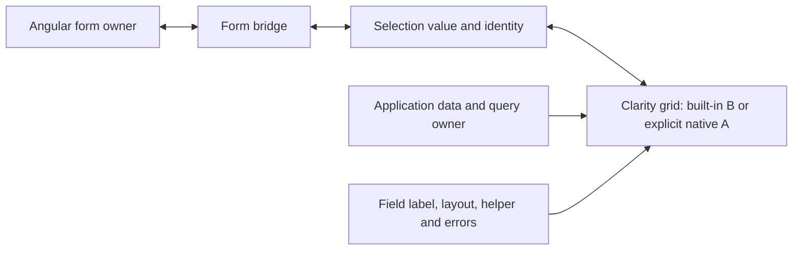

# Datagrid selection control design specification

Status: **API direction approved; local integration proof passed; production delivery pending**. Owner: clr-lift
maintainers. Updated: October 26, 2026. Approval: the maintainer approved Q1–Q12, with the simplified Q12 replacing the
earlier lock/two-permission proposals. Use one single/multi selection component with a fixed mode, preserve thin
resource-wrapper CVAs and formControlName, and use item disabled plus disabledReason. Dedicated locked/lockedReason and
select/deselect objects are outside v1. Forms store stable keys; entity conversion belongs at submission. The no-footer,
unpaged scrolling scope is approved. Proposed symbols remain unavailable until implemented and exported. This step
validates the installed Angular/Clarity integration; it does not claim completed production code, demos, localization or
installed-package acceptance.

Tracking: [Spec #198](https://github.com/wghglory/ngx-lift-workspace/issues/198). The specification is published; the
approved implementation graph is:

- [#200: Installable local selection field](https://github.com/wghglory/ngx-lift-workspace/issues/200) has no ticket
  blockers. Its concrete public API review precedes production exports.
- [#201: Server-page selection and recovery](https://github.com/wghglory/ngx-lift-workspace/issues/201) depends on #200.
- [#202: Reusable policy create/edit flow](https://github.com/wghglory/ngx-lift-workspace/issues/202) depends on #200.

After #200, #201 and #202 can proceed independently on the integration branch. Final feature closeout requires all three
slices and their acceptance evidence. The earlier local prototype remains integration evidence only.

## Approved rendering revision, October 26, 2026

The maintainer approved **B by default, A as an explicit advanced option**. This supersedes the earlier A-only
complete-grid composition decision while preserving the agreed key values, form ownership, availability, validation,
focus, select-all scope and async/reset semantics.

- **B / columns (default):** the component instantiates Clarity's grid, columns, rows and optional pagination. Callers
  declare bounded column metadata and Angular cell/custom-filter templates. Native Clarity still processes the table;
  this is not another grid engine or a universal configuration schema.
- **A / custom (explicit):** callers supply one complete native Clarity grid and use the shared form/selection bridge.
  This is the path for needs outside B's deliberate feature scope; extending B is optional, not a prerequisite to use A.
- Both use one private selection/form mechanism and shared field presentation. A field chooses exactly one renderer for
  its lifetime; no automatic fallback and no mixing column declarations with a projected native grid.
- Resource-specific pickers are optional reuse boundaries, not mandatory containers. Either renderer can be used inline
  in a form or inside a reusable picker. Fetching may belong to a parent, domain service or domain picker; it never
  becomes a responsibility of the generic selection component. Detail values reach the field through the form owner, not
  by passing an entire policy DTO to every picker.
- A preserves native template freedom, not a promise that every advanced Clarity feature is selection-compatible.
  Virtual scrolling, unusual row structures and complex overlays require their own compatibility evidence when claimed.

The three-ticket graph remains unchanged. #200 delivers the shared core and both local entry points, #201 verifies the
native server-page path and any deliberately supported built-in server features, and #202 demonstrates reusable pickers
and inline usage with shared query/edit/reset behavior. Both renderer paths must be independently demonstrated.

## Applicable contracts

- Value/form integration: the [shared forms contract](forms-compatibility-design-spec.md) governs Angular 21 CVA,
  ngModel, typed Reactive Forms, and the separate `toSignalForm` facade host. Native Signal Forms follows the platform
  upgrade, with the same submitted value contract.
- Rendered UI: selection, composite focus, field labeling, helper/error content, horizontal/vertical layout, and the
  [accessibility and language contract](../../guides/accessibility-and-localization.md).
- Async integration: loading, page replacement, edit preselection, stale results, and unavailable selections. The
  accepted boundary leaves fetching and cancellation with the application.
- Shared cache: no new cache or backend client is proposed. Applications may use existing query utilities. Explicit
  integration hosts must cover `resourceAsync`, `queryResource` and `mutateResource` without making these utilities
  required inputs of the selection component.

## Background

Production application forms repeatedly wrap a selectable Clarity datagrid in a custom value accessor and a form
container. They repeat identifier-to-row conversion, selection callbacks, labels, errors, and CSS compensating for a
text-input wrapper. Some expose identifiers; others expose row objects. They include both single and multiple selection,
mostly without a footer, and edit forms receive saved values before inventory loading completes.

A read-only consumer audit found nine modern datagrid CVAs and one legacy namespace CVA. Related legacy forms manually
bridge selection to controls. The application-specific source paths remain in the review conversation; this reusable
spec uses generic examples and does not introduce application or company identifiers.

Corrections established by that audit:

- The inspected tenant-assignment picker fetches every organization page before using `*clrDgItems`. It demonstrates
  client-side grid operations, not a server-driven grid.
- Namespace, cluster, and directory pickers use a recursive Kubernetes list helper. Some storage-target and deployment
  policy services instead read one response; the latter request a fixed limit and do not aggregate continuation pages at
  that service layer. This is a possible inventory-completeness gap, not evidence of observed production truncation.
- Data acquisition, client/server grid operations, row eligibility, and form validation are four separate concerns.
  Fetching all items does not validate a selection or guarantee that an existing assignment remains authorized.
- Disabled-state bridging is missing or a no-op in the inspected modern CVAs. Several identifier-array accessors also
  assume a non-null array. Existing behavior is migration evidence, not the desired generic contract.
- The inspected external hosts use Reactive Forms. CVA implementation alone does not establish tested ngModel support.

Installed Clarity 18.4.0 already provides single/multiple selection, row identity, local/server operation, eligibility,
loading, and optional projected footer/pagination. The datagrid itself is not a CVA. The proposed reusable value is the
form/selection boundary and field presentation, rather than a replacement grid engine.

## Terminology

The [root glossary](../../../GLOSSARY.md#datagrid-selection) records the accepted selection-value and selection-key
vocabulary following the accepted review. The [composition decision](../../adr/0002-datagrid-selection-composition.md)
records the architectural tradeoff. Exact symbols remain draft.

- **Item**: a selectable business resource. A row is its Clarity grid presentation, not its identity. Use `items`,
  `itemKey`, `itemAvailability` and item-oriented proposed bridge names; keep actual Clarity API names unchanged.
- **Selection value**: the value held by the owning form; the application's backend payload may be derived from it.
- **Item key**: the stable identity connecting that value to a rendered row, independent of object instance or page.
- **Loaded items**: items currently supplied to the grid; they may represent a complete local collection or one server
  page.
- **Inventory completeness**: whether the application knows it has the whole relevant collection. It cannot be inferred
  from an empty page, a loaded flag, or the use of `*clrDgItems`.
- **Reconciliation**: matching an existing selection to newly loaded row instances without making a user edit.
- **Unavailable selection**: a selected identity authoritatively known to be unavailable. An off-page or not-yet-loaded
  identity is unresolved, rather than automatically unavailable.
- **Selection eligibility**: whether a user may select or deselect a particular row. It is distinct from required and
  other form validation rules.

## Goals

- G1: Deliver single and multiple grid selection as real form values with predictable edit prefill and reset behavior.
- G2: Offer concise built-in columns/templates by default and an explicit complete native-grid option for advanced use.
- G3: Display a meaningful label, helper, and errors with horizontal and vertical field layouts, without consumer CSS
  patches for text-input dimensions.
- G4: Keep selection stable through loading, filtering, paging, refreshed objects, and future form-bridge changes.

## Non-goals

### Not now

- Implementing the component before the design interview and API approval are complete.
- Upgrading Angular/Nx or adding native Signal Forms imports to the Angular 21 package.
- Migrating every application-specific picker, replacing Clarity, supporting every advanced grid feature, or introducing
  runtime dependencies.
- Treating special values such as a version wildcard or an assignment scope as ordinary selected items.

### Outside this API

Backend authorization, Kubernetes pagination, API query construction, business warnings, resource-specific badges,
version comparison, and application payload conversion remain application concerns. A future request for all matching
server records requires a separately reviewed selection algebra; an ordinary array cannot imply an unbounded query.

## Use cases and acceptance

The inventory below describes observed categories; proposed outcomes are acceptance requirements under review.

| ID   | Actor and task                                  | Initial state                                                             | Action                                            | Proposed observable outcome                                                               | Failure/recovery                                        | Demo/test                           |
| ---- | ----------------------------------------------- | ------------------------------------------------------------------------- | ------------------------------------------------- | ----------------------------------------------------------------------------------------- | ------------------------------------------------------- | ----------------------------------- |
| UC1  | Assign several tenants                          | Saved stable IDs; items arrive later; no footer                           | Open edit, then select another row                | Existing items preselected; only the user edit changes form value/dirty state             | Loading/error preserves saved IDs                       | Planned multi/edit host             |
| UC2  | Assign namespaces                               | Saved names; complete local inventory; label chips in cells               | Filter and change selection                       | Selection survives filtering; custom cells remain native Clarity content                  | Empty inventory differs from failed request             | Planned local/filter host           |
| UC3  | Choose storage targets or deployment policies   | Optional storage and required policy fields; parent-owned validators      | Select, clear, submit                             | Owner receives selected identities; required feedback follows owner state                 | Business warning does not become a grid-owned validator | Planned validation host             |
| UC4  | Choose one deployment policy                    | Saved row reference, potentially replaced on refresh                      | Load, replace items, select another               | Exactly one selection; refreshed instance alone is not a user change                      | No match follows explicit unavailable policy            | Planned single/edit host            |
| UC5  | Choose a directory configuration                | Optional single selection; rich status cells                              | Select and explicitly clear                       | Clear submits the agreed empty single value                                               | Clear obeys disabled/readonly                           | Planned single/clear host           |
| UC6  | Choose a placement target                       | Single selection, eligibility constraints, footer/page size               | Page and select a permitted row                   | Eligibility and footer remain usable; stable identity includes namespace/scope            | Ineligible items cannot be chosen                       | Planned footer/eligibility host     |
| UC7  | Choose multiple placement targets               | Current objects include name and namespace                                | Refresh with equal names in different scopes      | Scoped identities remain distinct; payload conversion stays explicit                      | Duplicate keys produce a developer diagnostic           | Planned identity/type host          |
| UC8  | Embed the picker in a compound version selector | Separate All/Major/Minor scope control                                    | Switch between scope and explicit items           | Parent owns wildcard and scope; picker owns only explicit items                           | Parent explicitly decides when to clear/default         | Planned composition host            |
| UC9  | Maintain permissions with many items            | Preselected names and a paginated grid                                    | Inspect selected items and return                 | Value preserved; selected-only view is a deliberate presentation choice                   | Readonly remains distinct from disabled                 | Planned inspection host             |
| UC10 | Select across server pages                      | Saved key absent from current page                                        | Change page/filter, resolve saved key later       | Off-page selection survives; hydration emits no form edit                                 | Failure/stale response cannot clear or overwrite value  | Planned remote fixture host         |
| UC11 | Use either field layout                         | Long label, helper/errors, translated filters                             | Switch layout and narrow viewport                 | Label above or beside grid; grid and filter popovers remain usable                        | Reflow, zoom and RTL preserve actions                   | Planned layout/browser host         |
| UC12 | Reset, disable, and inspect                     | Selected items, focus inside cell/filter/footer                           | Reset or change availability                      | Shared form contract holds; all selection paths respect state                             | No late selection/touch callbacks                       | Planned three-form-host matrix      |
| UC13 | Select all in a footer-free scrolling grid      | 100 unpaged items; only 10 fit the scroll viewport                        | Click select-all, then scroll                     | All 100 eligible items selected, including initially out-of-view ones                     | Ineligible-item policy respected                        | Planned unpaged-scroll browser host |
| UC14 | Scope select-all to filtered results            | 100 unpaged items, 8 match a filter, other selections already exist       | Select/clear filtered results                     | Only those 8 eligible/removable items affected; unrelated keys retained                   | Later loads do not auto-select new keys                 | Planned filter/select-all host      |
| UC15 | Load inventory with resourceAsync               | Saved selection exists before a component-local read resolves             | Load, reload, fail and retry                      | Items reconcile by key; reads never change the form value, dirty or touched               | Failed or cancelled reads preserve selected keys        | Planned local-resource host         |
| UC16 | Load shared inventory with queryResource        | Scoped query may have cached data and multiple observers                  | Refresh or invalidate its scoped tags             | Fresh objects reconcile without selecting new arrivals or clearing saved keys             | Refresh error differs from authoritative removal        | Planned shared-query host           |
| UC17 | Save or change resources with mutateResource    | Valid form selection and an explicit submitted DTO snapshot               | Save policy or update inventory availability      | Mutation state stays outside field validity; refresh preserves selection intent           | Write failure keeps edits; refetch failure is separate  | Planned query/mutation host         |
| UC18 | Open an edit form with independent queries      | Policy detail and organization/namespace inventory return in either order | Initialize the edit session, then reconcile items | Values and cross-page preselection agree regardless of response order                     | Detail retry does not expose an editable blank form     | Proposed edit-query host            |
| UC19 | Distinguish inventory failure from empty data   | No initial inventory or cached inventory during refresh                   | Fail, display retry and recover                   | Initial error differs from empty success; refresh failure keeps cached rows and selection | Read failure never silently removes saved keys          | Proposed query-error host           |
| UC20 | Restart edits from the original configuration   | Many saved organizations span pages; user has changed multiple fields     | Reset changes to the edit-session baseline        | All baseline keys and text restored; pending edits discarded; owner pristine/untouched    | Current permissions and availability still apply        | Proposed baseline-reset host        |

## Industry evidence and current gaps

Checked October 25, 2026. Installed source governs the current Clarity integration; latest upstream documentation is
comparison evidence, not proof of compatibility with this package's pinned platform.

| Primary source                                                                                                                   | Observed capability                                                                                                                    | Adopt/adapt/reject recommendation                                                                 | Gap addressed                                                  |
| -------------------------------------------------------------------------------------------------------------------------------- | -------------------------------------------------------------------------------------------------------------------------------------- | ------------------------------------------------------------------------------------------------- | -------------------------------------------------------------- |
| Installed `@clr/angular` 18.4.0 declarations and datagrid implementation                                                         | `clrDgSelectionType`, array `clrDgSelected`, identity function, preserve-selection, selectable items, refresh events, projected footer | Adopt the existing grid and public APIs; adapt selection into a form value                        | Grid lacks a CVA and composite field contract                  |
| [Angular Material table source documentation](https://github.com/angular/components/blob/main/src/material/table/table.md)       | SelectionModel composition; separate table, data source, and paginator                                                                 | Adopt separation of selection/data/pagination; keep Clarity rendering                             | Use declarative templates; avoid a universal configuration DSL |
| [NG-ZORRO table source documentation](https://github.com/NG-ZORRO/ng-zorro-antd/blob/master/components/table/doc/index.en-US.md) | Explicit front/server pagination, query events, checkbox disabled/checked state, optional pagination                                   | Adopt explicit data-mode and availability boundaries; retain existing Clarity equivalents         | UI mode must not imply complete inventory or valid form data   |
| [React Aria Table](https://react-aria.adobe.com/Table)                                                                           | Controlled selected keys, single/multiple modes, disabled items and separate row actions                                               | Adapt key identity and independent selection/action semantics; defer the `all` selection sentinel | Stable form values must survive changing row instances/pages   |
| [Angular custom Signal Forms controls](https://angular.dev/guide/forms/signals/custom-controls)                                  | FormValueControl/model value and form-state integration                                                                                | Prepare an independent selection core; recheck interfaces at the platform upgrade                 | CVA alone does not establish native Signal Forms acceptance    |

Clarity-specific findings that constrain implementation:

- The installed version uses array `clrDgSelected` for both single and multi selection. Older examples using
  `clrDgSingleSelected` do not match the installed declarations.
- `clrDgPreserveSelection` prevents filter-triggered clearing. It does not define the entire unavailable-row policy.
  Client-grid replacement may prune items absent from the supplied collection; server-managed items behave differently.
- Identity-based object reconciliation can emit grid selection events. Forwarding every event directly to the form would
  incorrectly count hydration as a user edit.
- `*clrDgItems="let item of items; trackBy: trackItem"` uses Clarity's native `clrDgItemsTrackBy` input for row-view
  reuse. This is optional and separate from `[clrDgItemsIdentityFn]`, which identifies items for grid state and
  selection. A row trackBy is not required for key-based selection correctness. Resource examples should use stable
  scoped keys for both, but Clarity permits independent row-view tracking strategies, including index tracking. A row
  index must never become the form selection key or the grid's resource identity.
- Default select-all covers displayed selectable items, not all matching server results.
- `clrControl` supplies registration/presentation, not a CVA. Its host label/description handling alone does not prove
  that the internal element with `role="grid"` is named and described correctly.
- There is no general datagrid-wide disabled/readonly value-control input. Effective row eligibility and select-all must
  combine caller constraints with form availability.
- A complete projected grid in A preserves its own provider hierarchy. Projecting arbitrary caller-declared items into a
  different internal grid needs an injector/content-query proof before such an API can be accepted.

The source audit confirms both API forms. Installed Clarity 18.4.0 and upstream
[ClrDatagridItems](https://github.com/vmware-clarity/ng-clarity/blob/main/projects/angular/data/datagrid/datagrid-items.ts)
forward the iterator's trackBy to Angular's NgFor row-view differ. The upstream
[selection documentation example](https://github.com/vmware-clarity/ng-clarity/blob/main/projects/website/src/app/documentation/demos/datagrid/selection/selection.html)
sets `clrDgItemsIdentityFn` and omits iterator trackBy, while the upstream
[selection development demo](https://github.com/vmware-clarity/ng-clarity/blob/main/projects/demo/src/app/datagrid/selection/selection.html)
exercises both together, including row-view tracking by index. The
[v17 migration guide](https://clarity.design/pages/update-to-v17) records the separation of row iteration from selection
tracking; historical input names there do not override the installed version's `clrDgItemsIdentityFn` declaration. The
read-only application audit likewise finds identity-only resource pickers and list templates using both inputs.

## Developer learning journey and pedagogy plan

All destinations below are proposed. No demo route or package import has been delivered.

| Reader task / prerequisite                                      | Learning outcome                                 | Proposed destination                       | Working example and expected result                          | Validation          |
| --------------------------------------------------------------- | ------------------------------------------------ | ------------------------------------------ | ------------------------------------------------------------ | ------------------- |
| First local multi-select; know Clarity items and Reactive Forms | Submit stable selected keys                      | Datagrid selection playground              | Optional footer; value/status/submitted payload              | Compile and browser |
| Edit an existing selection                                      | Distinguish value from loaded items              | Prefill and identity example               | Delayed items and refreshed instances preserve pristine form | Controlled requests |
| Use one selected row                                            | Understand null, required and explicit clear     | Single selection example                   | Agreed scalar/null value; business adapter outside picker    | Forms/type checks   |
| Use template-driven or signal-observed Reactive Forms           | Keep one owner per host                          | Separate ngModel and toSignalForm examples | Same selection contract, real reset/submit                   | Installed consumers |
| Load server pages                                               | Preserve keys without claiming global select-all | Remote paging example                      | Keys survive page/filter changes and request races           | Browser fixture     |
| Adapt presentation and availability                             | Use both layouts and inspect readonly            | Layout/eligibility example                 | Long labels, errors, footer/filter focus and RTL             | Browser/a11y/manual |

## Public API and examples

### Accepted foundation

Q1–Q12 are approved with the simplified availability contract and no dedicated forced-retention API. Resource-specific
components use built-in columns by default or explicitly compose a complete Clarity grid; external formControlName stays
compatible. Forms store stable primitive keys: single K|null and multiple K[]; readonly key arrays remain supported.
Entity DTO conversion stays at submission. Field layout inherits clrForm with a per-field override.

Business code supplies scoped string/number item keys. Duplicate candidate keys are developer errors. Existing
multi-value order is stable through filtering, sorting and paging; new selections append. Defaults belong to the
application; the library never selects a first or sole item implicitly. Explicit single clear emits null even when
required, and owning-form validation then reflects emptiness.

The exact implementation and exported declarations require integration proof; approved interface direction remains
valid.

Here, **caller** means the application component using clr-lift, not the person interacting with the form. Under Q1,
that component declares columns/cell/filter templates for B, or the complete `clr-datagrid` for A. It supplies items,
fetching state, pagination preferences and domain eligibility/validation rules. Clarity still renders and operates the
grid. clr-lift owns the selection-to-form bridge, preselection reconciliation, availability enforcement, composite focus
and field presentation. The caller does not implement another CVA or independently synchronize `clrDgSelected` for this
inner control. Any outer application-component form bridge remains an explicit integration choice.

The revised tradeoff offers a concise default without forcing every use case through a growing wrapper surface. B owns
routine grid wiring and supports bounded declarative columns, rich cell templates and custom filter templates. A retains
direct native customization. Both can be centralized in a reusable domain picker or declared inline; domain reuse and
data retrieval do not determine grid ownership. Do not duplicate the selection engine or create a second form owner to
support the two renderers.

### Approved interface direction: Q10–Q12

The ask-matt workflow review identifies the next step as interface review followed by a real Angular/Clarity integration
proof. Its standard static logic/visual-variant prototypes cannot establish Angular CVA, projection or accessible-grid
behavior. Continue in this design context, then consolidate the proven contract for ticketing.

| Question | Proposal for review                                                                                                                       | Reason                                                                                                                                               |
| -------- | ----------------------------------------------------------------------------------------------------------------------------------------- | ---------------------------------------------------------------------------------------------------------------------------------------------------- |
| Q10      | One DatagridSelectionComponent with explicit selectionMode="single" or "multiple"; mode stays fixed for the instance                      | Keep one usage pattern while preserving scalar/null versus key-array values; generic inference and actual forms must be proved                       |
| Q11      | Preserve thin resource-wrapper CVAs initially; do not add a public generic CVA base class or host-directive export in the first increment | Existing formControlName remains compatible; selection complexity moves to the shared control without prematurely expanding the public forms surface |
| Q12      | Approved: item disabled plus disabledReason, no dedicated locks or dual permission objects                                                | Keep normal availability simple and preserve removal of invalid saved choices                                                                        |

Q12 is approved in its simplified form: item disabled plus a localized disabledReason, without locked/lockedReason or
separate select/deselect permission objects. Normal disabled items cannot be newly selected. An existing selection that
becomes unavailable keeps its key and explanation, remains removable for recovery, and is validated by the owning
business form. Whole-field disabled/readonly still blocks every value edit. Item disabled therefore describes
eligibility to add, rather than blindly mapping onto an already-selected checkbox's native disabled attribute.

The modern form consumers do not justify a dedicated must-retain API. A legacy registration dialog shows existing
resources checked and disabled but excludes them from create payloads; that action-only presentation is not a v1
form-value requirement. The simplified approval supersedes earlier lock proposals throughout this specification.

The proof must use the installed Angular/Clarity components and inspect actual owner values/dirty/touched,
projection/provider behavior and the accessibility tree. Cover delayed prefill/no echo, wrapped formControlName and
ngModel, disabled/readonly and unavailable selected items, unpaged-scroll/filtered/page select-all, true grid
naming/errors, and focus across cells/footer/filter popup. Strict templates and a packed consumer check the eventual
public surface. The local proof now passes strict Angular templates and 54 browser scenarios in each of Chromium,
Firefox and WebKit. This proves the scoped integration, not a new packaged public component.

After the proof, update this canonical spec rather than starting a competing contract. The recommended later route is
implementation against the approved child-ticket graph above. Concrete API review and production delivery remain
pending; the earlier workflow-routing discussion did not itself implement the component.

### Application component reuse and the outer form binding

Resource-specific components remain useful: an organization picker and a storage-target picker each declare their grid
once, and create/edit pages reuse those components. Shared behavior removes duplicated selection/form mechanisms, not
the resource-specific columns, filters or data sources.

Preserve the outer application component's existing `formControlName` binding. The main application example is:

```typescript
readonly form = new FormGroup({
  organizationIds: new FormControl<string[]>(['org-a'], {
    nonNullable: true,
    validators: [Validators.required],
  }),
  storageTargetNames: new FormControl<string[]>([], {nonNullable: true}),
});
```

`FormControl<K[]>` is the normal application example; `readonly K[]` is an optional TypeScript constraint, not a
required consumer declaration. The bridge must accept either array shape and emit a fresh mutable `K[]` for accepted
multi-select edits without mutating caller-owned arrays. The `readonly form` property modifier only prevents reassigning
that property. Neither TypeScript modifier makes the rendered field readonly; the field's readonly interaction state is
separate. Use Angular `setValue`, `patchValue` or `reset` to notify the form of application changes rather than mutating
its array in place.

```html
<!-- Proposed integration: outer wrappers must retain/provide a real value accessor. -->
<form [formGroup]="form">
  <app-organization-picker formControlName="organizationIds" [items]="organizations()" />
  <app-storage-target-picker formControlName="storageTargetNames" [items]="storageTargets()" />
</form>
```

The organization wrapper's domain inputs include `items` and an item-key function. It must retain its CVA or use a
proven reusable bridge; host NgControl does not automatically move to an inner grid. Exact bridge reuse, validation
presentation and migration require technical API proof under the accepted boundary. Do not promise zero wrapper adapter
code before the proof. Preserve existing object-valued wrapper contracts with explicit adaptation rather than silently
changing those fields to IDs.

The earlier `[control]` sketch passed an existing FormControl instance directly to a wrapper. That object includes
value, errors, disabled and touched state; it is not the ID array itself or Clarity's `clrControl` directive. This is a
possible Reactive Forms composition, but no longer the main API recommendation. It is not required by the generic
selection core. The parent form remains the one owner under either approach, with no mirrored FormControl. ngModel and
future native Signal Forms need real bridges for their own form systems.

### Wrapper bridge feasibility — source inspection only

Installed Angular supports a thin resource-wrapper CVA that passes controlled value, availability and interaction events
to the generic inner selection UI. The inner UI has no formControl/ngModel binding in that mode and creates no
FormControl. The wrapper remains connected to the original NgControl, validators and form commit timing. Owner writes
update the view without user callbacks; accepted inner edits and composite departures report through the outer CVA. Read
required/error/touched/pending presentation from the actual owner's public APIs with lifecycle-safe injection.

A reusable standalone CVA host directive is another possible mechanism, but exactly one custom value accessor may be
registered on the wrapper host. Installed ClrControl is not standalone and cannot simply be used as a host directive.
Host directives referenced by exported library components can also impose public-entrypoint visibility/export
requirements. Do not promise an invisible generic host-directive abstraction before strict packaging proof. A thin
existing wrapper CVA or an undecorated private helper can avoid expanding the public bridge surface prematurely.

These are source-supported implementation options, not compiled new APIs. Exact inputs/events and field-state
presentation still need the complete API/proof round; preserving formControlName does not require mirrored controls.

### Integration proof findings to preserve in production

- Keep caller items readonly. Clarity's smart iterator requires a mutable array, so adapt with a cached shallow copy
  rather than weakening types or mutating the caller's collection.
- Bind the library-derived selected item collection into clrDgSelected through Angular template binding. Direct member
  assignment after rendering left the header's internal ngModel checked state stale when paging; the explicit binding
  fixed the failing second-page regression without a DOM checkbox patch. This derived collection is not a second
  writable application selection owner. Preserve this binding behavior if a final bridge reduces template boilerplate.
- Cover single-radio and multi-checkbox intent separately; refreshed objects and grid reconciliation are not user edits.
- Own filter portals through standard aria-controls relationships. A host contains check alone touched the field when
  its own filter input received focus. Distinguish WebKit's transient body focus while a page's elements are replaced
  from actual outside focus/pointer/window departure.
- Use the declared public datagridTable element reference for grid naming/descriptions/invalid state. Required is
  associated instruction text, not aria-required on role=grid. Keep this version-sensitive adapter private.
- Preserve one Angular form owner. The wrapped Reactive Forms host and the direct ngModel host pass, including disabled
  serialization and Angular-owned blur/submit commit timing; there is no mirrored inner FormControl.

### Selection values versus backend payloads

Q2 is explicitly reconfirmed: store stable keys in the form and convert them to full/partial entity DTOs at submission
when the endpoint needs them. The generic control does not gain an entity-valued mode from this requirement.

```typescript
const organizationIds = form.controls.organizationIds.value;
const idPayload = {organizationIds};

// selectedItems represents ALL resolved selected entities, including off-page ones.
const referencePayload = {
  organizations: selectedItems.map((item) => ({id: item.id, name: item.name})),
};
const entityPayload = {
  organizations: selectedItems.map(toOrganizationDto),
};
```

Entity resolution and `toOrganizationDto` belong to the application, not new exports from this draft. Complete DTOs must
not accidentally include item-view state such as availability. Prefer an explicit reference DTO or
`Pick<Organization, 'id' | 'name'>` to an unconstrained Partial when specific fields are required.

Key-only endpoints need no entity hydration solely to submit. Entity endpoints require every selected key resolved from
authoritative cached data, a complete inventory or by-ID lookups, rather than just the current page. Unresolved keys
must keep the submitted request blocked until resolved or explicitly handled; do not silently filter them out. An
existing object-valued application wrapper needs a compatible explicit adapter or a separately reviewed value contract,
not a silent switch to key arrays.

### Hybrid public API proposal for #200 — exact declarations remain under review

This section supersedes the earlier conceptual markup. It is a proposed public contract, not implemented exports or a
compiled consumer. The approved behavior remains, with the October 26 B-default/A-custom rendering revision. Review this
surface before production implementation.

Proposed standalone imports from `clr-lift`:

```typescript
import {
  DatagridSelectionComponent,
  DatagridSelectionItemDirective,
  DatagridSelectionColumnDirective,
  type DatagridSelectionKey,
  type DatagridSelectionMode,
  type DatagridSelectionValue,
  type DatagridSelectionChange,
  type DatagridSelectionItemAvailability,
  type DatagridSelectionOwnerState,
} from 'clr-lift';
import {ClrDatagridModule} from '@clr/angular';
import {ReactiveFormsModule, FormControl, Validators} from '@angular/forms';
```

The component selector is `cll-datagrid-selection`; the row directive selector is
`clr-dg-row[cllDatagridSelectionItem]`. Do not export a generic CVA host directive or a second grid directive in v1. The
component creates its own grid in default columns mode. In explicit custom mode it discovers exactly one projected
complete Clarity grid; the row directive discovers its enclosing selection component and native row. Missing/multiple
custom grids, mixed renderers and rows outside an owner are developer diagnostics. The two renderers share the same CVA,
key reconciliation, availability and composite-focus behavior.

```typescript
export type DatagridSelectionKey = string | number;
export type DatagridSelectionMode = 'single' | 'multiple';
export type DatagridSelectionRenderMode = 'columns' | 'custom';
export type DatagridSelectionValue<K extends DatagridSelectionKey, M extends DatagridSelectionMode> = M extends 'single'
  ? K | null
  : readonly K[];
export type DatagridSelectionChange<
  K extends DatagridSelectionKey,
  M extends DatagridSelectionMode,
> = M extends 'single' ? K | null : K[];
export interface DatagridSelectionItemAvailability {
  readonly disabled: boolean;
  readonly disabledReason?: string;
}
export interface DatagridSelectionOwnerState {
  readonly invalid: boolean;
  readonly touched: boolean;
  readonly dirty: boolean;
  readonly pending: boolean;
  readonly submitted: boolean;
}
// Proposed generic component parameters, inferred from items, itemKey and the literal selectionMode:
// DatagridSelectionComponent<T, K extends DatagridSelectionKey, M extends DatagridSelectionMode>
```

String and finite number keys preserve primitive identity; do not coerce between them. Symbols, object keys, NaN and
infinite numbers are outside v1. Mode is required and fixed for the component lifetime. Single accepts `K | null`;
multiple accepts mutable or readonly key arrays, emits fresh mutable arrays and normalizes null/reset to `[]`. Neither
missing loaded items nor reconciliation removes a key or emits a user edit.

| Proposed member           | Type / default                                                | Contract                                                                                                                    |
| ------------------------- | ------------------------------------------------------------- | --------------------------------------------------------------------------------------------------------------------------- |
| `renderMode`              | `'columns' \| 'custom'`; columns                              | Fixed rendering choice, independent of single/multiple selectionMode.                                                       |
| `pagination`              | `false \| {pageSize: number}`; false                          | B only: absent/false means no pagination processing and no pager/footer. Positive page size enables both.                   |
| `loading`, `emptyMessage` | boolean / localized text                                      | B presentation inputs; transport/error/retry policy remains application-owned. A binds native loading/placeholder directly. |
| `itemLabel`               | `(item: T) => string`                                         | Meaningful B row-selection label; exact required/default typing must be proved before export.                               |
| `selectionMode`           | required `M`                                                  | Literal `single` or `multiple`; maps to native single/multi selection.                                                      |
| `items`                   | required `readonly T[]`                                       | Current complete local collection or current server page; never mutated.                                                    |
| `itemKey`                 | required `(item: T) => K`                                     | Stable scoped identity; duplicate candidate keys are developer errors.                                                      |
| `itemAvailability`        | `(item: T) => DatagridSelectionItemAvailability`; all enabled | Prevent additions when disabled; selected disabled items remain removable.                                                  |
| `label`                   | required `string`                                             | Visible field label and actual grid accessible name.                                                                        |
| `helper`, `error`         | `string`; empty                                               | Localized caller text; show error only when owner invalid and touched/submitted, helper otherwise.                          |
| `requiredIndicator`       | `boolean`; false                                              | Required instruction/marker only; does not install a validator. Actual validators belong to the owner.                      |
| `layout`                  | `'inherit' \| 'horizontal' \| 'vertical'`; inherit            | Inherit enclosing Clarity form; vertical outside a form; stack at narrow widths.                                            |
| `readonly`                | `boolean`; false                                              | Prevent selection changes, keep filtering/sorting/paging usable.                                                            |
| `interactionDisabled`     | `boolean`; false                                              | Effective selection disabled = input OR CVA disabled state; this input never changes owner status or serialization.         |
| `value`                   | `DatagridSelectionValue<K, M>`; absent                        | Controlled-inner mode only; cannot coexist with formControl/ngModel on this component.                                      |
| `ownerState`              | `DatagridSelectionOwnerState`; absent                         | Required with controlled value; otherwise derived from actual NgControl and containing form submission state.               |
| `valueChange`             | `DatagridSelectionChange<K, M>`                               | Accepted user edit only; emits alongside CVA onChange in direct mode.                                                       |
| `focusLeave`              | `void`                                                        | Composite departure including filter portals; emits alongside CVA onTouched in direct mode.                                 |
| `gridItems()`             | `T[]`                                                         | Cached mutable shallow copy for Clarity iterator compatibility.                                                             |
| `selectedItems()`         | `T[]`                                                         | Derived loaded selected rows, for template binding only; not all resolved selected entities.                                |
| `gridSelectionType()`     | installed Clarity `SelectionType`                             | Maps single/multiple to Clarity Single/Multi.                                                                               |
| `identify`                | `(item: T) => K`                                              | Stable forwarding callback for Clarity identity binding.                                                                    |
| `selectionDisabled()`     | `boolean`                                                     | Effective disabled OR readonly, for native header binding.                                                                  |

`requiredIndicator` and `interactionDisabled` deliberately avoid Angular form-directive input names. Angular's
`RequiredValidator` matches `required` together with formControlName, formControl or ngModel on custom components too;
binding `required` is therefore a validation request, not presentation-only metadata. Reactive Forms examples configure
`Validators.required` on the owner and bind `requiredIndicator` for presentation. Template-driven examples use Angular's
`required` directive when validation is intended and set `requiredIndicator` separately. Toggling the indicator alone
must not change owner validity.

Similarly, `NgModel` consumes a `disabled` binding and enables/disables its owning control. With an enabled containing
form, a disabled named control is omitted from NgForm.value and retained in the raw value. Reactive Forms hosts instead
enable/disable the owning control through Angular's control API; CVA setDisabledState forwards that state to the field.
The component does not declare a `disabled` input. Its `interactionDisabled` input only blocks selection edits and may
forward an outer wrapper's disabled state in controlled-inner mode; it does not call owner.disable() or owner.enable().
Use Angular-owned disabling when validation and serialization should change. Clearing interactionDisabled cannot
override a disabled form owner, and enabling the owner cannot override interactionDisabled. Readonly remains the
separate inspection mode described above.

The grid/selection getters above are read-only bridge outputs for advanced A; B consumes them internally. No
`clrDgSelectedChange` application callback or second writable row-selection model is needed. The component subscribes to
custom select-all; the item directive handles checkbox/range and radio user intent separately from reconciliation
notifications and applies native `clrDgSelectable`. It must not blindly forward every grid selection emission to the
form.

#### Default B: declarative columns and rich templates

The proposed column declaration is a template directive, not a JSON cell-rendering language. Each declaration has a
stable column id, localized header, optional native field/sort comparator, optional Clarity-compatible custom filter,
optional filter UI template and an Angular cell template. Display formatting, sort semantics and filter matching remain
independent. In B, the component creates the native column/filter/row instances and keeps registration in their proper
Clarity provider context; caller filter UI receives explicit state rather than relying on undeclared parent injection.

```html
<!-- Proposed B shape; names and strict generic template inference still need public-package proof. -->
<cll-datagrid-selection
  label="Organizations"
  selectionMode="multiple"
  formControlName="organizationIds"
  [items]="organizations()"
  [itemKey]="organizationKey"
  [itemLabel]="organizationLabel"
  [pagination]="{pageSize: 10}"
>
  <ng-template cllDatagridColumn="name" header="Name" field="name" let-item> {{ item.name }} </ng-template>
  <ng-template
    cllDatagridColumn="status"
    header="Status"
    field="status"
    [sortBy]="statusComparator"
    [filter]="statusFilter"
    [filterTemplate]="statusFilterUi"
    let-item
  >
    <span class="label" [class.label-success]="item.enabled">{{ item.status }}</span>
  </ng-template>
</cll-datagrid-selection>
<ng-template #statusFilterUi><app-status-filter [filter]="statusFilter" /></ng-template>
```

No row loop, selected-items binding, native mode mapping or item directive is required from B callers. B must support
rich Angular cells, custom comparison and filter UI, dynamic column definitions and optional pagination within its
reviewed selection-focused scope. Column ids must be unique. Strict cell-context inference needs its own proof; a parent
generic component does not automatically make a child template correctly typed. Do not silently fall back to untyped
public templates or advertise checked generic inference from the fixed-item scratch proof.

A pagination flag is not merely footer visibility: false also disables client page slicing. Server filtering/sorting
must not be applied again as local processing. Exact built-in server event/data-mode extensions require explicit API
review in #201; A already provides the native refresh/page integration path. Do not grow B into a universal facade for
every Clarity feature. A one-off native requirement may use A without extending B.

#### Advanced A: direct form owner and complete native grid

```typescript
// In a standalone host importing ReactiveFormsModule, ClrDatagridModule and the relevant proposed clr-lift declarations:
interface Organization { id: string; name: string; enabled: boolean; }
readonly organizationIds = new FormControl<string[]>([], {
  nonNullable: true,
  validators: [Validators.required],
});
readonly organizationKey = (item: Organization): string => item.id;
readonly organizationAvailability = (item: Organization): DatagridSelectionItemAvailability => ({
  disabled: !item.enabled,
  disabledReason: item.enabled ? undefined : 'New assignments are unavailable.', // Host-localized text.
});
readonly trackOrganization = (_index: number, item: Organization): string => item.id;
```

```html
<cll-datagrid-selection
  renderMode="custom"
  #selection
  selectionMode="multiple"
  [formControl]="organizationIds"
  [items]="organizations()"
  [itemKey]="organizationKey"
  [itemAvailability]="organizationAvailability"
  label="Organizations"
  helper="Choose one or more organizations."
  error="Choose at least one organization."
  [requiredIndicator]="true"
>
  <clr-datagrid
    [clrDgSelected]="selection.selectedItems()"
    [clrDgSelectionType]="selection.gridSelectionType()"
    [clrDgItemsIdentityFn]="selection.identify"
    [clrDgPreserveSelection]="true"
    [clrDgCustomSelectAllEnabled]="true"
    [clrDgSelectAllDisabled]="selection.selectionDisabled()"
    [clrDgLoading]="loading()"
  >
    <clr-dg-column clrDgField="name">Name</clr-dg-column>
    <clr-dg-column>ID</clr-dg-column>
    <clr-dg-placeholder>No organizations match.</clr-dg-placeholder>
    <clr-dg-row
      *clrDgItems="let item of selection.gridItems(); trackBy: trackOrganization"
      [clrDgItem]="item"
      [cllDatagridSelectionItem]="item"
      [clrDgRowSelectionLabel]="'Select ' + item.name"
    >
      <clr-dg-cell
        >{{ item.name }} @if (!item.enabled) {
        <div>New assignments are unavailable.</div>
        }
      </clr-dg-cell>
      <clr-dg-cell>{{ item.id }}</clr-dg-cell>
    </clr-dg-row>
    <!-- Optional caller-owned footer; omit it for the approved unpaged scrolling case. -->
    <clr-dg-footer><clr-dg-pagination [clrDgPageSize]="10" /></clr-dg-footer>
  </clr-datagrid>
</cll-datagrid-selection>
```

Every example message is caller-localized in the delivered demo. Availability reasons stay caller-rendered beneath the
name; returning a reason does not inject text into arbitrary cells. Callers may add filters, action bars and custom
cells. Native row `trackBy` is optional view reuse and does not replace `itemKey`. Retain the explicit Angular
selected-items binding: direct post-render member assignment left the scratch proof's header stale on page changes.

For single mode use `selectionMode="single"` with `new FormControl<string | null>(null)`; the same complete grid and row
bindings apply. In single mode the shell supplies a localized Clear action emitting null, blocked by effective
disabled/readonly. For ngModel, import FormsModule and replace the formControl binding with
`[(ngModel)]="organizationIds" name="organizationIds"` with an application-owned key-array model; never combine form
bindings. Add Angular's `required` directive to preserve this example's required validation; requiredIndicator alone
does not validate the model. Use `[disabled]="formDisabled()"` on the ngModel host only when Angular-owned disabling,
including exclusion from an enabled form's value, is intended. Use interactionDisabled for an interaction-only block.
`toSignalForm` observes the existing owning FormGroup; it adds no binding to the selection shell. Server pages use
caller-owned ordinary row iteration and `clrDgRefresh` instead of the smart iterator; selection scope is the native
logical displayed page, not viewport DOM rows. Neither server mode nor native row actions adds a second form owner.

#### Resource wrapper: controlled inner value, actual outer owner

Keep `<app-organization-picker formControlName="organizationIds" />`. The application wrapper retains exactly one CVA
provider. Its inner shell has no form binding, and its complete grid is exactly the preceding grid template:

```html
<cll-datagrid-selection
  renderMode="custom"
  #selection
  selectionMode="multiple"
  [items]="items()"
  [itemKey]="organizationKey"
  [itemAvailability]="organizationAvailability"
  [value]="viewKeys()"
  [ownerState]="ownerState()"
  [interactionDisabled]="formDisabled()"
  [readonly]="readonly()"
  [requiredIndicator]="required()"
  label="Organizations"
  helper="Choose organizations."
  [error]="ownerError()"
  (valueChange)="accept($event)"
  (focusLeave)="onTouched()"
>
  <!-- Insert the complete caller-owned clr-datagrid from the direct example here. -->
</cll-datagrid-selection>
```

The adapter's essential value wiring is:

```typescript
readonly viewKeys = signal<readonly string[]>([]);
readonly formDisabled = signal(false);
writeValue(value: readonly string[] | null): void { this.viewKeys.set([...(value ?? [])]); }
setDisabledState(disabled: boolean): void { this.formDisabled.set(disabled); }
accept(value: string[]): void {
  this.viewKeys.set(value);
  this.onChange(value);
}
// Standard registerOnChange/registerOnTouched store callbacks; owner writes never invoke them.
```

`ownerState()` reads the outer wrapper's actual `NgControl.control` invalid/touched/dirty/pending properties and its
containing FormGroupDirective/NgForm submitted state. `ownerError()` maps that owner's errors to localized text;
`required()` explicitly reflects its required business rule. Resolve NgControl lifecycle-safely (for example via an
Injector after CVA creation), subscribe to the owner's public `events` for OnPush updates, react to form
submission/reset, and dispose subscriptions. Do not eagerly inject a cyclic NgControl through the NG_VALUE_ACCESSOR
factory. These are wrapper responsibilities in this proposal; no unproved reusable owner-state helper is promised.

The view keys may differ from the owner's committed value with updateOn blur/submit. Forward accepted edits immediately
to outer onChange, forward composite departure to outer onTouched, and let Angular commit and validate. Do not overwrite
the pending view from owner.value on every status event. Owner reset/writeValue replaces pending edits; disabled changes
must not emit edit/touch callbacks. No mirrored FormControl is created.

#### Accessibility and typing limits

The shell renders an ARIA-labelled group and forwards its label, active helper/error IDs and optional required
instruction to the actual native role=grid via the installed public `datagridTable` reference. Apply aria-invalid,
aria-disabled and aria-readonly there; do not apply aria-required to role=grid. Errors use the Clarity error component,
icon and token styling; helper/error replacement must keep valid descriptions. Avoid duplicate live announcements. Row
selection labels, custom filter names, availability explanations and business messages remain caller supplied. Readonly
leaves browse controls operable; disabled blocks all selection paths including header, range, radio and Clear. Projected
non-selection actions remain caller-owned and must bind their own appropriate disabled state.

Generic inference can check `items`, `itemKey`, controlled `value` and literal-mode `valueChange` in strict templates.
Angular's ControlValueAccessor and NG_VALUE_ACCESSOR are untyped boundaries: a typed FormControl or formControlName does
not guarantee template rejection of a single/multiple/key mismatch. `NgModel` has the same limitation. Runtime incoming
value diagnostics and negative public type/strict-template fixtures must expose the actual guarantees. Row directives
that discover owners by DI also cannot establish a compile-time generic relationship to that ancestor; they must
validate composition at runtime. Do not advertise end-to-end CVA template type safety.

#### Decisions to review before exports

Approve or revise: (1) the shared selection component, column-template declaration, advanced row directive and exported
type names; (2) literal mode plus conditional value and change types, primitive key scope, and acknowledged CVA limits;
(3) B column/cell/filter context typing and native registration, plus explicit A grid bindings and its DI-owned row
directive; (4) controlled-inner value plus ownerState/interactionDisabled/requiredIndicator forwarding rather than a
public host directive; (5) string label/helper/error inputs and caller-rendered reasons; and (6) inherited layout with
vertical fallback. These are concrete API choices, not a reopening of Q1–Q12. Public names and complete consumer
templates still require strict compilation, negative type cases and packed-package proof after review.

Installed-source verification for this proposal: @clr/angular 18.4.0 declarations expose array selected input/output,
SelectionType, identity, preserve-selection, custom-select-all, select-all disabled, row selectable/output/selection
label, and datagridTable. Its implementation handles select-all over logical displayed items and can emit selection
updates during reconciliation. This inspection verifies the native building blocks only. No proposed export, strict
template, packed consumer or runtime production component was delivered for these public declarations. Private hybrid
proof results are recorded separately and do not establish public generic/type/package guarantees.

### Application-owned async inventory and mutation

The application may load items with either `resourceAsync` or `queryResource` and write with `mutateResource`. These are
host use cases, not alternative form owners or new selection-component inputs. Pass resolved items and presentation
state through the normal composition boundary. The field must not fetch, subscribe to a query cache or invalidate tags.
The snippets below use existing ngx-lift APIs; `Organization`, `SavePolicyArgs`, `api` and `scope` belong to the
application. They are design sketches, not compiled new public component examples.

For independent component-local inventory, use `resourceAsync`:

```typescript
import {computed} from '@angular/core';
import {resourceAsync} from 'ngx-lift';

readonly organizationsRef = resourceAsync(
  {
    params: () => this.scope(),
    loader: (scope) => this.api.listOrganizations(scope),
  },
  {defaultValue: [], preserveValueOnError: true},
);
readonly items = computed(() => this.organizationsRef.value());
```

For a shared, scoped inventory with cache invalidation, use `queryResource` instead:

```typescript
import {computed} from '@angular/core';
import {queryResource} from 'ngx-lift';

readonly organizationsRef = queryResource(() => {
  const scope = this.scope();
  return {
    key: ['organizations', scope],
    tags: [{type: 'Organizations', scope}],
    loader: () => this.api.listOrganizations(scope),
  };
});
readonly items = computed(() => this.organizationsRef.value() ?? []);
```

These are alternatives for the same application picker. Both expose `isLoading()` and `error()` for caller-owned Clarity
loading/error presentation. The local example explicitly preserves its last value on error; queryResource distinguishes
initial failure from refresh failure with cached data. Cache keys include the resource scope and every
server-response-changing parameter, including server page/filter parameters when applicable. A client-side grid filter
over a complete inventory does not require a different inventory query key. Cancelling/replacing reads, suppressing
stale results and managing query-observer lifetime remain the resource/query owner's responsibility.

For an explicit policy save, the parent validates and constructs a DTO snapshot before invoking a mutation:

```typescript
import {mutateResource} from 'ngx-lift';

readonly savePolicy = mutateResource(
  (args: SavePolicyArgs) => this.api.savePolicy(args.scope, args.policy),
  {
    concurrency: 'exhaust',
    invalidateTags: (_saved, args) => [{type: 'Policies', scope: args.scope}],
  },
);
// After validating the owning form and constructing its DTO snapshot:
// await this.savePolicy.mutate(args);
```

Policy tags and inventory tags describe different data. An inventory-changing mutation invalidates matching scoped
`Organizations` tags; saving a policy need not invalidate organization inventory. For local resourceAsync inventory, the
application explicitly calls `organizationsRef.reload()` after a relevant successful mutation. For shared queries, the
configured mutation/query client owns tag invalidation and refetch. If the save flow requires fresh data before
continuing, the application explicitly awaits the read; mutation success alone does not prove background refetch has
finished. The field does not automatically select a newly created item.

Required acceptance for both loading strategies and the mutation host:

- Saved keys can precede initial items. Loading, retry, reloading and fresh object instances reconcile the view without
  emitting a form edit, changing key order, marking dirty/touched or losing keys absent from the current data.
- Keep the field/form owner mounted during refresh. A temporary empty collection, cancelled request or failed reload is
  not authoritative deletion. Query cache updates must not overwrite pending blur/submit selection edits with the last
  committed form value. Native row trackBy remains optional throughout.
- Read loading, mutation loading, business validation pending, field disabled and field readonly are separate states.
  The parent owns the submit button's Clarity loading state, duplicate-submit policy and any temporary edit lock.
- Changed authoritative availability can update item eligibility and trigger parent validation without a fake value
  change. An unavailable selected key remains until explicitly removed; whether it blocks saving is a business rule.
- Submission snapshots the selected keys and required DTO data. Later refetches do not mutate an in-flight payload. Save
  failure retains the user's edits. A completed write followed by a refetch/invalidation failure is reported as a
  synchronization failure rather than encouraging a second create request.
- A resource-scope change is an application form transition. The application explicitly chooses reset, preserve and
  revalidate, or a different form instance; it must not submit old-scope keys under a new scope without that decision.

The local scratch proof now includes actual resourceAsync/queryResource/mutateResource hosts backed by in-memory
Observable transports. Policy detail and organization inventory use independent queries, namespace inventory uses a
local resource, and saving uses a mutation with scoped detail-query invalidation. These prove the covered local
transitions, not live HTTP/backend integration, every remaining async acceptance case or a packaged component.

### Edit-session loading, error and reset workflow

The following workflow is exercised by the local query-edit review host. It adds no production component inputs;
packaged delivery and full acceptance remain pending.

**Independent requests.** If policy id and resource scope are already known, start policy-detail and inventory queries
in parallel with separate keys, loading states and retry actions. Do not combine them solely to make preselection work,
and do not introduce an inventory-first waterfall. If inventory needs a scope or another parameter supplied only by the
detail response, that query waits for its actual prerequisite. Atomic rendering may be a product choice, but it is not
required by the selection bridge.

Accept the first detail response intended for editing into an application-owned baseline and initialize the form once
for that edit-session identity. Until then, show detail loading/error and keep the edit controls unavailable rather than
letting a late detail response overwrite edits made to an empty default form. Cached detail may be used if the
application deliberately accepts it as the editing baseline; preserve its server version when the backend supports
concurrency checks. Later detail-query refreshes must not automatically reset either the working form or its baseline. A
different policy/scope starts an explicit new edit session.

| Response order  | Form and grid behavior                                                                                                                                                                      |
| --------------- | ------------------------------------------------------------------------------------------------------------------------------------------------------------------------------------------- |
| Detail first    | Initialize policyName, organization keys and namespace key immediately. The grids can still be loading with no rows. Retain every key; select matching rows as each inventory/page arrives. |
| Inventory first | Rows may render for browsing, but selection editing waits for initial detail acceptance. Initializing the form then checks matching loaded rows through the normal model-write path.        |
| Different pages | Loaded matching rows show checked; selected keys on other or unrequested pages remain in the value and total selected count. Visit their page to see the checked rows.                      |

Initializing or hydrating these selections must not produce a user value-change callback or mark the form dirty/touched.
The same rules apply independently to the single namespace field and the multiple organization field. Loading all
inventory first is neither required nor implied. An off-page or unresolved key is not missing merely because it is not
currently rendered.

**Network states.** The caller binds `[clrDgLoading]="organizationsQuery.isLoading()"` to the Clarity grid; `clrLoading`
is the button-loading API. Clarity does not infer HTTP failures from an empty array or fetch/retry requests itself. The
application composes a Clarity/clr-lift alert near the affected grid and an explicit Retry action calling
`organizationsQuery.reload()`. Keep transport feedback separate from the selection field's required/business error.

| State                                      | Recommended presentation and behavior                                                                                                                               |
| ------------------------------------------ | ------------------------------------------------------------------------------------------------------------------------------------------------------------------- |
| Initial detail failure                     | Page/form-level failure and Retry; no editable blank policy or submission before a baseline is accepted.                                                            |
| Initial inventory loading                  | Grid loading indicator; retain saved keys and do not display a successful empty-inventory message.                                                                  |
| Initial inventory failure                  | Error and Retry near the grid; do not say that no organizations exist. Retain saved keys, even though no row can be resolved yet.                                   |
| Successful empty inventory                 | Actual empty-inventory message. Existing keys still require authoritative availability validation, not silent removal.                                              |
| Inventory refresh failure with cached data | Keep cached rows, current choices and form owner mounted; show a refresh-failure message and Retry. Do not replace the inventory with an error-derived empty array. |

Use queryResource's `isInitialError()` and `isRefreshError()` to distinguish failures with and without cached data.
Whether submission requires a fresh inventory is a parent-owned business rule: key-only endpoints may not require entity
hydration, while entity DTOs and current eligibility checks can require it. Read loading/failure is not automatically
Angular validation pending/invalid. An accepted backend write and a later read failure remain separate outcomes.

**Restarting an edit.** Recommended action: **Reset changes**, a secondary button with type="button" beside Save/Cancel
in the parent form. It restores the entire original policy form, including name, all selected organization keys across
pages, and namespace. It stays on the edit form and performs no backend write. Clear selection, closing/cancelling the
form and fetching the latest server detail remain distinct actions. A domain wrapper may offer a separately named Reset
organization selection when field-only recovery is actually needed.

The baseline is a copied form-value snapshot of the initially accepted policy detail, not the current query-cache
object, current grid page, or latest refreshed inventory. It belongs to the parent edit session, not to the generic
datagrid selection component. No `originalItems`, baseline input or public draft-history API is proposed. For example:

```typescript
// baseline contains policyName, every organization key, and the namespace key.
// The parent captured a separate copy when it accepted the initial detail.
this.formDirective.resetForm(structuredClone(this.baseline));
```

Use the owning [FormGroupDirective's resetForm](https://angular.dev/api/forms/FormGroupDirective#resetform) so Angular
also clears submitted state; bare patchValue does not restart the form interaction state. Reset must discard pending
blur/submit selections, write every baseline key back through the value accessor, and leave controls pristine/untouched.
Normal owner reset events may notify Angular observers/facades; the CVA must not echo them as a user edit. A Reset
button must not rely solely on form.dirty for enablement, since pending blur/submit changes can exist before that flag
changes. Re-run applicable current validators. Preserve current permissions, item availability, inventory and query
errors: an originally selected item that is now unavailable is restored as a selected key and can still be invalid under
today's business rules. Do not falsely restore old permission or eligibility metadata. Reset changes preserves grid
filters/page by default and does not refetch; a separate View selected action can make restored choices easier to
inspect.

For recognition, always display the total selected count across pages. A caller-owned optional **Original
configuration** summary can show saved names/keys, namespace and added/removed counts without mixing original and
current checkmarks. Names for unrequested selected keys require detail-provided display metadata or explicit by-key
resolution; never infer them from the current page. Diff/summary presentation does not replace the copied baseline used
for reset. Whether to ship this optional summary alongside Reset changes remains a product-review choice.

After a successful save, the parent closes the form or deliberately starts a new baseline from the accepted saved
response. Background detail refetch must not silently move what Reset changes means. New owned messages for the eventual
host include initial/refresh load failures, Retry, successful empty inventory, selected count, Reset changes,
reset-result announcement and any original-configuration/diff labels, with all supported locales required at delivery.
The local proof covers both response orders, error/retry with and without cache, cross-page original keys, reset of
pending blur/submit edits, submitted-state reset, detail refresh while editing, simulated mutation failure/success, and
restored keys that are now unavailable. The example uses a complete 25-item inventory with client-side pagination;
server-page fetches, real HTTP errors, mutation-success/detail-refetch-failure and broader request races still need
production integration coverage.

## Behavior and architecture

The [shared form contract](forms-compatibility-design-spec.md) already settles model-write no-echo behavior, owner
reset, Angular-owned `updateOn`, composite departure touch, disabled/readonly distinction, validator ownership and async
state. These are existing requirements, not questions reopened by this feature.

Approved responsibility boundary; concrete bridge implementation remains unproved:



Required transitions and proof points:

- `writeValue`, reset and row hydration render supplied selection without change/touch callbacks. Nullable multi-form
  initialization renders empty without silently rewriting its owner; explicit user clear reports the approved empty
  value.
- A meaningful user selection reports one serialized value change. Row-instance refresh and selection ordering alone
  must not cause duplicate notifications under the chosen equality/order policy.
- Unresolved keys remain distinguishable from unavailable keys. A filtered-out row, empty loading collection, current
  remote page or failed request is not authoritative removal evidence.
- Disabled/readonly must block checkbox/radio, keyboard, row-click if present, select-all, clear and selected-item
  removal paths while preserving the value. Readonly permits viewing, filtering, sorting and paging, without changing
  selection.
- Focus departure considers the complete grid, footer, filter trigger and owned filter popup. Moving between them does
  not touch the form early. Reset followed by a later departure must still notify the owner correctly.
- Fetching retains application cancellation/generation ownership under the proposed boundary. Grid loading does not
  become `FormControl.pending`; only form async validation supplies that state.
- Shared labels/errors must reach meaningful accessible targets. Avoid a dependency on private Clarity selection
  services or unreviewed DOM selectors; lack of public access may require an upstream change or a revised API.

The maintainer approved the simplified Q12 and removed dedicated forced-retention scope. Other accepted behavior remains
valid. Concrete bridge interfaces, accessible targets and installed-package proof remain implementation/API work.

### Select-all scope with pagination, filters and scrolling

Select-all is scoped to the grid's active logical item collection after current filters and pagination. A footer is
presentation; the actual pagination configuration defines a page. A scroll viewport does not define selection scope.

| Grid configuration                                           | Scope of one select-all action                                                     |
| ------------------------------------------------------------ | ---------------------------------------------------------------------------------- |
| Actual local/server pagination, with any footer presentation | Current filtered page's eligible items                                             |
| No pagination, no footer, all items in a scrollable grid     | All currently filtered eligible items, including those outside the scroll viewport |
| No pagination, footer used only for counts or summary        | The same entire filtered eligible collection                                       |
| Server-managed data where only one batch/page is supplied    | Only that supplied logical page; never unrequested matching server results         |

The action records explicit keys at that moment. Later data arrivals or filter/page changes do not implicitly select new
keys. Existing out-of-scope selections are preserved. Clearing the header removes only in-scope selections that business
rules permit removing. Grid sorting changes neither existing form-value order nor identity. Reason strings, header state
and accessibility must reflect actual eligibility/removal policy.

Acceptance examples: 100 unpaged items in a 10-row-height scrolling area select all 100 eligible items; a filter
matching 8 scopes the next action to those 8; a paginated page of 10 affects those 10 rather than the collection total.
Each example excludes items ineligible for that action, preserves out-of-scope choices, and covers unavailable selected
items.

### Business item availability, reasons and validation

Business logic supplies item eligibility and a localized disabledReason. The approved simple contract is:

```typescript
interface DatagridItemAvailability {
  disabled: boolean;
  disabledReason?: string;
}
```

An item availability function returns that state; denied choices must have an understandable localized explanation. Item
eligibility composes with field disabled/readonly. It blocks additions through rows, keyboard and select-all; selected
unavailable items remain removable, unless the whole field is disabled/readonly. The bridge and actual Clarity input
state must reflect this distinction. No item creates a child FormControl.

The default reason is visible wrapping text beneath the item name, with caller-controlled placement in a status or
availability cell. Do not rely solely on hover or a native disabled checkbox for access to the explanation. The exact
renderer symbol and semantic association are integration-proof details. A unavailable unselected item does not make the
field invalid; authoritative business validators decide whether a selected unavailable key may be submitted.

Required, selection count, eligibility of submitted keys and cross-field compatibility belong to the owning Angular
form. For example, this application chooses required organization assignment capped at three and optional storage:

```typescript
readonly form = new FormGroup({
  organizationIds: new FormControl<string[]>([], {
    nonNullable: true,
    validators: [Validators.required, Validators.maxLength(3)],
  }),
  locationNames: new FormControl<string[]>([], {nonNullable: true}),
});
```

The wrapper retains the parent's form owner through its CVA/bridge; it must not recreate validators or synchronize a
second control. The CVA reports value/interaction, while the field presentation reflects real
required/error/touched/pending state through reviewed metadata and error slots. The requiredIndicator input and label
only present the required rule; Angular's separate required directive installs validation when used with a form binding.
ngModel validation directives and later native Signal Forms schemas need their own real-host checks.

Business async validators own remote eligibility checks and actual form pending. When authoritative inventory or
permission state changes independently of the value, business integration must revalidate that owner without faking a
user edit or replacing its value. Disallowing new selection need not imply rejecting a grandfathered saved selection.
Field disabled state, row availability, network loading and invalid selection remain separate concepts. Any future
control-owned structural validator must compose with owner validators rather than replace them.

## Clarity, accessibility, and localization

Use Clarity tokens and existing form layout concepts. A vertical field puts the label above the grid; horizontal puts it
beside the grid with helper/errors aligned to the grid. Layout width must not leak into filter-popup labels. Cover
optional footer/pagination, long cell contents, compact/light/dark modes, touch, zoom, narrow widths and RTL.

Field feedback follows Clarity input conventions: a caller-supplied helper appears below the grid in the normal state; a
visible error replaces it with Clarity error text and an error icon. Correcting the error restores the helper. The real
grid's aria-describedby references only the currently rendered helper or error, plus any required hint. Invalidity alone
does not imply immediate error display: the form integration uses the owner's touched/submitted policy. Submitting an
empty required single selection must reveal the same feedback even when the user never focused that field. Clarity's
helper/error components may be reused without creating another form owner or forwarding validators into a second
control. Scratch technical fixture keys and raw Angular state must be explained separately from field helper text.

Clear-selection and other field actions belong above the grid, outside the gap between the grid/footer and its
helper/error. In this form, align Clear selection to the start of the grid control column in either field layout,
following reading direction. This is the selected field-level default, not a universal table-toolbar placement rule.
Error coloring is scoped to the feedback region; do not place clr-error on an ancestor of the grid, selection inputs,
filters or pagination. Required selection failure is a field-level error, so valid pagination/search controls and the
row radio/checkbox indicators retain their ordinary styling. Keep aria-invalid and the current error association on the
actual grid. Under change/blur policies, a required empty field remains without visible error while untouched, becomes
touched after departure from the whole composite, and remains pristine when focus moves without selection changes. The
submit policy preserves Angular's deferred value/touched behavior until form submission. Single and multiple values
share the same Angular invalid/dirty/touched semantics; diagnostic prefixes must not imply separate validation
contracts. Field readonly blocks every selection edit, including clear and select-all, without making individually
disabled items selectable when readonly is false.

The policy-creation host starts with empty organizations, namespace and policyName, without selecting the first
namespace or requiring an action to clear a default. Edit preselection uses an explicitly separate fixture. Its
horizontal/vertical switch applies to all three fields, retains owners and drafts, and reflows to stacked fields on
narrow screens. Selection fields have a label and control body without an enclosing field border; feedback aligns with
the control body. Use actual Clarity input/select directives for owned settings as well as business inputs. Keep debug
scenario actions and state outside the three-field form, in an optional advanced area. Warning presentation does not
implicitly determine whether an item can be selected; callers still provide disabled/disabledReason and owner
validation.

Filtering belongs to the caller's Clarity grid. Do not add first-N, ID-interval or generic from/to filtering to the
selection field without an evidenced business use case. The proof uses real organization-name filtering to exercise
filtered select-all and off-filter selection preservation. A domain may project its own date/capacity/range filter when
its semantics are meaningful; removing a synthetic fixture does not restrict Clarity's filtering capabilities. The
[Carbon table guidance](https://github.com/carbon-design-system/carbon-website/blob/main/src/pages/components/data-table/usage.mdx#batch-actions)
places batch-mode cancellation on the far right. Adapt the broader action-grouping idea; this form's field-value Clear
is kept with the grid's selection area at the control start rather than treating batch cancellation as a universal rule.

Review diagnostics distinguish the UI's read-only viewValue from the committed FormControl value. They normally agree
for updateOn=change and may differ until blur/submit commits a user edit. A selected key absent from loaded items
remains in both values when committed; it is not a backend draft. Event-emission counters belong only to regression
probes, not visible field state, submitted data or a component API.

For this form, small inventories use natural height. The unpaged grid has a CSS height ceiling of approximately ten
ordinary Clarity rows plus its header; wrapping rows can occupy more space. This limits the viewport, not the items or
selection. Retain the last unfiltered footprint while filtering, including one-result and empty-result states, to keep
subsequent fields steady. Paginated grids use their page footprint and retain it for filtering/short pages. Rebase the
footprint when the unfiltered inventory size or available width genuinely changes; do not permanently retain a larger
height from an unrelated inventory. The proof's sizing adapter and CSS are caller-side experiment code, not an approved
new exported sizing utility or maxVisibleItems API. Large/remote/virtual inventories need their own production evidence.

Inventory all owned messages before implementation: field label, description, required/invalid feedback, loading, load
failure/retry, empty results, selection count, selected/unresolved/unavailable status where offered, row selection
labels, select-all scope, clear/removal labels, and disabled/readonly explanations. Resource labels, custom columns and
business errors remain caller supplied. Avoid duplicate announcements between shell and native Clarity controls.

Deliver every owned message and demo explanation in en, zh-CN, zh-TW, de, es, fr, ja, ko, nl, pt-BR and ru, retaining
library aliases. Runtime switching must preserve selection, focus and query state. Automated dictionary/browser checks,
independent language review and manual assistive-technology acceptance remain distinct gates.

## Demo and validation plan

No production-component suite has run. A local scratch integration proof passes strict Angular compilation and 162
browser scenarios (54 per engine); its scope and remaining gates are recorded below.

The local proof exercises complete-grid projection, field registration, item availability, accessible grid naming and
filter-popup/footer focus against installed Clarity. Production implementation must preserve these verified behaviors,
complete the remaining API/type/package gates and retain corresponding regressions.

Then cover every approved use case in copyable playgrounds and focused tests:

- Unit/host tests: prefill before/after items, no-echo hydration, refreshed identities, scoped duplicate names,
  null/reset, single clear, multi ordering, cross-page preservation, stale requests, and unavailable preselected items.
- Identity/type hosts: selection remains stable with native row trackBy omitted and configured. Stable-key row trackBy
  reuses retained row elements after fresh instances and reorder; independent row-view tracking must not override the
  resource/selection key. Cover both `FormControl<K[]>` and `FormControl<readonly K[]>`, with fresh mutable output
  arrays and no mutation of caller-owned values.
- Async hosts: actual resourceAsync local reads, queryResource cached/refreshed reads and mutateResource writes; delayed
  preselection, request replacement, refresh errors, scoped tag invalidation, availability changes, pending blur/submit
  edits, immutable submit snapshots and mutation-success/refetch-failure separation.
- Forms: real ngModel, typed Reactive Forms and toSignalForm hosts; change/blur/submit timing; pristine/dirty/touched,
  caller sync/async validators, disabled initial values, reset and serialized submission.
- Form-input boundaries: direct Reactive Forms and ngModel hosts prove that requiredIndicator alone does not add
  validation, while an owner validator or Angular required directive does. interactionDisabled blocks edits without
  changing owner status or normal/raw serialization; Angular-owned disabling changes those according to the form
  contract. Cover both orders of input/owner enablement and the controlled wrapper's state forwarding.
- Browser: Chromium, Firefox and WebKit; keyboard/pointer/touch selection, filters and popup focus, footer optionality,
  horizontal/vertical/reflow, light/dark/compact, locale switching and RTL. Controlled fixtures; no timing sleeps.
- Installed packages: public declarations and strict templates in Angular 21 zoneless and ZoneJS consumers. Typed
  FormControl alone does not establish CVA template typing. Native Signal Forms gets a separate post-upgrade matrix.
- Performance/platform: choose realistic local inventory and bounded server-page budgets during review; measure rather
  than assert untested scale. Verify teardown and SSR/hydration if claimed. No new runtime dependency is proposed.

## Compatibility, rollout, and risks

The current workspace uses Angular 21.2.17 and installed Clarity 18.4.0. Existing broad package peers do not prove every
older Clarity version supports the proposed bridge. Record a minimum supported Clarity version and installed evidence
after API proof; do not silently narrow peers in this design draft.

The roadmap already defers Angular/Nx upgrades and requires native Signal Forms after that upgrade. Preserve existing
Reactive Forms/ngModel behavior through the future form bridge unless a separately reviewed release decision changes it.
Object-valued application pickers need explicit adapters under the accepted primitive-key contract. Automatic default
selection and wildcard semantics must not be imported accidentally from existing domain controls.

Major risks: unavailable public accessible-name forwarding, disabled/readonly row integration, Clarity projection/DI,
selection events caused by reconciliation, complete-local versus remote-page removal semantics, scoped key collisions,
and accidental migration changes in form dirty/submission behavior. Each needs a reviewed policy and observable test.

## Review decisions and delivery

The maintainer accepted Q1–Q9 and clarified that an unpaged, footer-free grid may show the entire item collection in a
scrolling area. The maintainer subsequently approved Q10/Q11 and the simplified Q12, with dedicated locks removed from
v1. The API direction is approved; integration proof and production delivery remain separate gates.

| Decision | Accepted policy                                                                                                                                             |
| -------- | ----------------------------------------------------------------------------------------------------------------------------------------------------------- |
| Q1       | B-default built-in columns/templates with explicit A complete-grid option; optional reusable resource pickers; preserve outer formControlName               |
| Q2       | Stable key-valued forms; convert to full/partial entity DTOs at submission when required                                                                    |
| Q3       | Inherit form horizontal/vertical layout; per-field override and narrow-screen reflow                                                                        |
| Q4       | Retain unresolved/off-page selections; only authoritative business validation establishes invalidity; no silent removal                                     |
| Q5       | Prevent unavailable additions; allow invalid selections to be removed; no independent lock API; reasons beneath the name with caller-controlled placement   |
| Q6       | Actual filtered page scope; all filtered items when unpaged, including scrolled-out items; preserve out-of-scope selections; no all-server-results sentinel |
| Q7       | Readonly supports viewing, filtering, sorting and paging without selection changes; disabled retains value and blocks edits                                 |
| Q8       | No implicit first/sole selection; application sets defaults; single clear emits null with owner validation                                                  |
| Q9       | Scoped stable item keys; duplicate candidate keys are developer errors; retain multi-value order and append new selections                                  |

The [ADR](../../adr/0002-datagrid-selection-composition.md) records the revised B-default/A-custom rendering decision
and shared key-valued form contract. Next resolve public single/multi typing, wrapper bridge and owner-state
presentation, item add/remove policy representation, accessible targets and layout defaults. Technical facts come from
installed-source/proof work; only genuine remaining API/product choices return to maintainer review. Present the
complete concrete API before production implementation. Existing approved decisions remain valid.

Delivery sequence: concrete API/projection proof; local single/multi selection and field presentation; remote-page and
unavailable-item acceptance; complete demos/localization/browser/package validation. Include unpaged scroll and filtered
select-all in the validation matrix. Roadmap priority remains unchanged.

## Evidence

- October 25, 2026 source-only audit: current ngx-lift revision `17a38283980e4340bb1367846b6a432a74f12792`, installed
  Clarity 18.4.0 declarations/implementation, shared form contract, field/layout patterns, and consumer implementations
  and create/edit call sites. Consumer behavior was not runtime-reproduced and inferred completeness/identity risks are
  identified as risks.
- Primary-source comparison: official Angular Material/NG-ZORRO repository docs, React Aria Table and Angular custom
  Signal Forms documentation linked above. Clarity integration claims use the installed version rather than older docs.
- Follow-up explanation checked the actual organization/storage CVAs, cluster eligibility/reason markup, and installed
  Angular 21 required/maxLength implementations. The latter validate empty arrays and array lengths respectively. The
  original application sources were not changed. Public cll-* examples remain proposals; the separate local proof below
  compiles and exercises the bridge mechanism.
- Select-all scope inspection: the installed datagrid exposes its logical displayed collection through public class
  declarations; its smart client processing applies filtering/sorting/pagination before viewport rendering. With no
  pagination it contains the entire filtered collection, not merely on-screen rows. Do not derive selection scope from
  DOM rows. Host-directive packaging notes remain source inspection; the thin-wrapper mechanism is exercised by the
  local runtime proof below.
- Current draft checks passed: focused Prettier check, relative file-link existence for this spec and the design index,
  and `git diff --check`. Local browser proof is recorded below. Production-component suites, full accessibility and
  installed-consumer acceptance, human review, CI, merge and publication are not claimed.

### Hybrid rendering proof, October 26, 2026

The private Angular/Clarity proof now defaults to B and has an explicit A demo over the same policy detail/inventory,
form values and query/reset/mutation flow. Both entry points use the same selection component, CVA, reconciliation,
availability and field presentation. B creates a native grid from template column declarations; A retains its complete
projected native grid and thin resource-wrapper bridge. No public production exports are added by this proof.

Strict Angular template compilation passed. Chromium, Firefox and WebKit each passed **54 scenarios, 162 total**: 26
existing local-field regressions, 14 B cases, 13 A cases and one isolated mixed-configuration scenario that checks both
invalid directions. The common query cases cover independent response orders, errors/retries, cached refresh failure,
cross-page preselection/reset, pending blur/submit reset, mutation failure/success, current unavailable restored keys
and responsive layouts. B additionally verifies rich Clarity labels, a custom comparator, actual custom-filter
registration and portal focus. Both renderers verify footer-free scrolling and select-all over all eligible logical
items. Expected configuration errors are isolated from normal page-error checks.

A real pagination trap was reproduced: removing only the footer left Clarity's old page slicing active. The proof now
recreates the private grid when pagination is switched on/off while preserving the field and form values. It does not
mutate Clarity's private page provider. Column/cell/filter declarations and the real native context are exercised, but
the proof's fixed item type is not public generic-template or installed-package evidence. Full locales, human
acceptance, server-page compatibility and other production gates remain separate.

The preview exposes explicit B and A links and a comparison of their private declaration syntax. The two links start
separate local edit sessions; they are not an automatic renderer fallback. The earlier A-only evidence below is retained
as history and must not be mistaken for public-package delivery.

### Original A-only integration proof, October 25, 2026

Workspace revision: f865000dd9691e83c954ec02a10a126ec197c89c plus the local design/proof work. Installed Angular
21.2.17, Clarity 18.4.0 and Node v24.18.0. The scratch proof lives in the ignored tmp directory and is not a package
export. Strict TypeScript/Angular template compilation passed; Chromium, Firefox and WebKit each passed 38 browser
scenarios, 114 in total, with no pageerror. The scoped ARIA attribute/name/structure rules also passed.

The added query-edit review host contributes twelve scenarios per browser. It uses actual queryResource for independent
policy-detail and organization reads, resourceAsync for namespace inventory, and mutateResource for local simulated
policy saves with scoped detail invalidation. It covers both response orders, initial failures/retry, cached refresh
failure, successful empty inventory, cross-page preselection and reset, preservation of edits/baseline during detail
refresh, reset of pending blur/submit choices, mutation failure/success and the saved reset baseline, current
unavailable item validation after reset, and responsive layout. Native row trackBy is verified by retaining a row
element marker across a successful refetch with fresh item objects. The local fixture has 25 items with client-side
pagination; no live backend or server-page request is claimed. The preview now has a detached local launcher so serving
the review page does not depend on an interactive command session remaining open. These scratch additions are not public
package exports.

The scenarios cover unresolved edit keys, delayed items, refreshed identities/no echo, actual scrolling select-all,
filtered clear, readonly browsing, field disabled/raw versus normal serialization, unavailable-item removal, single
radio/null/required, real ngModel, keyboard/filter-portal/footer focus, owner error association, blur and submit commit
timing, and real paginated select-all preserving other pages. Failed portal-focus, native-header-binding and WebKit
transient-focus cases were reproduced before fixes and included in the final all-engine run.

The expanded review page separates Reactive Forms and template-driven forms, with independent validation and payload
previews. Its organization example supplies Name, ID and Status; only Enabled organizations may be newly selected. A
parent-owned validator rejects a saved item that becomes unavailable while preserving its key until explicit removal.
The guarded submit handler displays errors and produces no payload for an invalid form. The separate verified off-page
fixture remains selected and submittable when hidden by ordinary organization-name filtering. An earlier first-N fixture
was removed because the reviewed business flows do not justify that feature. Switching updateOn in this demo preserves
the current selection instead of reintroducing edit defaults. An empty UI draft in blur mode produces a visible required
error after composite-field departure. Clarity button classes and actual footer arrow SVG paths are checked.

The field shell reuses the installed Clarity control-helper/control-error components, including its real error icon. An
additional browser scenario initializes a required single field to empty and untouched, submits without focusing it,
asserts visible feedback using the actual Clarity invalid-color token, and verifies that correction restores the helper
and grid description. The previous plain paragraph error was present but its custom class lost to Clarity's generic
paragraph selector, leaving normal text color; the regression first reproduced that mismatch before this fix.

The latest presentation regression snapshots computed radio indicator colors and pagination input borders before and
after required feedback appears; neither changes. It also measures clear-action/grid/error ordering, verifies actual Tab
departure and pristine/untouched behavior for single and multiple fields, and checks that readonly disables every
rendered selection control while individually unavailable items stay disabled after readonly is removed. Diagnostic JSON
groups identical Angular state names by field instead of using different single/multiple flag prefixes.

The review hosts use a create-data-service-policy scenario with organizations (multiple organization keys), namespace
(one scoped namespace key) and policyName (a normal Clarity text input). The independent template-driven host binds
versions to multiple version strings and supplies Version, Status and Release date columns. These are named business
controls over the same selection contract; namespace and version items use their own inventories. Version approval
status is distinct from row availability: the example can warn about CreateDisabled without forbidding selection.

The default create host starts with all three business values empty and untouched, auto-loads the sample organization
inventory, and has no start-empty action. Submitting reveals all required errors; reset hides them again. Separate edit
fixtures retain preselection and delayed-inventory coverage. All owned text inputs and selects use actual Clarity
directives; debug controls/state are collapsed outside the three-field form. Field borders are removed. Horizontal and
vertical screenshots and browser geometry checks verify aligned label/control/feedback columns, no owner or pending
submit-value replacement, and stacked reflow without page overflow at 390 CSS pixels. The installed ClrLayout directive
reads only during initialization, so the proof uses ClrForm's public LayoutService for live switching without rebuilding
the form. Filter controls have their own vertical Clarity layout scope. These are basic layout proofs; the remaining
full theme, zoom, RTL, localization and installed-component gates still apply.

The sizing proof additionally checks five-item natural height with no filler, stable one/zero-result filtering, a
large-inventory ceiling, and a small paginated inventory with no gap before the footer. A two-item empty-filter test
records ResizeObserver samples to reject transient growth from the empty-state placeholder. Filtered height is reserved
in the render pass; natural-height rebasing is measured from public Clarity elements and row queries. Source inventory
fixtures are distinct from filters. The visible JSON now uses viewValue and omits emission counters; only automated
proof URLs enable an out-of-band event-count probe. No new public size-policy API is claimed by these results.

Portal ownership is checked after Angular rendering when a dialog receives focus before Clarity assigns its ARIA ID.
Ordinary field departures do not wait for another render. The proof uses an ARIA-labelled group and the real grid name;
its earlier native fieldset wrapper produced a blank flex grid after a dynamic error was inserted in Chromium. These
implementation findings remain constraints to verify in the eventual Clarity form-container integration.

Re-run the technical proof from the repository root with node tmp/datagrid-selection-proof/run.mjs. This standalone
scratch runner uses existing installed dependencies; it is not an inferred project target or a fresh packed consumer.
The attempted Nx exec dispatch did not provide a reliable scratch-run entry, so the proof uses the direct Node entry.

Remaining gates: production source/exports and regression suite, generic key/value declarations and negative type cases,
full field layout/theme/zoom/RTL and localization/demo delivery, true remote races and lifecycle budgets, installed
tarball consumers in supported render modes, full repository checks, manual language/assistive-technology acceptance, CI
and release. SSR/hydration is not established. No production delivery, merge or publication is claimed.
