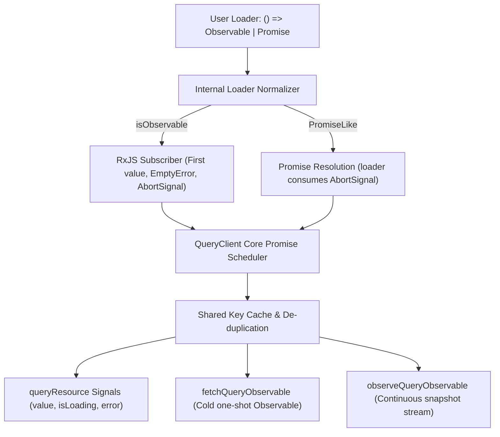

# Query API Developer Experience: Observable-First Reads, Architecture Patterns, and Request Composition

**Status:** Core API and practical examples implemented; dynamic collections implement pattern B only. **Reviewed:**
October 14, 2026. PR #146 implementation and review fixes; DSM UI reference snapshot `e377fa09ea`.

**Audience:** Angular application developers and ngx-lift maintainers.

**Companion:** [中文完整设计方案](query-api-dx-proposal.zh-CN.md).

---

## 1. Developer Experience First: Designing `queryResource` Parameters

The primary design goal for `queryResource` is developer ergonomics: concise, reactive, type-safe, and natural to
Angular developers whose services return RxJS `Observable`s, while seamlessly supporting `Promise`s without adapters.

### Target Parameter Signature

```typescript
import type {QueryResourceDefinition, QueryResourceOptions, QueryResourceRef} from 'ngx-lift';

export declare function queryResource<T, E = Error>(
  definition: () => QueryResourceDefinition<T> | undefined,
  options?: QueryResourceOptions,
): QueryResourceRef<T | undefined, E>;
```

### Parameter Breakdown

| Parameter / Property               | Type                                                               | Required? | Meaning and Default Behavior                                                                                                                                                                  |
| ---------------------------------- | ------------------------------------------------------------------ | --------- | --------------------------------------------------------------------------------------------------------------------------------------------------------------------------------------------- |
| **`definition`**                   | `() => QueryResourceDefinition<T> \| undefined`                    | **Yes**   | A reactive factory executed in an Angular reactive tracking context. Reads signals, captures parameters, and returns definition object. Returning `undefined` disables the query (idle gate). |
| `definition().key`                 | `QueryKey` (`readonly QueryKeyValue[]`)                            | **Yes**   | Canonical tuple uniquely identifying the cached resource, including all filtering, paging, and authorization scope variables.                                                                 |
| `definition().loader`              | `(context: QueryLoaderContext) => Observable<T> \| PromiseLike<T>` | **Yes**   | Lazy transport function. **Directly accepts either `Observable<T>` or `PromiseLike<T>` out of the box.** Receives `{ abortSignal, refresh }`.                                                 |
| `definition().tags`                | `readonly QueryTag[]`                                              | No        | Invalidation tags used by `mutateResource` or `client.invalidateTags()`.                                                                                                                      |
| `definition().staleTime`           | `number`                                                           | No        | Freshness window in milliseconds. Default `0` (stale immediately, but served while revalidating).                                                                                             |
| `definition().gcTime`              | `number`                                                           | No        | Cache retention window in milliseconds after last observer disconnects. Default `300_000` (5 minutes).                                                                                        |
| `definition().cancelOnNoObservers` | `boolean`                                                          | No        | Whether to abort in-flight transport if all component observers unmount before completion. Default `false`.                                                                                   |
| **`options.pollInterval`**         | `number \| (() => number \| undefined)`                            | No        | Periodic polling interval in milliseconds, or a reactive signal function. Default `undefined` (no polling).                                                                                   |
| **`options.injector`**             | `Injector`                                                         | No        | Custom lifecycle owner. Required only when called outside an Angular injection context.                                                                                                       |
| **`options.client`**               | `QueryClient`                                                      | No        | Custom query client instance. Defaults to the injected `QUERY_CLIENT`.                                                                                                                        |

### Return Value (`QueryResourceRef`)

| Signal / Method    | Type                     | Description                                                                                                 |
| ------------------ | ------------------------ | ----------------------------------------------------------------------------------------------------------- |
| `value`            | `Signal<T \| undefined>` | The latest cached or resolved data. Retains previous successful data during background refetching.          |
| `isLoading`        | `Signal<boolean>`        | `true` if initial load or background reload is active (`status === 'loading' \|\| status === 'reloading'`). |
| `isInitialLoading` | `Signal<boolean>`        | `true` only during the very first fetch before any data exists (`status === 'loading'`).                    |
| `isRefreshing`     | `Signal<boolean>`        | `true` during subsequent background revalidations (`status === 'reloading'`).                               |
| `error`            | `Signal<E \| null>`      | Error returned by the latest failed attempt.                                                                |
| `status`           | `Signal<QueryStatus>`    | `'idle' \| 'loading' \| 'reloading' \| 'resolved' \| 'error'`.                                              |
| `isStale`          | `Signal<boolean>`        | Whether cached data has exceeded `staleTime`.                                                               |
| `hasValue()`       | Type guard method        | Returns `true` if `value()` is defined, narrowing the value to exclude undefined.                           |
| `reload()`         | `() => boolean`          | Imperatively triggers a background revalidation, bypassing `staleTime`.                                     |
| `execute()`        | `() => Promise<T>`       | Imperatively triggers a revalidation and returns an awaitable Promise.                                      |
| `destroy()`        | `() => void`             | Disposes the observer immediately without waiting for component destruction.                                |

### Why This Parameter Design Delivers Superior DX

1. **Closure Capture Prevents Key-Loader Drift:** By capturing signal values once inside the factory (e.g.
   `const id = this.userId();`), both `key: ['users', id]` and `loader: () => this.userService.getUser(id)` are
   guaranteed to use the identical parameter snapshot.
2. **Returning `undefined` as a Natural Readiness Gate:** Developers do not need to learn a separate `enabled: boolean`
   property or `skipToken`. If prerequisites are missing (e.g. `if (!orgId) return undefined;`), returning `undefined`
   cleanly halts the query in `'idle'` state without making network requests.
3. **No Leaky Adapters:** Developers return `this.http.get<User>(...)` directly. No adapter wrapper, no
   `firstValueFrom`, no manual conversion needed.

### Recommended Naming Conventions (`userQuery` vs `userRef`)

When calling `queryResource` in an Angular component, how should the variable be named?

- **Recommended Primary Pattern: `userQuery` (Best DX and Clarity)**
  - **Natural Template Destructuring:** `@if (userQuery.value(); as user)`. This clearly separates the reactive query
    handle (`userQuery`) from the unwrapped domain entity (`user`). Template access to entity fields is clean
    (`user.name`), while query states and actions are unambiguous (`userQuery.isLoading()`, `userQuery.reload()`).
  - **Symmetry with Mutations:** Pairs cleanly with `createUserMutation = mutateResource(...)`.
  - **Ecosystem Alignment:** Matches the widely recognized `const userQuery = useQuery(...)` convention from TanStack
    Query.
- **Alternative Pattern: `userRef` / `userResource`**
  - If a team enforces an Angular-wide rule that all signal resource wrappers end with `*Ref` (consistent with
    `databaseRef = resourceAsync(...)` or `httpResource`), `userRef` is a coherent alternative.
- **Discouraged: Plain noun `user`**
  - Avoid `readonly user = queryResource(...)`, as it causes confusion in templates between the signal ref handle and
    the resolved user object.

---

## 2. Developer Feedback, Clarifications, and Points to Challenge

### Native loader contract

All query entry points accept `Observable<T> | PromiseLike<T>` directly. There is no public adapter wrapper. The
internal normalizer owns first-value resolution, empty completion, error propagation, and cancellation. Throwing
teardown cannot strand a request: original transport errors take precedence; cleanup failure escaping `subscribe()` or
`unsubscribe()` after a value rejects the attempt so the next read can retry. RxJS may internally suppress cleanup
errors in operator chains after a subscriber is closed (for example synchronous `finalize`); those errors never reach
normalization, matching `firstValueFrom`.

### Points to Challenge and Architectural Guardrails

While we agree that developer ergonomics should be seamless, several architectural principles must be upheld:

1. **A Query Snapshot vs. An Infinite Stream:**
   - A query represents a **point-in-time cached snapshot of server state**. When an Observable loader emits its first
     value, it immediately unsubscribes. Successful settlement waits for subscription setup to finish.
   - If an endpoint represents a persistent stream (e.g. WebSocket, Server-Sent Events, or continuous signal emissions),
     it should **not** be forced into `queryResource`. Use `resourceAsync`, an Angular Signal effect, or native RxJS
     streams instead.
2. **Do Not Put `QueryClient` in Every Service:**
   - In standard Angular feature development, services should remain pure, stateless HTTP clients returning
     `Observable<T>`.
   - Components use `queryResource` to consume those services.
   - Injecting `QueryClient` into a service is an advanced pattern reserved only for **cross-cutting domain services**
     (like DSM's `VcfTmService`) that need to expose a shared, cached Observable to multiple micro-frontends or plugins
     without binding to a component tree.
3. **Internal Normalization Must Preserve RxJS Semantics:**
   - Even though the public API accepts `Observable` directly, the underlying query scheduler operates on Promises. The
     internal normalizer must handle:
     - Preserving Angular `HttpClient` interceptors and Zone.js stability.
     - Synchronous emissions (e.g. `of(mockData)`) resolving immediately.
     - Empty streams rejecting with `EmptyError` rather than hanging indefinitely.
     - `abortSignal` canceling the underlying HTTP request via unsubscription.

### Deep Comparison: Key vs. Tags — Are Tags Redundant?

Developers familiar with early React Query often ask: _"React Query invalidates everything using query keys alone. Why
does ngx-lift introduce tags? Are tags redundant?"_

**Direct Answer: `key` is mandatory; `tags` is 100% optional. Tags are NOT redundant—they solve multidimensional cache
invalidation cleanly without rigid hierarchical key schemas.**

#### 1. Why React Query Relies Solely on Keys

React Query uses **hierarchical prefix fuzzy matching**:

- Definition: `queryKey: ['todos', 'list', { status: 'all' }]`
- Invalidation: `queryClient.invalidateQueries({ queryKey: ['todos'] })`
- Mechanism: Any active or cached query whose key begins with `['todos']` is invalidated regardless of remaining
  parameters.
- Prefix matching is convenient for hierarchical keys. TanStack also supports exact matching and predicate filters for
  orthogonal relationships; a tree hierarchy is not mandatory. See the
  [official filters guide](https://tanstack.com/query/latest/docs/framework/react/guides/filters).

#### 2. Why ngx-lift Introduces Tags (Inspired by RTK Query)

- **`key` Responsibility:** **Unique Resource Identity.** Identifies one specific request instance (URL + filter
  parameters + pagination + authorization scope). Two calls share cache only if their serialized keys match identically.
- **`tags` Responsibility:** **Multidimensional Invalidation Dependencies.**
  - Page 1 and Page 10 of a table have distinct keys, but both share `tags: [{ type: 'Databases' }]`.
  - A database detail view has key `['databases', id]` and tag `tags: [{ type: 'Databases', id }]`.
  - When an entity is deleted or updated, `mutateResource` simply declares: `invalidatesTags: [{ type: 'Databases' }]`
    or `invalidatesTags: (result) => [{ type: 'Databases', id: result.id }]`.
  - The engine automatically invalidates all matching queries across the application, regardless of their key structure!
- **Usage Recommendation:**
  - **Simple queries:** Do not write `tags`! Key-only querying keeps overhead at zero.
  - **Enterprise grids and mutation workflows:** Use `tags` to achieve seamless post-mutation list revalidation without
    manual refresh callbacks.

### Deep Dive: `concurrency` Options in `mutateResource`

Developers ask: _"What are the other values for `concurrency: 'exhaust'`? How does React Query handle this? What if
someone doesn't understand exhaust, or leaves concurrency unset?"_

#### 1. The Three Concurrency Modes

`mutateResource(mutationFn, options)` supports three concurrency strategies:

| Value                             | Behavior and Scheduling                                                                                                                                                                        | RxJS Equivalent | Typical Use Case                                                                                                                                     |
| --------------------------------- | ---------------------------------------------------------------------------------------------------------------------------------------------------------------------------------------------- | --------------- | ---------------------------------------------------------------------------------------------------------------------------------------------------- |
| **`'parallel'`**<br>**(Default)** | **Full Concurrent Execution.** Every call to `mutate(args)` immediately fires a real network request. Multiple requests run concurrently. **This is the default if `concurrency` is omitted.** | `mergeMap`      | Independent operations without race conditions, such as parallel batch retries or item upvotes.                                                      |
| **`'exhaust'`**                   | **Ignore While Busy (Lockout).** If a mutation is already in flight, subsequent calls to `mutate()` return the active in-flight Promise without triggering a duplicate network request.        | `exhaustMap`    | **Form submissions and submit buttons.** Guards against rapid double-clicks or slow UI disabled-state rendering, guaranteeing only one server write. |
| **`'concat'`**                    | **Sequential Queue.** If a mutation is in flight, new invocations queue up and execute strictly one after another.                                                                             | `concatMap`     | Strictly ordered operations, such as chat message delivery or sequential audit log flushes.                                                          |

#### 2. How Does React Query Handle This?

- TanStack mutations run in parallel by default; mutations sharing `scope: {id}` run serially. See the
  [official mutation reference](https://tanstack.com/query/latest/docs/framework/react/reference/functions/useMutation).
- Serial queuing executes every invocation. ngx-lift's `exhaust` instead joins pending work and does not start the new
  invocation. Choose deliberately when arguments differ. Neither strategy replaces server-side idempotency.

#### 3. What if a Team Member Does Not Understand `exhaust`?

- **Simply omit it!** Without `concurrency`, it defaults to `'parallel'`.
- Standard template binding `[disabled]="saveMutation.isLoading()"` is sufficient for 90% of basic UI flows.

---

## 3. How Industry Query Libraries Handle Parallel and Sequential Requests

| Library                      | Parallel Requests (Fixed & Dynamic)                                                   | Sequential / Dependent Requests                                                             | Lessons for ngx-lift                                                                                            |
| ---------------------------- | ------------------------------------------------------------------------------------- | ------------------------------------------------------------------------------------------- | --------------------------------------------------------------------------------------------------------------- |
| **TanStack Query (React)**   | Fixed: Sibling `useQuery` calls.<br>Dynamic: `useQueries({ queries: ids.map(...) })`. | `enabled: !!parentId`. Downstream query waits until upstream data is present.               | Clear separation between independent cached nodes. Gating via truthiness/readiness.                             |
| **TanStack Query (Angular)** | Sibling `injectQuery()` calls. Dedicated `useQueries` equivalent in Angular adapter.  | `enabled: computed(() => !!parentQuery.data())`.                                            | Documentation originally required converting HttpClient Observables via `firstValueFrom`.                       |
| **SWR (Vercel)**             | Independent hooks run in parallel automatically.                                      | Passing `null` or a function returning `null` halts downstream query until ready.           | Returning `undefined` in ngx-lift matches SWR's clean conditional pattern.                                      |
| **RTK Query**                | Multiple `useXQuery()` hooks execute concurrently.                                    | `skip: !userId` or passing `skipToken` delays query execution.                              | Differentiates composite multi-step backend endpoints from client-side cached nodes.                            |
| **RxJS Native**              | `forkJoin` (one-shot completion) or `combineLatest` (continuous stream aggregation).  | `switchMap` (cancels previous), `concatMap` (sequential queue), or `mergeMap` (concurrent). | Powerful streaming pipelines in services, but lacks shared caching and tag invalidation.                        |
| **Angular `rxResource`**     | Sibling `rxResource` declarations.                                                    | `params: () => parentResource.value()?.id`. Runs when param is defined.                     | Native Angular reactive parameters, but scoped locally to one component instance without global cache identity. |

---

## 4. Deep Dive: Can `queryResource` Support Dependent Requests Besides `switchMap`?

**YES!** In fact, for UI component state, dependent queries with `queryResource` are often vastly superior to
`switchMap`.

### The Signal Readiness Gate Pattern

Instead of combining two HTTP calls inside an imperative RxJS pipeline, you declare two separate `queryResource`
instances where the second inspects the first:

```typescript
// Query 1: Fetch User
readonly userQuery = queryResource(() => {
  const id = this.userId();
  if (!id) return undefined;
  return {
    key: ['users', id],
    loader: () => this.userService.getUser(id),
  };
});

// Query 2: Fetch Projects (Depends on Query 1)
readonly projectsQuery = queryResource(() => {
  const user = this.userQuery.value();
  // READINESS GATE: If user data is not yet resolved, return undefined!
  // The query stays in 'idle' status and performs NO network request.
  if (!user) return undefined;

  return {
    key: ['projects', user.id],
    loader: () => this.projectService.getProjects(user.id),
  };
});
```

### Comparing `queryResource` Readiness Gates vs. RxJS `switchMap`

```
┌────────────────────────────────────────────────────────────────────────────────────────┐
│                                   ARCHITECTURAL COMPARISON                              │
├───────────────────────────────┬────────────────────────────────────────────────────────┤
│ Feature                       │ queryResource Readiness Gate    │ RxJS switchMap Pipeline      │
├───────────────────────────────┼─────────────────────────────────┼──────────────────────┤
│ Primary Location              │ Component View Layer            │ Service / Business Layer     │
│ UI Loading States             │ Granular: User and Projects     │ Monolithic: One single       │
│                               │ have distinct loading spinners  │ loading state for both       │
│ Cache Granularity             │ Independent: ['users'] and      │ Combined or un-cached        │
│                               │ ['projects'] cached separately  │                              │
│ Partial Invalidation          │ Invalidating 'projects' reloads │ Must re-execute pipeline     │
│                               │ ONLY projects, not user         │ from the start               │
│ Error Isolation               │ If projects fails, user profile │ Entire combined pipeline     │
│                               │ remains visible with retry btn  │ errors out                   │
│ Parameter Reactivity          │ Automatic via Angular Signals   │ Needs Subject + pipeline     │
│ Best For                      │ Distinct UI widgets / sections  │ Atomic, multi-step backend   │
│                               │ on the same page                │ transactions hidden from UI  │
└───────────────────────────────┴─────────────────────────────────┴──────────────────────┘
```

---

## 5. Deep Dive: What Does "Dynamic Lists: Stable ID, Deletion Cleanup, Reordering, and Type Inference" Mean?

The proposal stated:

> _"Dynamic lists: worthy of subsequent consideration for `queryResources`, but must first design stable ID, deletion
> cleanup, reordering, and type inference."_

### The Problem in Angular Signals

Suppose a user selects an unknown number of entity IDs: `selectedIds = signal(['id-1', 'id-2', 'id-3'])`. A developer
might naively attempt:

```typescript
// ❌ ANTI-PATTERN: DO NOT DO THIS!
readonly itemQueries = computed(() => {
  return this.selectedIds().map(id =>
    queryResource(() => ({
      key: ['item', id],
      loader: () => this.itemService.getItem(id),
    }))
  );
});
```

**Why this breaks disastrously:**

1. **Calling `queryResource` inside `computed()`:** `queryResource` sets up Angular `effect()`s, registers observers in
   `QueryClient`, and attaches cleanup handlers to `DestroyRef`. Calling it inside `computed()` creates brand new
   observers on every signal change, causing severe memory leaks!
2. **Lack of Reconciliation (Stable IDs):** If `selectedIds` changes from `['1', '2', '3']` to `['1', '3', '4']`:
   - Without reconciliation, all 3 existing queries are discarded, and 3 new ones are created.
   - An intelligent dynamic manager must track items by **Stable ID** (e.g. `'1'`, `'3'`), reusing their existing
     resources and cached data.
3. **Deletion Cleanup (Memory Leaks):** When `'2'` is removed from the list, who calls `.destroy()` on `'2'`'s query
   observer? If not explicitly cleaned up, the observer remains alive in `QueryClient`, continuing to poll or occupy
   memory until the parent component unmounts.
4. **Reordering:** If the list order changes from `['1', '2']` to `['2', '1']`, the UI should simply reorder the
   references without triggering unnecessary refetches.
5. **Type Inference:** TypeScript must cleanly infer the array of results (e.g. `Signal<QueryResourceRef<Item>[]>`) so
   developers get full auto-completion on `items()[0].value()`.

This is why `queryResources` (plural) requires a dedicated reconciliation engine (analogous to Angular's
`@for (item of items; track item.id)`).

---

## 6. Comprehensive Catalog of Real-World Use Cases (With Code Examples)

### Use Case 1: Fixed Parallel Queries in a Component

**Scenario:** A dashboard page displays User Profile and System Status side by side. They should load concurrently
without blocking each other.

```typescript
import {Component, computed, inject} from '@angular/core';
import {HttpClient} from '@angular/common/http';
import {queryResource} from 'ngx-lift';

interface UserProfile {
  name: string;
  email: string;
}
interface SystemStatus {
  healthy: boolean;
  version: string;
}

@Component({
  selector: 'app-dashboard',
  template: `
    <div class="dashboard-grid">
      <!-- Profile Card -->
      <div class="card">
        @if (profileQuery.isLoading()) {
          <span>Loading profile...</span>
        }
        @if (profileQuery.value(); as p) {
          <h3>{{ p.name }}</h3>
          <p>{{ p.email }}</p>
        }
        @if (profileQuery.error()) {
          <button (click)="profileQuery.reload()">Retry Profile</button>
        }
      </div>

      <!-- System Status Card -->
      <div class="card">
        @if (statusQuery.isLoading()) {
          <span>Loading system status...</span>
        }
        @if (statusQuery.value(); as s) {
          <div>Health: {{ s.healthy ? 'OK' : 'Degraded' }}</div>
        }
        @if (statusQuery.error()) {
          <button (click)="statusQuery.reload()">Retry Status</button>
        }
      </div>
    </div>
  `,
})
export class DashboardComponent {
  private readonly http = inject(HttpClient);

  // Both queries launch concurrently upon initialization
  readonly profileQuery = queryResource(() => ({
    key: ['user', 'profile'],
    loader: () => this.http.get<UserProfile>('/api/profile'),
    staleTime: 60_000,
  }));

  readonly statusQuery = queryResource(() => ({
    key: ['system', 'status'],
    loader: () => this.http.get<SystemStatus>('/api/system/status'),
    staleTime: 10_000,
  }));

  // Combined state helper
  readonly isAnyLoading = computed(() => this.profileQuery.isLoading() || this.statusQuery.isLoading());
}
```

---

### Use Case 2: Dependent Sequential Queries in a Component (Signal Gate)

**Scenario:** Selecting an Organization loads its details, which yields a `defaultProjectId`. The project details query
only executes once `defaultProjectId` is available.

```typescript
import {Component, inject, signal} from '@angular/core';
import {HttpClient} from '@angular/common/http';
import {queryResource} from 'ngx-lift';

interface Organization {
  id: string;
  name: string;
  defaultProjectId: string;
}
interface Project {
  id: string;
  title: string;
  quota: number;
}

@Component({
  selector: 'app-org-view',
  template: `
    @if (orgQuery.isLoading()) {
      <p>Loading Organization...</p>
    }
    @if (orgQuery.value(); as o) {
      <h2>Org: {{ o.name }}</h2>

      <!-- Dependent Project Section -->
      @if (projectQuery.isLoading()) {
        <p>Loading Default Project...</p>
      }
      @if (projectQuery.value(); as p) {
        <div class="project-box">
          <h4>Project: {{ p.title }}</h4>
          <p>Quota: {{ p.quota }}</p>
        </div>
      }
    }
  `,
})
export class OrgViewComponent {
  private readonly http = inject(HttpClient);
  readonly selectedOrgId = signal<string>('org-101');

  // Step 1: Organization Query
  readonly orgQuery = queryResource(() => {
    const orgId = this.selectedOrgId();
    if (!orgId) return undefined;
    return {
      key: ['organizations', orgId],
      loader: () => this.http.get<Organization>(`/api/orgs/${orgId}`),
      staleTime: 300_000,
    };
  });

  // Step 2: Dependent Project Query (waits for orgQuery.value())
  readonly projectQuery = queryResource(() => {
    const orgData = this.orgQuery.value();
    // Gate: returns undefined until Step 1 resolves
    if (!orgData?.defaultProjectId) return undefined;

    return {
      key: ['projects', orgData.defaultProjectId],
      loader: () => this.http.get<Project>(`/api/projects/${orgData.defaultProjectId}`),
      staleTime: 60_000,
    };
  });
}
```

---

### Use Case 3: Parallel Requests in a Service (RxJS `forkJoin` Snapshot)

**Scenario:** A service needs to fetch both Permissions and Roles in parallel before returning an aggregated permissions
model to non-component callers (e.g. functional route guards, interceptors, or cross-cutting stores).

#### 1. Why Use `fetchQueryObservable` and `queryClient` Here Instead of Direct `this.http.get`?

- **With direct `this.http.get`:** Every invocation performs two live HTTP roundtrips. If three components render at
  once and call this method, 6 requests hit the backend with zero caching.
- **With `fetchQueryObservable(queryClient, ...)`:**
  1. **Global Cache Sharing:** With `staleTime: 60_000`, any other component or route guard requesting
     `getUserAuthContext(userId, scope)` within 60 seconds resolves instantaneously from memory without network traffic.
  2. **In-Flight Request Coalescing (Deduplication):** If 3 widgets initialize at the same instant and request the same
     user's context, `queryClient` fires **only 1 request for roles and 1 for permissions**. All 3 callers share the
     exact same pending Promise.
  3. **Tag Invalidation:** When an admin modifies roles, mutating with `invalidatesTags: [{ type: 'Roles', scope }]`
     immediately marks this cached context stale.

#### 2. Service Implementation

```typescript
import {Injectable, inject} from '@angular/core';
import {HttpClient} from '@angular/common/http';
import {forkJoin, Observable, map} from 'rxjs';
import {fetchQueryObservable, QUERY_CLIENT} from 'ngx-lift';

export interface UserAuthContext {
  permissions: string[];
  roles: string[];
}

@Injectable({providedIn: 'root'})
export class AuthService {
  private readonly http = inject(HttpClient);
  private readonly queryClient = inject(QUERY_CLIENT);

  getUserAuthContext(userId: string, scope: string): Observable<UserAuthContext> {
    // Both queries share global cache and deduplicate in-flight requests
    const permissions$ = fetchQueryObservable(this.queryClient, {
      key: ['users', scope, userId, 'permissions'],
      tags: [{type: 'Permissions', scope}],
      loader: () => this.http.get<string[]>(`/api/users/${userId}/permissions`),
      staleTime: 60_000,
    });

    const roles$ = fetchQueryObservable(this.queryClient, {
      key: ['users', scope, userId, 'roles'],
      tags: [{type: 'Roles', scope}],
      loader: () => this.http.get<string[]>(`/api/users/${userId}/roles`),
      staleTime: 60_000,
    });

    return forkJoin({permissions: permissions$, roles: roles$});
  }
}
```

#### 3. Complete Component Consumption Examples

**Approach A (Modern Angular Signals via `resourceAsync` - Recommended):**

```typescript
import {Component, inject, signal} from '@angular/core';
import {resourceAsync} from 'ngx-lift';
import {AuthService} from './auth.service';

@Component({
  selector: 'app-user-profile',
  template: `
    @if (authContextRef.isLoading()) {
      <p>Loading security permissions...</p>
    }
    @if (authContextRef.value(); as ctx) {
      <div class="security-card">
        <h4>User Roles</h4>
        <p>{{ ctx.roles.join(', ') }}</p>
        <h4>Granted Permissions</h4>
        <p>{{ ctx.permissions.join(', ') }}</p>
      </div>
    }
    @if (authContextRef.error()) {
      <button (click)="authContextRef.reload()">Retry</button>
    }
  `,
})
export class UserProfileComponent {
  private readonly authService = inject(AuthService);
  readonly currentUserId = signal('user-888');
  // Example only: production scope comes from the authenticated session.
  readonly sessionScope = signal('session-a');

  // Bridges the service's cached Observable into reactive Signals
  readonly authContextRef = resourceAsync(() =>
    this.authService.getUserAuthContext(this.currentUserId(), this.sessionScope()),
  );
}
```

**Approach B (Traditional RxJS `async` Pipe):**

```typescript
import {Component, computed, inject, signal} from '@angular/core';
import {AsyncPipe} from '@angular/common';
import {toObservable} from '@angular/core/rxjs-interop';
import {switchMap} from 'rxjs';
import {AuthService} from './auth.service';

@Component({
  selector: 'app-user-profile-rxjs',
  imports: [AsyncPipe],
  template: `
    @if (authContext$ | async; as ctx) {
      <p>Roles: {{ ctx.roles.join(', ') }}</p>
    }
  `,
})
export class UserProfileRxjsComponent {
  private readonly authService = inject(AuthService);
  readonly currentUserId = signal('user-888');
  // Example only: production scope comes from the authenticated session.
  readonly sessionScope = signal('session-a');

  readonly authParams = computed(() => ({id: this.currentUserId(), scope: this.sessionScope()}));
  readonly authContext$ = toObservable(this.authParams).pipe(
    switchMap(({id, scope}) => this.authService.getUserAuthContext(id, scope)),
  );
}
```

---

### Use Case 4: Sequential Pipeline in a Service (RxJS `switchMap`)

**Scenario:** A deployment workflow where creating a build artifact yields an `artifactId`, and the service must
immediately fetch the initial build log.

#### When to Use `this.http.get` vs. `fetchQueryObservable`?

- **"Can I just write `this.http.get` here?"—YES, absolutely!**
  - If fetching the build log is a private, one-off step internal to this service workflow with no other component
    observing it, **direct `this.http.get` is preferred! Do not add query abstraction without need.**
- **When is `fetchQueryObservable` genuinely needed here?**
  - **Shared UI Visibility & Tag Invalidation:** If the application features a global "Build Monitor Drawer" or header
    notification widget that also listens to `key: ['builds', buildId, 'logs']`, wrapping the call in
    `fetchQueryObservable` populates that cache entry immediately. When the build drawer mounts, it displays the cached
    log with zero extra network latency.
- **Architectural Rule:** Use plain `this.http.get` for private, transient steps; use `fetchQueryObservable` only when
  the result belongs in the global shared cache.

```typescript
import {Injectable, inject} from '@angular/core';
import {HttpClient} from '@angular/common/http';
import {Observable, switchMap} from 'rxjs';
import {fetchQueryObservable, QUERY_CLIENT} from 'ngx-lift';

interface BuildSummary {
  buildId: string;
  status: string;
}
interface BuildLog {
  buildId: string;
  logs: string[];
}

@Injectable({providedIn: 'root'})
export class BuildService {
  private readonly http = inject(HttpClient);
  private readonly queryClient = inject(QUERY_CLIENT);

  startAndFetchInitialLogs(projectId: string): Observable<BuildLog> {
    return this.http.post<BuildSummary>(`/api/projects/${projectId}/builds`, {}).pipe(
      switchMap(
        (summary) =>
          // Stored in shared cache if other widgets observe ['builds', id, 'logs']
          fetchQueryObservable(this.queryClient, {
            key: ['builds', summary.buildId, 'logs'],
            loader: () => this.http.get<BuildLog>(`/api/builds/${summary.buildId}/logs`),
            staleTime: 5_000,
          }),
        // If private and unshared, write:
        // this.http.get<BuildLog>(`/api/builds/${summary.buildId}/logs`)
      ),
    );
  }
}
```

---

### Use Case 5: Dynamic Parallel Requests (Implemented Pattern B)

Pattern B is sufficient for dynamic ID collections: `queryResources(items, definition, options?)`. Pattern A accepts
prebuilt definition arrays; defer it until an actual prebuilt-array or heterogeneous-query use case justifies another
entry point. No artificial item ID or nested definition wrapper is required.

The result is a readable `QueryResourcesRef<T, I>` signal. Each item has the single-resource state/refresh methods plus
a stable canonical serialized `key` for template tracking. Reordering retains refs; removal hides rows immediately and
disposes observers during effect reconciliation. Empty arrays have no observers. Duplicate canonical keys throw
explicitly; individual failures remain independent. New items appear after Angular effect scheduling, rather than
creating every request synchronously.

```typescript
import {HttpClient} from '@angular/common/http';
import {ChangeDetectionStrategy, Component, inject, signal} from '@angular/core';
import {queryResources} from 'ngx-lift';

interface HostMetrics {
  hostId: string;
  loadAverage: number;
}

@Component({
  selector: 'app-host-monitor',
  changeDetection: ChangeDetectionStrategy.OnPush,
  template: `
    @for (query of metricQueries(); track query.key) {
      @if (query.value(); as metrics) {
        <p>{{ metrics.hostId }}: {{ metrics.loadAverage }}</p>
      }
    }
  `,
})
export class HostMonitorComponent {
  private readonly http = inject(HttpClient);
  readonly selectedHostIds = signal<string[]>(['host-1', 'host-2']);
  readonly metricQueries = queryResources(this.selectedHostIds, (hostId) => ({
    key: ['hosts', hostId, 'metrics'],
    loader: () => this.http.get<HostMetrics>(`/api/hosts/${hostId}/metrics`),
    staleTime: 5_000,
  }));
}
```

---

### Use Case 6: Mutation with Automatic Query Invalidation (`mutateResource` + `queryResource`)

**Scenario:** Adding a new database instance automatically refreshes the database list query without manual subscription
management.

```typescript
import {Component, inject} from '@angular/core';
import {HttpClient} from '@angular/common/http';
import {queryResource, mutateResource} from 'ngx-lift';

interface Database {
  id: string;
  name: string;
  engine: string;
}
interface CreateDbDto {
  name: string;
  engine: string;
}

@Component({
  selector: 'app-databases',
  template: `
    <button (click)="createDatabase()" [disabled]="createMutation.isLoading()">
      {{ createMutation.isLoading() ? 'Creating...' : 'Add Database' }}
    </button>

    @if (databasesQuery.isLoading()) {
      <p>Updating database list...</p>
    }
    <ul>
      @for (db of databasesQuery.value() ?? []; track db.id) {
        <li>{{ db.name }} ({{ db.engine }})</li>
      }
    </ul>
  `,
})
export class DatabasesComponent {
  private readonly http = inject(HttpClient);

  // 1. Query: List of databases tagged with 'Databases'
  readonly databasesQuery = queryResource(() => ({
    key: ['databases'],
    tags: [{type: 'Databases'}],
    loader: () => this.http.get<Database[]>('/api/databases'),
    staleTime: 30_000,
  }));

  // 2. Mutation: Automatically invalidates 'Databases' tag upon success
  readonly createMutation = mutateResource((dto: CreateDbDto) => this.http.post<Database>('/api/databases', dto), {
    invalidatesTags: [{type: 'Databases'}],
    concurrency: 'exhaust', // Prevents double submission
  });

  async createDatabase() {
    await this.createMutation.mutate({name: 'analytics-db', engine: 'postgres'});
    // 'databasesQuery' automatically refetches in the background!
  }
}
```

---

### Use Case 7: Dynamic Polling / Conditional Auto-Refresh

**Scenario:** A long-running backup task needs to be polled every 3 seconds while in `'IN_PROGRESS'` status, and stop
polling as soon as it succeeds or fails.

```typescript
import {Component, inject, signal} from '@angular/core';
import {HttpClient} from '@angular/common/http';
import {queryResource} from 'ngx-lift';

interface BackupJob {
  id: string;
  status: 'PENDING' | 'IN_PROGRESS' | 'COMPLETED' | 'FAILED';
}

@Component({
  selector: 'app-backup-status',
  template: `
    @if (backupQuery.value(); as job) {
      <div>Status: {{ job.status }}</div>
      @if (job.status === 'IN_PROGRESS') {
        <span>Auto-polling active...</span>
      }
    }
  `,
})
export class BackupStatusComponent {
  private readonly http = inject(HttpClient);
  readonly jobId = signal('job-999');

  readonly backupQuery = queryResource(
    () => {
      const jobId = this.jobId();
      return {key: ['backups', jobId], loader: () => this.http.get<BackupJob>(`/api/backups/${jobId}`)};
    },
    {
      // Reactive pollInterval function: stops polling when completed
      pollInterval: (): number | undefined => {
        const status = this.backupQuery?.value()?.status;
        return status === 'PENDING' || status === 'IN_PROGRESS' ? 3000 : undefined;
      },
    },
  );
}
```

---

### Use Case 8: Imperative Cache Access in Route Guards / Resolvers

**Scenario:** An Angular functional route guard pre-fetches user permissions using `QueryClient`, preventing route
activation if unauthorized, while priming the cache for the page component.

```typescript
import {inject} from '@angular/core';
import {CanActivateFn, Router} from '@angular/router';
import {HttpClient} from '@angular/common/http';
import {QUERY_CLIENT} from 'ngx-lift';
import {SessionService} from './session.service';

export const adminGuard: CanActivateFn = async (route, state) => {
  const queryClient = inject(QUERY_CLIENT);
  const http = inject(HttpClient);
  const router = inject(Router);
  const sessionId = inject(SessionService).id();
  if (sessionId === undefined) return router.parseUrl('/login');

  try {
    // Imperatively fetch or read fresh from cache
    const permissions = await queryClient.fetchQuery({
      key: ['session', sessionId, 'permissions'],
      loader: () => http.get<string[]>('/api/user/permissions'),
      staleTime: 60_000,
    });

    if (permissions.includes('ROLE_ADMIN')) {
      return true;
    }
    return router.parseUrl('/unauthorized');
  } catch {
    return router.parseUrl('/login');
  }
};
```

---

## 7. Architecture Guide: Writing Services, When to Use `QueryClient`, and Query vs. Mutate

### When Should an Application Service Inject `QueryClient`?

```
                                Does the Service need QueryClient?
                                                │
                       Is the Service consumed strictly by Angular Components?
                                       /                 \
                                    YES                   NO
                                    │                      │
                       Keep Service Stateless!      Does it need Cross-Cutting
                       Return pure Observable<T>.   Shared Caching across
                       Components use queryResource. plugins/micro-frontends?
                                                          /           \
                                                       YES             NO
                                                        │               │
                                              Inject QueryClient!    Plain
                                              Use fetchQueryObservable HTTP
```

#### Pattern A: Pure Stateless HTTP Service (Recommended for 90% of use cases)

```typescript
@Injectable({providedIn: 'root'})
export class UserService {
  private readonly http = inject(HttpClient);

  getUser(id: string): Observable<User> {
    return this.http.get<User>(`/api/users/${id}`);
  }
}
```

_Why:_ Keeps services decoupled from UI caching semantics. Components specify their own `staleTime`, `tags`, and polling
requirements.

#### Pattern B: Reusable Query Definition Service (Clean Abstraction)

```typescript
@Injectable({providedIn: 'root'})
export class UserService {
  private readonly http = inject(HttpClient);

  userQuery(id: string): QueryDefinition<User> {
    return {
      key: ['users', id],
      tags: [{type: 'User', id}],
      staleTime: 60_000,
      loader: () => this.http.get<User>(`/api/users/${id}`),
    };
  }
}

// In Component:
readonly userQuery = queryResource(() => this.userService.userQuery(this.id()));
```

#### Pattern C: Cached Observable Service (DSM `VcfTmService` Pattern)

Used when the service itself is a shared domain cache for non-component consumers (e.g. iframe plugins, router
resolvers, interceptors):

```typescript
import {HttpClient} from '@angular/common/http';
import {inject, Injectable} from '@angular/core';
import {fetchQueryObservable, QUERY_CLIENT} from 'ngx-lift';
import {defer, Observable} from 'rxjs';

interface Binding {
  id: string;
}
interface BindingScope {
  origin: string;
  sessionId: string;
  organization: string;
}

@Injectable({providedIn: 'root'})
export class VcfTmService {
  private readonly http = inject(HttpClient);
  private readonly client = inject(QUERY_CLIENT);

  getDsmBinding(scope: () => BindingScope, options: {refresh?: boolean} = {}): Observable<Binding[]> {
    return defer(() => {
      const {origin, sessionId, organization} = scope();
      const url = `${origin}/api/organizations/${encodeURIComponent(organization)}/bindings`;
      return fetchQueryObservable(
        this.client,
        {
          key: ['vcf', 'dsm-bindings', origin, sessionId, organization],
          tags: [{type: 'DsmBindings', scope: sessionId}],
          staleTime: 30_000,
          loader: () => this.http.get<Binding[]>(url),
        },
        options,
      );
    });
  }
}
```

---

## 8. Implemented API Contract

```typescript
import type {Injector, Signal} from '@angular/core';
import type {Observable} from 'rxjs';
import type {
  QueryClient,
  QueryFailureSignals,
  QueryReadPolicy,
  QueryRecoveryOptions,
  QuerySnapshot,
  QueryStatus,
} from 'ngx-lift';

export type QueryKeyValue =
  string | number | boolean | null | readonly QueryKeyValue[] | {readonly [key: string]: QueryKeyValue};

export type QueryKey = readonly QueryKeyValue[];

export interface QueryTag {
  readonly type: string;
  readonly id?: string | number;
  readonly scope?: string;
}

export interface QueryLoaderContext {
  readonly abortSignal: AbortSignal;
  readonly refresh: boolean;
}

/** Universal loader return type: natively accepts Observable or Promise */
export type QueryResult<T> = Observable<T> | PromiseLike<T>;

export interface QueryDefinition<T> extends QueryReadPolicy {
  readonly key: QueryKey;
  readonly loader: (context: QueryLoaderContext) => QueryResult<T>;
  readonly tags?: readonly QueryTag[];
  readonly staleTime?: number;
  readonly gcTime?: number;
  readonly cancelOnNoObservers?: boolean;
}

export type QueryResourceDefinition<T> = QueryDefinition<T>;

export interface QueryResourceOptions extends QueryRecoveryOptions {
  pollInterval?: number | (() => number | undefined);
  injector?: Injector;
  client?: QueryClient;
}

export interface QueryResourceRef<T, E = Error> extends QueryFailureSignals {
  readonly value: Signal<T>;
  readonly error: Signal<E | null>;
  readonly status: Signal<QueryStatus>;
  readonly isLoading: Signal<boolean>;
  readonly isInitialLoading: Signal<boolean>;
  readonly isRefreshing: Signal<boolean>;
  readonly isStale: Signal<boolean>;
  hasValue(): this is QueryResourceRef<Exclude<T, undefined>, E>;
  reload(): boolean;
  execute(): Promise<T>;
  destroy(): void;
}

// Universal entry points
export declare function queryResource<T, E = Error>(
  definition: () => QueryDefinition<T> | undefined,
  options?: QueryResourceOptions,
): QueryResourceRef<T | undefined, E>;

export interface QueryResourceItem<T, I = unknown> extends QueryResourceRef<T | undefined> {
  readonly key: string;
  readonly item: Signal<I>;
}
export interface QueryResourcesRef<T, I = unknown> extends Signal<readonly QueryResourceItem<T, I>[]> {
  destroy(): void;
}
export declare function queryResources<I, T>(
  items: () => readonly I[],
  definition: (item: I) => QueryDefinition<T>,
  options?: QueryResourceOptions,
): QueryResourcesRef<T, I>;

export declare function fetchQueryObservable<T>(
  client: QueryClient,
  definition: QueryDefinition<T>,
  options?: {refresh?: boolean},
): Observable<T>;

export declare function observeQueryObservable<T>(
  client: QueryClient,
  definition: QueryDefinition<T>,
  options?: QueryRecoveryOptions & {pollInterval?: number; refresh?: boolean},
): Observable<QuerySnapshot<T>>;
```

---

## 9. Internal Normalization and Lifecycle Guarantees

The prose and table are the complete contract even when Mermaid is not rendered. The definition factory captures
parameters and identity. QueryClient selects one entry per canonical key and joins valid in-flight work. It calls the
loader only when a read is needed, then normalizeQueryResult bridges Observable/PromiseLike results into the Promise
scheduler. Angular observers own their lifecycle without duplicating cache state.

| Case              | Behavior and boundary                                                                                                                                                                     |
| ----------------- | ----------------------------------------------------------------------------------------------------------------------------------------------------------------------------------------- |
| Observable        | First value wins and unsubscribes; empty completion rejects with EmptyError; source errors are retained.                                                                                  |
| Throwing teardown | The attempt settles; original errors take precedence; cleanup failure reaching the subscription boundary after a value rejects and permits retry.                                         |
| PromiseLike       | Promise.resolve assimilates the result; the loader must pass abortSignal to transport for network cancellation.                                                                           |
| Same key          | Share cache and valid pending work; refresh bypasses completed fresh data but joins pending reads.                                                                                        |
| Key/scope changes | Immediately hide old identity data; obsolete generations cannot overwrite newer cache state.                                                                                              |
| queryResources    | Reconcile by canonical key, retain refs on reorder, dispose removed items and destroy all observers with the owner; definition updates do not implicitly force refresh.                   |
| Cancellation      | Finite shared reads finish by default; only the last observer leaving with the shared opt-in policy aborts transport. Fetch-stream unsubscription alone does not cancel shared transport. |



### Normalization Guarantees

1. **First Value Wins:** The first emitted value immediately triggers unsubscription, ignoring later values.
2. **Synchronous Emission:** Settlement waits until `subscribe()` returns, including registration of returned teardown.
   If that teardown throws through the subscription boundary, a successful value becomes a rejection and is not cached.
   Original source errors, `EmptyError`, and `AbortError` take precedence over cleanup errors. Regression tests cover
   all four synchronous terminal paths and QueryClient retry after failed cleanup.
3. **Empty Stream Handling:** An Observable completing without emitting any value rejects with `EmptyError` instead of
   leaving the query hanging in loading state.
4. **Abort Signal Forwarding:** Aborting transport removes the abort event listener and unsubscribes from the active
   RxJS subscription.
5. **Deduplication:** Multiple concurrent readers for the same key attach to the exact same transport instance.

---

## 10. Delivery Plan and Review Gates

- **Phase 1: Universal Loader Contract & Normalizer**
  - Update `QueryDefinition.loader` to accept `QueryResult<T>`.
  - Implement internal loader normalizer.
  - Use one native loader contract; no deprecated public adapter is retained.
  - Verify unit tests across `HttpClient`, `of()`, `throwError()`, `EMPTY`, and native `fetch`.
- **Phase 2: Additive Signals & Demo Pages**
  - Add `isInitialLoading` and `isRefreshing` signals to `QueryResourceRef`.
  - Add runnable demo examples in `apps/demo`:
    - Observable-first HTTP query demo.
    - Dependent query demo with readiness gates.
    - Mutation with automatic tag invalidation.
- **Phase 3: Dynamic Collections (`queryResources`, implemented B)**
  - Reactive items plus a per-item definition factory; canonical-key reconciliation and deletion cleanup.
  - Pattern A is deferred until prebuilt-definition or heterogeneous-query use cases justify it.

---

## 11. Demo Application Implementation Guidance

The queryResource page now provides direct HttpClient loaders, dependent database reads, scoped mutation refresh, live
snapshots, and three coalesced service callers alongside the original Promise examples. The list below describes the
teaching goals; a configurable concurrency playground remains a follow-up, not a delivered feature:

1. **Observable `HttpClient` Query Card:**
   - Demonstrates `loader: () => this.http.get<User>('/api/users/1')` directly without any wrapper.
   - Visually contrasts `userQuery.isLoading()`, `userQuery.isInitialLoading()`, and `userQuery.isRefreshing()`.
2. **Signal Readiness Gate Dependent Query Card:**
   - Dropdown selects Tenant ID -> loads tenant details -> enables database metrics query.
   - Shows the dependent query remaining cleanly in `'idle'` status until prerequisite data resolves.
3. **Mutation and Automatic Tag Invalidation (Mutate & Auto-Invalidate):**
   - Renders a database table with `tags: [{ type: 'Databases' }]`.
   - "Add Database" modal calls `mutateResource` with `invalidatesTags: [{ type: 'Databases' }]`.
   - Demonstrates the table automatically refetching in the background upon creation without manual refresh callbacks.
4. **Concurrency Mode Playground:**
   - A form submit button wired to a delayed simulated API.
   - Toggle switch between `'exhaust'` and `'parallel'`.
   - Allows users to rapid-click the button, demonstrating how `'exhaust'` drops duplicate clicks and guarantees a
     single network call.
5. **Shared Service Bus & Coalescing Inspector:**
   - Emulates Scenario 3's `SecurityService`. Mounts 3 separate widgets that all call
     `securityService.getUserSecurityContext('user-1', scope)` on mount.
   - Displays a live network request counter confirming that only a single HTTP call is dispatched, visually proving
     cross-component coalescing.

## Review fixes and executable examples

`SessionService.id()` in guard examples is supplied by the application authentication layer. It must change on account,
tenant, or authorization-session changes and must not contain bearer credentials. Clear old session entries with
`client.removeQueries()` on logout. Route guards control navigation; backend authorization remains required.

`fetchQueryObservable` returns a finite snapshot. Matching scoped tags invalidate cached data for the next fetch; a
completed `resourceAsync` or async-pipe consumer does not automatically receive a later refresh. Explicitly reload with
`{refresh: true}` forwarded to each fetch when freshness must be bypassed, or use `observeQueryObservable` /
`queryResource` for live state.

The queryResource demo now includes a local mock HttpClient backend, parallel tenant/health reads, a tenant-to-databases
readiness gate, scoped mutation refresh, snapshot observation, and three Observable service callers sharing one request.
Existing Promise examples remain. The API table includes both loading signals. `queryResources` implements pattern B;
pattern A is deferred.

## Why retain both Observable entry points?

| API                    | Output                       | Completion                                                        | Use cases                                                                                                                                          |
| ---------------------- | ---------------------------- | ----------------------------------------------------------------- | -------------------------------------------------------------------------------------------------------------------------------------------------- |
| fetchQueryObservable   | Observable<T>                | Completes after one result; request errors reject the subscriber. | Finite service reads, forkJoin, switchMap workflows, firstValueFrom.                                                                               |
| observeQueryObservable | Observable<QuerySnapshot<T>> | Unsubscribe or explicit cache removal.                            | Mounted views observing loading/error/value, mutation-driven refresh, polling. Request errors appear in snapshot.error without ending observation. |

Both are cold and share the same client and definitions. Do not use forkJoin with ongoing snapshot streams; use
combineLatest. These are two consumption lifecycles, not two independent caches.

## Definition factories and Promise handling

The identity-only defineQuery helper is removed. It adds no runtime behavior and widens literal keys and concrete
transport types. A regular factory returning QueryDefinition<T> is sufficient; use satisfies QueryDefinition<T> when
preserving the concrete inferred object matters.

Use void mutation.mutate(args) for event handlers that have no follow-up action. mutateResource records errors in
signals and attaches a rejection handler while preserving rejection for callers that await it. Use async/await with
try/catch when success must precede navigation or another action. void alone does not catch rejection and must not be
treated as general Promise error handling.

## Implemented failure recovery extensions

[Failure design and public API](query-failure-design.md) defines the Angular client provider, opt-in shared read retries
and total deadlines, initial/refresh error flags, retry progress, terminal error reporting, diagnostic isolation, and
stale-observed focus/reconnect recovery. Native Observable and PromiseLike loaders share these contracts; mutation
replay remains disabled.

B-only dynamic collections also expose typed `row.item()` (Signal<I>) before a successful result. Updating the same-key
input preserves its resource ref. The failure demo supports all 11 languages.
