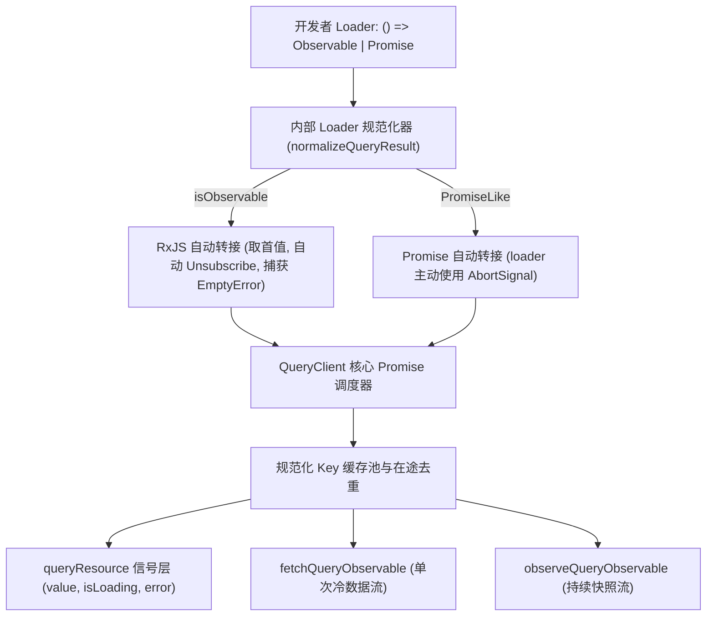

# Query API 开发者体验：Observable 优先、架构实践与请求编排设计方案

**状态：核心 API 与实际示例已实现；动态集合已实现 B 方案。** **审核日期：** 2026-10-14。针对 PR
#146 的实现和回归修复；DSM UI 参考快照为 `e377fa09ea`。

**读者对象：** Angular 应用开发工程师、架构师及 ngx-lift 核心维护者。

**配套英文文档：** [Query API Developer Experience Specification](query-api-dx-proposal.md)。

---

## 1. 开发者体验第一：`queryResource` 参数设计规范

在现代 Angular 应用中，开发者的首要诉求是
**API 简洁、类型安全、符合直觉，且天然支持 Observable（`HttpClient`）与 Promise**，无需繁琐的适配包装。

### 核心参数签名定义

```typescript
import type {QueryResourceDefinition, QueryResourceOptions, QueryResourceRef} from 'ngx-lift';

export declare function queryResource<T, E = Error>(
  definition: () => QueryResourceDefinition<T> | undefined,
  options?: QueryResourceOptions,
): QueryResourceRef<T | undefined, E>;
```

### 参数深度解析

| 参数 / 属性                        | 类型                                                           | 是否必填 | 含义与默认行为                                                                                                                                                                          |
| ---------------------------------- | -------------------------------------------------------------- | -------- | --------------------------------------------------------------------------------------------------------------------------------------------------------------------------------------- |
| **`definition`**                   | `() => QueryResourceDefinition<T> \| undefined`                | **是**   | 响应式定义工厂函数。在 Angular 响应式追踪上下文中运行，读取 signal 参数并返回查询配置。**当依赖前置条件未满足时返回 `undefined`，直接进入 `'idle'` 空闲就绪状态，不发起任何网络请求**。 |
| `definition().key`                 | `QueryKey` (`readonly QueryKeyValue[]`)                        | **是**   | 唯一标识该缓存资源的规范化元组。**必须包含所有影响返回数据的参数与授权租户范围**（例如 `['users', tenantId, userId]`）。                                                                |
| `definition().loader`              | `(context: QueryLoaderContext) => Observable<T> \| Promise<T>` | **是**   | 延迟加载函数。**原生支持返回 `Observable<T>` 或 `Promise<T>`，无需任何外部适配器**。入参提供 `{ abortSignal, refresh }`。                                                               |
| `definition().tags`                | `readonly QueryTag[]`                                          | 否       | 缓存失效依赖标签（例如 `[{ type: 'Users', id }]`），供 `mutateResource` 或 `client.invalidateTags()` 批量失效。                                                                         |
| `definition().staleTime`           | `number`                                                       | 否       | 数据保鲜期（毫秒）。在此期间的再次读取直接返回缓存。默认 `0`（立即视为过期，但后台静默重校验期间仍优先显示缓存）。                                                                      |
| `definition().gcTime`              | `number`                                                       | 否       | 孤立缓存保留期（毫秒）。当所有组件观察者注销后开始倒计时，默认 `300_000`（5 分钟）。                                                                                                    |
| `definition().cancelOnNoObservers` | `boolean`                                                      | 否       | 当所有组件销毁时，是否中断正在飞行中的 HTTP 请求。默认 `false`（共享请求默认允许完成并存入缓存）。                                                                                      |
| **`options.pollInterval`**         | `number \| (() => number \| undefined)`                        | 否       | 定时轮询间隔（毫秒）。支持响应式函数，返回 `undefined` 时动态暂停轮询。                                                                                                                 |
| **`options.injector`**             | `Injector`                                                     | 否       | 依赖注入容器。仅在脱离 Angular 构造注入上下文调用时需要手动传入。                                                                                                                       |
| **`options.client`**               | `QueryClient`                                                  | 否       | 自定义 QueryClient 实例。默认注入全局单例 `QUERY_CLIENT`。                                                                                                                              |

### 返回对象能力矩阵 (`QueryResourceRef`)

| 属性 / 方法        | 类型                     | 核心作用与使用场景                                                                    |
| ------------------ | ------------------------ | ------------------------------------------------------------------------------------- |
| `value`            | `Signal<T \| undefined>` | 当前缓存或已解析的数据 Signal。在后台静默刷新时**保持旧数据不变**，防止界面白屏跳动。 |
| `isLoading`        | `Signal<boolean>`        | 是否处于网络活动中（包括初次加载与后台静默刷新，`loading \|\| reloading`）。          |
| `isInitialLoading` | `Signal<boolean>`        | **仅在首次没有数据加载时为 `true`**。非常适合用于展示整页 Skeleton 骨架屏。           |
| `isRefreshing`     | `Signal<boolean>`        | **仅在拥有旧数据并在后台静默刷新时为 `true`**。适合展示局部小 Spinner 或灰度状态。    |
| `error`            | `Signal<E \| null>`      | 最近一次加载失败的错误对象 Signal。                                                   |
| `status`           | `Signal<QueryStatus>`    | 精细状态枚举：`'idle' \| 'loading' \| 'reloading' \| 'resolved' \| 'error'`。         |
| `isStale`          | `Signal<boolean>`        | 当前数据是否已超过 `staleTime`。                                                      |
| `hasValue()`       | 类型守卫方法             | 判断数据是否有效，可将类型收窄为排除 `undefined` 的明确数据。                         |
| `reload()`         | `() => boolean`          | 主动触发后台静默重校验，跳过 `staleTime` 缓存，返回是否成功发起。                     |
| `execute()`        | `() => Promise<T>`       | 编程式主动触发重校验，返回可 await 的 Promise。                                       |
| `destroy()`        | `() => void`             | 手动销毁当前观察者，断开对缓存的监听。                                                |

### 为什么说这套参数设计 DX 极佳？

1. **单工厂闭包彻底杜绝 Key 与 Loader 参数不一致：** 在工厂函数内部通过闭包捕获一次参数（例如
   `const id = this.userId();`），随后 `key: ['users', id]` 和 `loader: () => this.userService.getUser(id)`
   必定引用完全一致的入参快照，绝不会出现网络请求发送的是新 ID、缓存 Key 却还记录旧 ID 的竞态 Bug。
2. **`undefined` 优雅充当就绪门禁（Readiness Gate）：** 开发者不需要学习额外的 `enabled: boolean` 属性或复杂的
   `skipToken`。当前置依赖缺失时（如 `if (!orgId) return undefined;`），返回 `undefined` 即可让查询自然处于待机状态。
3. **零适配成本，还开发者清爽体验：** 直接写 `loader: () => this.http.get(...)`，无需额外的 Observable 适配器包装。

### 推荐变量命名规范 (Naming Conventions: `userQuery` vs `userRef`)

在组件中调用 `queryResource` 时，变量应该如何命名？推荐以下实践：

- **首选推荐：`userQuery`（DX 与可读性最佳，强烈推荐）**
  - **模板解构极度自然：**
    `@if (userQuery.value(); as user)`。这样可以清晰将“查询句柄（`userQuery`）”与“解构后的实体数据（`user`）”区分开。模板中访问数据直接用
    `user.name`，需要查询控制与状态时用 `userQuery.isLoading()` 或 `userQuery.reload()`，杜绝命名冲突。
  - **与 Mutation 对称：** `userQuery = queryResource(...)` 与 `createUserMutation = mutateResource(...)`
    形成完美的语义呼应。
  - **与 TanStack Query 心智统一：** 匹配业界广泛接受的 `const userQuery = useQuery(...)` 命名惯例。
- **备选规范：`userRef` / `userResource`**
  - 如果团队在 Angular 规范中统一要求所有资源类型对象均以 `*Ref` 为后缀（例如与 `databaseRef = resourceAsync(...)`
    保持一致），使用 `userRef` 也是合理的。
- **避免命名：直接命名为 `user`**
  - 不建议写
    `readonly user = queryResource(...)`，否则在模板中极易产生混淆（到底是指代 Signal 句柄，还是实体数据本身）。

---

## 2. 澄清开发者反馈、确认共识与技术边界探讨

### 原生 loader 契约

所有查询入口直接接受
`Observable<T> | PromiseLike<T>`。应用不需要公开适配器；内部 normalizer 负责首次值、空完成、错误和取消。teardown 失败不会使共享请求一直 pending。已有请求错误优先保留；收到值后，从
`subscribe()` 或 `unsubscribe()`
传出的 cleanup 错误令请求进入可重试 error 状态。RxJS 的某些算子链会在 subscriber 关闭后内部吞掉同步 cleanup 异常（例如同步
`finalize`）；这类异常不会到达 normalizer，与 `firstValueFrom` 行为一致。

### 技术边界与架构考量（Challenge 与澄清）

1. **有限快照（Query Snapshot）vs. 无限数据流（Infinite Stream）：**
   - 缓存查询（Query）本质是对后端服务端状态在某一时刻的**有限快照**。因此，当 Observable
     loader 发送**第一个值**时，立即 unsubscribe 取消订阅；成功结算要等订阅初始化完成。
   - 如果某个场景是持久推送流（如 WebSocket、SSE、实时日志长连接），**切勿**强行使用 `queryResource`，而应使用
     `resourceAsync` 或原生 RxJS 结合 Signal 管理。
2. **切勿在每一个 Service 中滥用 `QueryClient`：**
   - 90% 的普通业务 Service 应保持为**无状态的纯 HTTP 客户端**，仅返回纯净的
     `Observable<T>`。缓存与重校验交由消费该服务的 Component 通过 `queryResource` 来控制。
   - 仅在诸如 DSM `VcfTmService` 这样的**全局跨微前端共享领域服务**中，才适合注入 `QueryClient` 并在方法内部通过
     `fetchQueryObservable` 提供透明缓存。
3. **底层 Promise 调度下的 RxJS 语义完整性：**
   - 内部透明适配必须严格保证：`HttpClient` 的拦截器（Interceptors）与 Zone.js 稳定性不被破坏；`of(data)`
     同步流正常解析；空流发射 `EMPTY` 时抛出 `EmptyError` 而不是卡死在 loading；`abortSignal`
     触发时能正确取消 HTTP 请求。

### Key 与 Tags 深度对比：Tags 到底是不是多余的？

很多习惯了早期 React Query 的开发者会有疑问：_“React
Query 用一个 key 就能做全局 invalidateQueries，为什么 ngx-lift 还要搞一个 tags？tags 会不会多余？”_

**明确结论：`key` 是必须的；`tags` 完全是可选的（Optional）！Tags 绝不多余，而是解决复杂多维缓存失效的神器。**

#### 1. React Query 为什么只用 Key？

React Query 采用的是**层级前缀模糊比对（Hierarchical Prefix Invalidation）**：

- 声明：`queryKey: ['todos', 'list', { status: 'all' }]`
- 失效：`queryClient.invalidateQueries({ queryKey: ['todos'] })`
- 底层机制：只要在内存字典中检索到以 `['todos']` 开头的 Key，无论后面的参数是什么，全部打上 Stale 标记并触发重新请求。
- 前缀匹配适合层级 key；TanStack 也支持 exact 和 predicate filters，不强制树状结构。参见
  [官方 filters 文档](https://tanstack.com/query/latest/docs/framework/react/guides/filters)。

#### 2. ngx-lift 为什么引入 Tags？（汲取自 RTK Query 的精华）

- **`key` 的职责：** **唯一精确寻址（Cache
  Identity）**。代表当前网络调用的唯一入参快照（包含 URL、Filter、分页、授权范围）。两个请求只有 key 完全相同，才能共享同条缓存与在途去重。
- **`tags` 的职责：** **多维业务依赖与解耦失效（Invalidation Target）**。
  - 例如主机列表第一页和第二页拥有不同的 `key`，但它们都打上标签 `tags: [{ type: 'Hosts' }]`；
  - 主机详情查询拥有 key `['hosts', id]`，打上标签 `tags: [{ type: 'Hosts', id }]`；
  - 某个删除或编辑操作完成时，`mutateResource` 只需声明： `invalidatesTags: [{ type: 'Hosts' }]` 或
    `invalidatesTags: (res) => [{ type: 'Hosts', id: res.id }]`。
  - **收益：** 变更操作不需要关心前端有哪些复杂的页面、哪几个分页正在展示主机，底层自动失效所有关联查询！
- **开发建议：**
  - **简单查询：不写 `tags` 即可！** 仅凭 `key` 就足以完成独立缓存与生命周期管理。
  - **复杂表格/变更联动：使用 `tags`！** 实现修改后对应列表的自动静默刷新。

### `mutateResource` 的 `concurrency` 并发控制机制深度解析

开发者提问：_“concurrency: 'exhaust' 还有什么 values？这里像 RxJS，React
Query 是怎么做的？我怕有人搞不懂 exhaust 的意思，不用它或者不写会怎么样？”_

#### 1. `concurrency` 的 3 个可选值与应用场景

`mutateResource(mutationFn, options)` 的 `concurrency` 选项提供以下三种模式：

| 可选值                           | 核心行为与底层机制                                                                                                                                                    | 对应 RxJS 操作符 | 典型应用场景                                                                                                                                       |
| -------------------------------- | --------------------------------------------------------------------------------------------------------------------------------------------------------------------- | ---------------- | -------------------------------------------------------------------------------------------------------------------------------------------------- |
| **`'parallel'`**<br>**(默认值)** | **完全并发执行**。每次调用 `mutate(args)` 都会立即发起一次真实的后端网络请求，多个请求并行在途。**不写该选项时，默认就是 `'parallel'`**。                             | `mergeMap`       | 无排他性要求的独立操作，例如表格中对多行数据的独立并发批量重试、点赞。                                                                             |
| **`'exhaust'`**                  | **在途排他 / 忽略新操作**。当已有一次 mutate 在执行尚未完成时，后续再次调用 `mutate()` 会直接复用并返回当前在途的同一个 Promise，**绝不会向后端发起第二次重复请求**。 | `exhaustMap`     | **表单提交、创建按钮防手抖/防双击**。即使前端按钮由于变更检测延迟还没来得及渲染 disable，或者用户 100ms 内连点了 3 次，也只会向后端发送 1 次请求！ |
| **`'concat'`**                   | **排队串行执行**。当前请求在执行时，新发起的请求不会被丢弃，而是排队等待前一个请求彻底完成后，再依次发起。                                                            | `concatMap`      | 严格要求顺序的队列操作，例如聊天消息发送、有序审计日志上报、流水线阶段性审批。                                                                     |

#### 2. React Query 是怎么做的？

- TanStack mutation 默认并行；相同 `scope: {id}` 的调用串行排队。参见
  [官方 mutation API](https://tanstack.com/query/latest/docs/framework/react/reference/functions/useMutation)。
- 排队会执行每次调用；ngx-lift 的 `exhaust`
  则复用当前 Promise，不执行新调用。参数不同时必须明确选择。这些策略不能替代后端幂等性。

#### 3. 团队开发者搞不懂 `exhaust` 怎么办？

- **直接不写即可！** 不写 `concurrency` 时默认就是 `'parallel'`，开发者完全不需要理解这个词汇。
- 平时只需要在按钮上照常绑定 `[disabled]="saveMutation.isLoading()"`
  即可满足 90% 的普通场景；只有在需要严格防连击重复提交时，才建议开启 `concurrency: 'exhaust'`。

---

## 3. 业界主流查询库如何处理并行与串行/依赖请求

| 查询库                       | 固定并行请求 (Fixed Parallel)                              | 动态并行请求 (Dynamic Parallel)                      | 依赖/串行请求 (Dependent / Sequential)                          | 对 ngx-lift 的启示与借鉴                                                |
| ---------------------------- | ---------------------------------------------------------- | ---------------------------------------------------- | --------------------------------------------------------------- | ----------------------------------------------------------------------- |
| **TanStack Query (React)**   | 并列声明多个 `useQuery` 即可并发执行。                     | 使用专门的 `useQueries({ queries: ids.map(...) })`。 | 通过 `enabled: !!parentId` 控制下游查询等待前置数据完成。       | 独立缓存节点各自维护状态；动态列表需要专属管理函数。                    |
| **TanStack Query (Angular)** | 并列声明多个 `injectQuery()`。                             | `injectQueries`，需核对安装的包版本。                | `enabled: computed(() => !!parent.data())`。                    | 官方文档曾要求使用 `firstValueFrom` 转换 Observable，DX 略有割裂。      |
| **SWR (Vercel)**             | 并列调用 `useSWR` 自动并发。                               | 使用 keyed 子组件，不在循环中调用 Hook。             | 传入 `null` 或返回 `null` 的函数即自动暂停执行。                | ngx-lift 的 `undefined` 工厂模式与 SWR 的简洁性高度契合。               |
| **RTK Query**                | 多个 `useXQuery` 自动并发。                                | 使用 keyed 子组件或 imperative initiate。            | 使用 `skip: !userId` 或 `skipToken` 暂停下游。                  | 区分单条复合接口（复合查询）与独立缓存实体的界限。                      |
| **RxJS 原生**                | `forkJoin`（等待全部完成）或 `combineLatest`（流式聚合）。 | `from(ids).pipe(mergeMap(...))`。                    | `switchMap`（切换最新）、`concatMap`（排队执行）。              | 适合服务层管道编排，但缺乏多组件间去重、缓存、标签失效与 Signals 响应。 |
| **Angular `rxResource`**     | 并列声明多个 `rxResource`。                                | 循环声明受限于注入上下文。                           | `params: () => parent.value()?.id`，入参为 undefined 时不加载。 | 原生响应式体验极佳，但缺乏全局缓存键与跨组件共享去重机制。              |

---

## 4. 深度剖析：除 `switchMap` 外，`queryResource` 也能支持串行依赖请求吗？

**答案是：完全支持，而且在组件视图层中，`queryResource` 的表现往往比 `switchMap` 更加优雅！**

### 核心机制：Signal 就绪门禁模式（Readiness Gate）

在组件中，你可以声明两个各自独立的 `queryResource`，下游查询的工厂函数读取上游查询的 `.value()`。只要上游尚未就绪（值为
`undefined`），下游就返回 `undefined` 进入 `'idle'` 待机状态：

```typescript
// 查询 1：获取用户基础信息
readonly userQuery = queryResource(() => {
  const id = this.userId();
  if (!id) return undefined;
  return {
    key: ['users', id],
    loader: () => this.userService.getUser(id),
  };
});

// 查询 2：依赖查询 —— 必须等用户加载完成后，用用户的 orgId 去查部门详情
readonly orgQuery = queryResource(() => {
  const user = this.userQuery.value();
  // 核心就绪门禁：只要用户未解析完成，直接返回 undefined！
  // orgQuery 处于 'idle' 状态，不会发起任何请求，也不会报错！
  if (!user?.orgId) return undefined;

  return {
    key: ['organizations', user.orgId],
    loader: () => this.orgService.getOrg(user.orgId),
  };
});
```

### 两种方式的本质区别与架构选型对比

```
┌────────────────────────────────────────────────────────────────────────────────────────┐
│                                   架构选型与场景对比表                                  │
├───────────────────────────────┬─────────────────────────────────┬──────────────────────┤
│ 比较维度                      │ queryResource 信号门禁模式      │ RxJS switchMap 流水线│
├───────────────────────────────┼─────────────────────────────────┼──────────────────────┤
│ 推荐运行层次                  │ Component 视图展示层            │ Service 业务逻辑层   │
│ UI Loading 粒度               │ 独立粒度：User 和 Org 各自拥有  │ 粗粒度：整个流为一个 │
│                               │ 独立的加载中状态和 Skeleton     │ 单一的 Loading 状态  │
│ 独立缓存节点                  │ 分离缓存：`['users']` 和        │ 整体缓存或无缓存，   │
│                               │ `['organizations']` 独立复用    │ 无法单独复用局部数据 │
│ 局部失效与刷新                │ 刷新 Org 时，User 无需重新请求  │ 必须从第一步重新执行 │
│ 局部容灾与重试                │ 若 Org 失败，User 仍然正常展示，│ 一个环节出错，整个流 │
│                               │ 可单独点击 Org 的重试按钮       │ 彻底失败中断         │
│ 参数响应式                    │ 深度融合 Angular Signals        │ 需配合 Subject 处理  │
│ 最佳适用场景                  │ 页面上有独立区域分别展示 A 和 B │ 纯业务多步原子操作   │
│                               │ 的数据与状态                    │ （如登录后换取 Token)│
└───────────────────────────────┴─────────────────────────────────┴──────────────────────┘
```

---

## 5. 深度剖析：“动态列表：确实值得后续考虑 queryResources，但要先设计 stable ID、删除 cleanup、重排和类型推断”这句话什么意思？

很多开发者在面对动态 ID 列表时，容易写出如下致命的直觉代码：

```typescript
// ❌ 极度危险的代码！切勿在生产环境这样写！
readonly dynamicQueries = computed(() => {
  return this.selectedIds().map(id =>
    queryResource(() => ({
      key: ['item', id],
      loader: () => this.itemService.getItem(id),
    }))
  );
});
```

### 为什么上面这段代码会引发灾难性 Bug？

1. **`computed()` 内违规反复创建资源与严重内存泄漏：**
   - `queryResource` 内部包含 Angular `effect()` 调度、向全局 `QueryClient` 注册观察者，以及挂载
     `DestroyRef.onDestroy`。
   - 一旦在 `computed()` 内部循环调用它，每当 `selectedIds` 变动一次，旧的一批 `queryResource`
     并没有被主动销毁，它们依然挂载在 `QueryClient`
     内部持续监听轮询，直至整页组件注销！这会造成严重的内存泄漏与 CPU 占用。
2. **缺乏稳定 ID（Stable ID）的比对协调机制（Reconciliation）：**
   - 假设列表原先为 `['A', 'B', 'C']`，随后用户操作变为 `['A', 'C', 'D']`。
   - 这里的 Stable ID **根本不需要开发者额外传一个人造的 `id` 属性**！每一个查询的 `key`（在底层序列化为
     `serializeQueryKey(key)`，如 `["hosts","A","metrics"]`）本身就是全局唯一的天然唯一标识符！
   - 这正是 **React Query (`useQueries`)** 的核心设计精髓：开发者只需提供标准的对象
     `{ key, loader }`，底层协调引擎通过内部 Key 比对自动识别：已有 key 予以保留复用，新 key 建立新查询，消失的 key 立即注销回收。
   - ngx-lift 采纳 React Query 这一成熟理念，彻底免除 `id` 这一冗余字段，实现无包袱的极简 DX。
3. **删除项的即时销毁清理（Deletion Cleanup）：**
   - 当 `'B'` 从列表中移除时，动态管理器必须立即对其调用 `.destroy()`，解除在全局 `QueryClient`
     中的注册，停止其轮询并释放内存。
4. **重排（Reordering）防抖：**
   - 当列表从 `['A', 'B']` 变成 `['B', 'A']` 时，仅进行引用重排序，不应导致底层查询重新初试化。
5. **强类型推断（Type Inference）：**
   - 统一推断为 `Signal<QueryResourceRef<T>[]>`，让开发者在模板的 `@for (q of dynamicQueries(); track q.key)`
     中享受到完整的 TypeScript 类型补全。

因此，**动态列表不能简单通过循环调用单体 `queryResource` 实现，而需要专门设计一套类似于 Angular `@for track`
机制的高性能协调引擎 `queryResources`（复数形式）**。

---

## 6. 全场景用例手册（覆盖全部常见场景，附完整代码）

### 场景 1：组件内固定并行请求 (Fixed Parallel)

**业务场景：**
监控看板页面同时加载“用户偏好配置”和“系统健康状态”，两个接口相互独立，必须并行加载，互不阻塞，且允许各自独立重试。

```typescript
import {Component, computed, inject} from '@angular/core';
import {HttpClient} from '@angular/common/http';
import {queryResource} from 'ngx-lift';

interface UserSettings {
  theme: string;
  notifications: boolean;
}
interface SystemHealth {
  status: 'healthy' | 'degraded';
  cpu: number;
}

@Component({
  selector: 'app-dashboard',
  template: `
    <div class="dashboard-grid">
      <!-- 模块 1：用户设置 -->
      <div class="card">
        @if (settingsQuery.isLoading()) {
          <span>加载设置中...</span>
        }
        @if (settingsQuery.value(); as s) {
          <div>主题：{{ s.theme }}</div>
        }
        @if (settingsQuery.error()) {
          <button (click)="settingsQuery.reload()">重试设置</button>
        }
      </div>

      <!-- 模块 2：系统状态 -->
      <div class="card">
        @if (healthQuery.isLoading()) {
          <span>监测健康状态中...</span>
        }
        @if (healthQuery.value(); as h) {
          <div>系统状态：{{ h.status }} (CPU: {{ h.cpu }}%)</div>
        }
        @if (healthQuery.error()) {
          <button (click)="healthQuery.reload()">重试健康检查</button>
        }
      </div>
    </div>
  `,
})
export class DashboardComponent {
  private readonly http = inject(HttpClient);

  // 两个查询在组件初始化时自动并发启动
  readonly settingsQuery = queryResource(() => ({
    key: ['user', 'settings'],
    loader: () => this.http.get<UserSettings>('/api/user/settings'),
    staleTime: 60_000,
  }));

  readonly healthQuery = queryResource(() => ({
    key: ['system', 'health'],
    loader: () => this.http.get<SystemHealth>('/api/system/health'),
    staleTime: 10_000,
  }));

  // 计算聚合状态
  readonly isAnyLoading = computed(() => this.settingsQuery.isLoading() || this.healthQuery.isLoading());
}
```

---

### 场景 2：组件内依赖串行请求 (Dependent Sequential with Signal Gate)

**业务场景：**
下拉框选择租户后加载租户详情，租户详情返回首选数据库实例 ID；页面依赖该实例 ID 自动发起第二步加载实例监控指标。

```typescript
import {Component, inject, signal} from '@angular/core';
import {HttpClient} from '@angular/common/http';
import {queryResource} from 'ngx-lift';

interface TenantDetail {
  id: string;
  name: string;
  defaultDbId: string;
}
interface DbMetrics {
  dbId: string;
  connections: number;
  memoryUsage: string;
}

@Component({
  selector: 'app-tenant-monitor',
  template: `
    @if (tenantQuery.isLoading()) {
      <p>加载租户信息...</p>
    }
    @if (tenantQuery.value(); as t) {
      <h3>租户：{{ t.name }}</h3>

      <!-- 依赖的数据库指标展示 -->
      @if (metricsQuery.isLoading()) {
        <p>加载默认数据库监控数据...</p>
      }
      @if (metricsQuery.value(); as m) {
        <div class="metric-box">
          <p>当前活动连接数：{{ m.connections }}</p>
          <p>内存占用：{{ m.memoryUsage }}</p>
        </div>
      }
      @if (metricsQuery.error()) {
        <button (click)="metricsQuery.reload()">重新加载指标</button>
      }
    }
  `,
})
export class TenantMonitorComponent {
  private readonly http = inject(HttpClient);
  readonly selectedTenantId = signal<string>('tenant-888');

  // 第一步：根据租户 ID 查询详情
  readonly tenantQuery = queryResource(() => {
    const tenantId = this.selectedTenantId();
    if (!tenantId) return undefined;
    return {
      key: ['tenants', tenantId],
      loader: () => this.http.get<TenantDetail>(`/api/tenants/${tenantId}`),
      staleTime: 120_000,
    };
  });

  // 第二步：依赖第一步产出的 defaultDbId，就绪门禁自动拦截
  readonly metricsQuery = queryResource(() => {
    const defaultDbId = this.tenantQuery.value()?.defaultDbId;
    if (!defaultDbId) return undefined; // 第一步没准备好之前，保持 idle，不发起请求

    return {
      key: ['databases', defaultDbId, 'metrics'],
      loader: () => this.http.get<DbMetrics>(`/api/databases/${defaultDbId}/metrics`),
      staleTime: 30_000,
    };
  });
}
```

---

### 场景 3：服务层并行请求合并 (RxJS `forkJoin` Snapshot)

**业务场景：**
服务需要聚合两个后端 API（角色列表与权限字典）后返回一个完整的权限上下文对象，非组件调用者（如拦截器、路由守卫或权限服务）需要单次 Observable 快照。

#### 1. 为什么这里要用 `fetchQueryObservable` 和 `queryClient`？直接用 `this.http.get` 不行吗？

- **直接用 `this.http.get`：**
  每次调用该方法都会向后端真实发出 2 次 HTTP 请求。如果页面上有 3 个组件同时调用该方法，总共会发出 6 次请求，且不会有任何缓存。
- **使用 `fetchQueryObservable(queryClient, ...)` 的核心价值：**
  1. **跨组件/跨调用全局缓存共享：** 设定了
     `staleTime: 60_000`。在 60 秒内，无论当前页面切到哪个 Tab、无论哪个组件再次调用
     `getUserSecurityContext(userId, scope)`，**直接从内存缓存秒级返回，不发网络请求**！
  2. **在途请求合并去重 (Coalescing / Deduplication)：**
     如果页面加载瞬间，顶部导航栏、侧边栏菜单和个人主页 3 个组件在同一时间毫秒内调用此方法，`queryClient`
     会自动合并，**只向后端发出 1 次 roles 和 1 次 permissions 请求**，3 个组件共享同一批响应！
  3. **标签声明式失效联动：** 一旦发生用户权限变更，`mutateResource` 触发
     `invalidatesTags: [{ type: 'Permissions', scope }]`，该缓存自动失效。

#### 2. 服务端实现代码

```typescript
import {Injectable, inject} from '@angular/core';
import {HttpClient} from '@angular/common/http';
import {forkJoin, Observable} from 'rxjs';
import {fetchQueryObservable, QUERY_CLIENT} from 'ngx-lift';

export interface UserPermissionContext {
  roles: string[];
  permissions: string[];
}

@Injectable({providedIn: 'root'})
export class SecurityService {
  private readonly http = inject(HttpClient);
  private readonly queryClient = inject(QUERY_CLIENT);

  getUserSecurityContext(userId: string, scope: string): Observable<UserPermissionContext> {
    // 两个查询共享全局 QueryClient 缓存与在途请求去重
    const roles$ = fetchQueryObservable(this.queryClient, {
      key: ['users', scope, userId, 'roles'],
      tags: [{type: 'Roles', scope}],
      loader: () => this.http.get<string[]>(`/api/users/${userId}/roles`),
      staleTime: 60_000,
    });

    const permissions$ = fetchQueryObservable(this.queryClient, {
      key: ['users', scope, userId, 'permissions'],
      tags: [{type: 'Permissions', scope}],
      loader: () => this.http.get<string[]>(`/api/users/${userId}/permissions`),
      staleTime: 60_000,
    });

    // 优雅使用 forkJoin 并行等待两者一次性完成
    return forkJoin({roles: roles$, permissions: permissions$});
  }
}
```

#### 3. 组件完整调用示例（组件该怎么消费？）

**方式 A（现代 Angular Signals 推荐用法：使用 `resourceAsync`）：**

```typescript
import {Component, inject, signal} from '@angular/core';
import {resourceAsync} from 'ngx-lift';
import {SecurityService} from './security.service';

@Component({
  selector: 'app-user-profile',
  template: `
    @if (authContextRef.isLoading()) {
      <p>正在加载权限上下文...</p>
    }
    @if (authContextRef.value(); as ctx) {
      <div class="security-card">
        <h4>用户权限概览</h4>
        <p>所属角色：{{ ctx.roles.join(', ') }}</p>
        <p>拥有的权限点：{{ ctx.permissions.join(', ') }}</p>
      </div>
    }
    @if (authContextRef.error()) {
      <button (click)="authContextRef.reload()">重试加载权限</button>
    }
  `,
})
export class UserProfileComponent {
  private readonly securityService = inject(SecurityService);
  readonly currentUserId = signal('user-888');
  // Example only: production scope comes from the authenticated session.
  readonly sessionScope = signal('session-a');

  // 将服务返回的 Observable 转为组件内的 Signals 资源
  readonly authContextRef = resourceAsync(() =>
    this.securityService.getUserSecurityContext(this.currentUserId(), this.sessionScope()),
  );
}
```

**方式 B（传统 RxJS Async Pipe 用法）：**

```typescript
import {Component, computed, inject, signal} from '@angular/core';
import {AsyncPipe} from '@angular/common';
import {toObservable} from '@angular/core/rxjs-interop';
import {switchMap} from 'rxjs';
import {SecurityService} from './security.service';

@Component({
  selector: 'app-user-profile-rxjs',
  imports: [AsyncPipe],
  template: `
    @if (authContext$ | async; as ctx) {
      <p>所属角色：{{ ctx.roles.join(', ') }}</p>
    }
  `,
})
export class UserProfileRxjsComponent {
  private readonly securityService = inject(SecurityService);
  readonly currentUserId = signal('user-888');
  // Example only: production scope comes from the authenticated session.
  readonly sessionScope = signal('session-a');

  readonly authParams = computed(() => ({id: this.currentUserId(), scope: this.sessionScope()}));
  readonly authContext$ = toObservable(this.authParams).pipe(
    switchMap(({id, scope}) => this.securityService.getUserSecurityContext(id, scope)),
  );
}
```

---

### 场景 4：服务层串行请求流水线 (RxJS `switchMap`)

**业务场景：** 导出任务：先调用 POST 创建异步导出任务，获取 `taskId`，随即拉取该任务的初始进度配置。

#### 追问解答：直接用 `this.http.get` 不行吗？为什么这里用 `fetchQueryObservable`？

- **“直接用 `this.http.get` 行不行？”——当然行！**
  - **如果第 2 步获取进度只是当前服务内部的一次性临时转换，没有其他任何组件关心这个数据，直接写 `this.http.get`
    才是最简单清晰的，完全不需要强加 `fetchQueryObservable`！**
- **那为什么该场景要用 `fetchQueryObservable`？什么场景才需要它？**
  - 核心在于：**全局缓存、跨组件共享与标签失效！**
  - 假设这是一个企业级后台系统，用户点击“开始导出”后，不仅当前方法需要返回进度，**同时界面右下角的“全局任务进度抽屉组件”、或者顶部导航栏的“任务小铃铛”也需要感知该任务的进度**。
  - 通过 `fetchQueryObservable` 请求后，该任务进度已自动录入全局缓存池
    `key: ['exports', taskId, 'progress']`，并被打上了标签 `tags: [{ type: 'Exports' }]`。
  - 界面上的其他组件如果也以此 key 请求或监听，**直接命中已存在的数据，不会发出第二次 HTTP 请求**！后续用户点击“终止任务”触发 Mutation 时，也可以通过
    `invalidatesTags` 自动刷新该进度的展示。
- **架构黄金法则：**
  - **一次性私有内部请求：** 直接用 `this.http.get`，保持简洁！
  - **需要跨组件共享复用、去重或参与标签自动失效：** 使用 `fetchQueryObservable`。

```typescript
import {Injectable, inject} from '@angular/core';
import {HttpClient} from '@angular/common/http';
import {Observable, switchMap} from 'rxjs';
import {fetchQueryObservable, QUERY_CLIENT} from 'ngx-lift';

interface ExportTaskSummary {
  taskId: string;
  createdAt: string;
}
interface TaskProgress {
  taskId: string;
  progressPercentage: number;
}

@Injectable({providedIn: 'root'})
export class ExportService {
  private readonly http = inject(HttpClient);
  private readonly queryClient = inject(QUERY_CLIENT);

  createAndFetchInitialProgress(exportParams: Record<string, unknown>): Observable<TaskProgress> {
    return this.http.post<ExportTaskSummary>('/api/exports', exportParams).pipe(
      switchMap(
        (task) =>
          // 如果该进度需要共享至全局缓存池供抽屉/通知栏组件复用：
          fetchQueryObservable(this.queryClient, {
            key: ['exports', task.taskId, 'progress'],
            tags: [{type: 'Exports'}],
            loader: () => this.http.get<TaskProgress>(`/api/exports/${task.taskId}/progress`),
            staleTime: 5_000,
          }),
        // 如果只是私有一次性转换，无需共享缓存，直接写：
        // this.http.get<TaskProgress>(`/api/exports/${task.taskId}/progress`) 即可！
      ),
    );
  }
}
```

---

### 场景 5：动态列表并行请求（已实现 B 方案）

B 方案足够覆盖动态 ID 集合：`queryResources(items, definition, options?)`。A 方案接收查询定义数组，只有当已有查询数组或异构查询出现实际需求时再考虑，不同时增加两个入口。这里不需要人为的 id 或 definition 包装。

返回的是可读取的 `QueryResourcesRef<T>` signal。每项含有与单体资源相同的状态/刷新方法，以及用于 `@for track` 的稳定
`key` 字符串（canonical
key 序列化结果）。重排保留 ref；删除 ID 立即从结果中隐藏该项，随后 effect 销毁观察者。空数组没有观察者。重复 canonical
key 明确抛错；单项失败不影响其他项。新增项在 Angular effect 调度后出现，并不是同步创建全部请求。

```typescript
import {HttpClient} from '@angular/common/http';
import {ChangeDetectionStrategy, Component, inject, signal} from '@angular/core';
import {queryResources} from 'ngx-lift';

interface HostMetrics {
  hostId: string;
  loadAverage: number;
}

@Component({
  selector: 'app-host-monitor',
  changeDetection: ChangeDetectionStrategy.OnPush,
  template: `
    @for (query of metricQueries(); track query.key) {
      @if (query.value(); as metrics) {
        <p>{{ metrics.hostId }}: {{ metrics.loadAverage }}</p>
      }
    }
  `,
})
export class HostMonitorComponent {
  private readonly http = inject(HttpClient);
  readonly selectedHostIds = signal<string[]>(['host-1', 'host-2']);
  readonly metricQueries = queryResources(this.selectedHostIds, (hostId) => ({
    key: ['hosts', hostId, 'metrics'],
    loader: () => this.http.get<HostMetrics>(`/api/hosts/${hostId}/metrics`),
    staleTime: 5_000,
  }));
}
```

---

### 场景 6：变更操作与自动查询失效联动 (`mutateResource` + `queryResource`)

**业务场景：**
用户点击按钮删除一个集群节点，触发变更。操作成功后，自动触发节点列表查询的静默刷新，无需手动编写回调订阅刷新逻辑。

```typescript
import {Component, inject} from '@angular/core';
import {HttpClient} from '@angular/common/http';
import {queryResource, mutateResource} from 'ngx-lift';

interface ClusterNode {
  id: string;
  name: string;
  ip: string;
}

@Component({
  selector: 'app-cluster-nodes',
  template: `
    @if (nodesQuery.isLoading()) {
      <p>刷新节点列表中...</p>
    }
    <ul>
      @for (node of nodesQuery.value() ?? []; track node.id) {
        <li>
          {{ node.name }} ({{ node.ip }})
          <button (click)="deleteNode(node.id)" [disabled]="deleteMutation.isLoading()">删除</button>
        </li>
      }
    </ul>
  `,
})
export class ClusterNodesComponent {
  private readonly http = inject(HttpClient);

  // 1. 查询：绑定标签 'ClusterNodes'
  readonly nodesQuery = queryResource(() => ({
    key: ['cluster', 'nodes'],
    tags: [{type: 'ClusterNodes'}],
    loader: () => this.http.get<ClusterNode[]>('/api/cluster/nodes'),
    staleTime: 60_000,
  }));

  // 2. 变更：声明式配置 invalidatesTags
  readonly deleteMutation = mutateResource((nodeId: string) => this.http.delete(`/api/cluster/nodes/${nodeId}`), {
    invalidatesTags: [{type: 'ClusterNodes'}], // 成功后自动失效所有打上该标签的查询！
    concurrency: 'exhaust', // 防重复提交
  });

  async deleteNode(id: string) {
    await this.deleteMutation.mutate(id);
    // 成功后，上面的 nodesQuery 查询将自动在后台触发静默重新拉取！
  }
}
```

---

### 场景 7：基于业务状态的有条件定时轮询 (Conditional Polling)

**业务场景：** 异步数据库创建任务，当状态为 `'PROVISIONING'` 时每 3 秒轮询一次，一旦状态变成 `'READY'` 或
`'FAILED'`，自动终止轮询。

```typescript
import {Component, inject, signal} from '@angular/core';
import {HttpClient} from '@angular/common/http';
import {queryResource} from 'ngx-lift';

interface ProvisionJob {
  id: string;
  status: 'PROVISIONING' | 'READY' | 'FAILED';
  message?: string;
}

@Component({
  selector: 'app-provision-tracker',
  template: `
    @if (jobQuery.value(); as currentJob) {
      <div class="status-banner">
        状态：{{ currentJob.status }}
        @if (currentJob.status === 'PROVISIONING') {
          <span>(正在实时轮询进度...)</span>
        }
      </div>
    }
  `,
})
export class ProvisionTrackerComponent {
  private readonly http = inject(HttpClient);
  readonly jobId = signal('job-12345');

  readonly jobQuery = queryResource(
    () => {
      const jobId = this.jobId();
      return {key: ['jobs', jobId], loader: () => this.http.get<ProvisionJob>(`/api/jobs/${jobId}`)};
    },
    {
      // 传入响应式函数：根据当前数据状态动态判定轮询周期
      pollInterval: (): number | undefined => {
        const status = this.jobQuery?.value()?.status;
        return status === 'PROVISIONING' ? 3000 : undefined; // 返回 undefined 即刻挂起轮询
      },
    },
  );
}
```

---

### 场景 8：路由守卫中的编程式缓存预取与校验 (Route Guard Prefetching)

**业务场景：**
在 Angular 路由激活前预取租户授权凭证，若无权访问则重定向，若有权访问则提前填装缓存，组件进入时实现零等待直出。

```typescript
import {inject} from '@angular/core';
import {CanActivateFn, Router} from '@angular/router';
import {HttpClient} from '@angular/common/http';
import {QUERY_CLIENT} from 'ngx-lift';
import {SessionService} from './session.service';

interface AccountEntitlement {
  hasAccess: boolean;
  plan: string;
}

export const featureGuard: CanActivateFn = async (route) => {
  const queryClient = inject(QUERY_CLIENT);
  const http = inject(HttpClient);
  const router = inject(Router);
  const sessionId = inject(SessionService).id();
  if (sessionId === undefined) return router.parseUrl('/login');
  const tenantId = route.paramMap.get('tenantId');
  if (tenantId === null) return router.parseUrl('/login');

  try {
    // 编程式预取并写入全局共享缓存
    const entitlement = await queryClient.fetchQuery({
      key: ['tenants', sessionId, tenantId, 'entitlement'],
      loader: () => http.get<AccountEntitlement>(`/api/tenants/${tenantId}/entitlement`),
      staleTime: 180_000,
    });

    if (entitlement.hasAccess) {
      return true;
    }
    return router.parseUrl('/upgrade-plan');
  } catch {
    return router.parseUrl('/login');
  }
};
```

---

## 7. 架构决策指南：Service 该怎么写？何时注入 `QueryClient`？

### 决策树：Service 到底需不需要注入 `QueryClient`？

```
                         你的业务 Service 需要引入 QueryClient 吗？
                                             │
                       该 Service 是否主要供 Angular Component 消费？
                                     /               \
                                  是                  否
                                  │                    │
                  保持 Service 无状态纯净！      该 Service 是否属于跨微前端、
                  只返回纯 Observable<T>。       跨插件的全局共享领域缓存？
                  由组件使用 queryResource。            /             \
                                                     是                否
                                                     │                 │
                                            注入 QueryClient!       常规 HTTP
                                            使用 fetchQueryObservable 即可
```

### 三种常见代码编写范式

#### 范式 A：无状态纯 HTTP Service（推荐 90% 的业务场景）

```typescript
@Injectable({providedIn: 'root'})
export class ClusterService {
  private readonly http = inject(HttpClient);

  getCluster(id: string): Observable<Cluster> {
    return this.http.get<Cluster>(`/api/clusters/${id}`);
  }
}

// 组件中优雅消费：
readonly clusterQuery = queryResource(() => {
  const id = this.clusterId();
  if (!id) return undefined;
  return {
    key: ['clusters', id],
    loader: () => this.clusterService.getCluster(id),
    staleTime: 60_000,
  };
});
```

_优势：_ 职责分离极度清晰。Service 单测非常容易 Mock（只需 `of(mockCluster)`），组件可按需自定义缓存时长和失效标签。

#### 范式 B：Query Definition 工厂 Service（规范化治理大中型项目）

当多处页面需要共享相同的 `key`、`staleTime` 和 `tags` 时，由 Service 集中暴露配置定义：

```typescript
@Injectable({providedIn: 'root'})
export class ClusterService {
  private readonly http = inject(HttpClient);

  clusterQuery(id: string): QueryDefinition<Cluster> {
    return {
      key: ['clusters', id],
      tags: [{type: 'Cluster', id}],
      staleTime: 60_000,
      loader: () => this.http.get<Cluster>(`/api/clusters/${id}`),
    };
  }
}

// 组件中极致精简：
readonly clusterQuery = queryResource(() => this.clusterService.clusterQuery(this.clusterId()));
```

#### 范式 C：全局缓存领域 Service（类似 DSM `VcfTmService` 场景）

当 Service 本身需要作为数据总线，直接向 iframe 插件、全局拦截器或无界面逻辑提供带缓存的 Observable 时：

```typescript
import {HttpClient} from '@angular/common/http';
import {inject, Injectable} from '@angular/core';
import {fetchQueryObservable, QUERY_CLIENT} from 'ngx-lift';
import {defer, Observable} from 'rxjs';

interface Binding {
  id: string;
}
interface BindingScope {
  origin: string;
  sessionId: string;
  organization: string;
}

@Injectable({providedIn: 'root'})
export class VcfTmService {
  private readonly http = inject(HttpClient);
  private readonly client = inject(QUERY_CLIENT);

  getDsmBinding(scope: () => BindingScope, options: {refresh?: boolean} = {}): Observable<Binding[]> {
    return defer(() => {
      const {origin, sessionId, organization} = scope();
      const url = `${origin}/api/organizations/${encodeURIComponent(organization)}/bindings`;
      return fetchQueryObservable(
        this.client,
        {
          key: ['vcf', 'dsm-bindings', origin, sessionId, organization],
          tags: [{type: 'DsmBindings', scope: sessionId}],
          staleTime: 30_000,
          loader: () => this.http.get<Binding[]>(url),
        },
        options,
      );
    });
  }
}
```

---

## 8. 目标 API 统一契约 TypeScript 定义

```typescript
import type {Injector, Signal} from '@angular/core';
import type {Observable} from 'rxjs';

export type QueryKeyValue =
  string | number | boolean | null | readonly QueryKeyValue[] | {readonly [key: string]: QueryKeyValue};

export type QueryKey = readonly QueryKeyValue[];

export interface QueryTag {
  readonly type: string;
  readonly id?: string | number;
  readonly scope?: string;
}

export interface QueryLoaderContext {
  readonly abortSignal: AbortSignal;
  readonly refresh: boolean;
}

/** 核心统一加载函数返回类型：原生支持 Observable 与 Promise */
export type QueryResult<T> = Observable<T> | PromiseLike<T>;

export interface QueryDefinition<T> {
  readonly key: QueryKey;
  readonly loader: (context: QueryLoaderContext) => QueryResult<T>;
  readonly tags?: readonly QueryTag[];
  readonly staleTime?: number;
  readonly gcTime?: number;
  readonly cancelOnNoObservers?: boolean;
}

export type QueryResourceDefinition<T> = QueryDefinition<T>;

export interface QueryResourceOptions {
  pollInterval?: number | (() => number | undefined);
  injector?: Injector;
  client?: QueryClient;
}

export interface QueryResourceRef<T, E = Error> {
  readonly value: Signal<T>;
  readonly error: Signal<E | null>;
  readonly status: Signal<QueryStatus>;
  readonly isLoading: Signal<boolean>;
  readonly isInitialLoading: Signal<boolean>;
  readonly isRefreshing: Signal<boolean>;
  readonly isStale: Signal<boolean>;
  hasValue(): this is QueryResourceRef<Exclude<T, undefined>, E>;
  reload(): boolean;
  execute(): Promise<T>;
  destroy(): void;
}

// 统一入口函数
export declare function queryResource<T, E = Error>(
  definition: () => QueryDefinition<T> | undefined,
  options?: QueryResourceOptions,
): QueryResourceRef<T | undefined, E>;

export interface QueryResourceItem<T> extends QueryResourceRef<T | undefined> {
  readonly key: string;
}
export interface QueryResourcesRef<T> extends Signal<readonly QueryResourceItem<T>[]> {
  destroy(): void;
}
export declare function queryResources<I, T>(
  items: () => readonly I[],
  definition: (item: I) => QueryDefinition<T>,
  options?: QueryResourceOptions,
): QueryResourcesRef<T>;

export declare function fetchQueryObservable<T>(
  client: QueryClient,
  definition: QueryDefinition<T>,
  options?: {refresh?: boolean},
): Observable<T>;

export declare function observeQueryObservable<T>(
  client: QueryClient,
  definition: QueryDefinition<T>,
  options?: {pollInterval?: number; refresh?: boolean},
): Observable<QuerySnapshot<T>>;
```

---

## 9. 内部规范化与生命周期保证

本节的文字和表格就是完整契约，不依赖下方 Mermaid 的渲染。定义工厂捕获参数和 key；QueryClient 以 canonical
key 查找唯一缓存条目并合并在途请求。只有真正需要读取时才调用 loader，由内部 `normalizeQueryResult` 将 Observable /
PromiseLike 统一交给 Promise 调度器。Angular 桥接层拥有观察者生命周期，不创建第二份缓存。

| 场景              | 行为与边界                                                                                                                               |
| ----------------- | ---------------------------------------------------------------------------------------------------------------------------------------- |
| Observable        | 第一个值决定结果并 unsubscribe；空完成产生 EmptyError；请求错误保留。                                                                    |
| teardown 抛错     | 请求仍会结束；已有错误优先保留；成功值后传到订阅边界的 cleanup 错误令该次请求失败且可重试。                                              |
| PromiseLike       | Promise.resolve 解析；loader 必须主动向 fetch 等 transport 传递 abortSignal 才能停止网络请求。                                           |
| 相同 key          | 共享缓存与当前有效在途请求；refresh 跳过已完成的 fresh cache，但仍合并在途请求。                                                         |
| key 或 scope 改变 | 立即隐藏旧身份的数据；旧代际结果不能覆盖新缓存。                                                                                         |
| queryResources    | canonical key 决定身份；重排复用、删除释放、销毁清理；单项定义更新不隐式触发强制 refresh。                                               |
| 取消              | 默认允许有限共享读取完成；仅在最后观察者离开且 cancelOnNoObservers 生效时 abort。fetch stream unsubscribe 本身不等于取消共享 transport。 |



### 运行时硬性保障

1. **首值即决断（First-value Resolution）：** Observable 命中首个数据后立即取消订阅，忽略后续值。
2. **同步发射安全（Synchronous Safety）：** 等 `subscribe()`
   返回并完成返回 teardown 的注册后再结算。teardown 异常从订阅边界传出时，成功值转为 rejection，不写入成功缓存；已有请求错误、`EmptyError`
   和 `AbortError` 优先保留。回归测试覆盖四种同步终止路径及 QueryClient 清理失败后的重试。
3. **空流处理（Empty Error Handling）：** 遇到没有发射任何值就 complete 的流，明确 reject
   `EmptyError`，绝不处于挂起状态。
4. **中断协同（Abort Signal Forwarding）：** 外部 abort 时，不仅解除监听，还会同步向底层的 RxJS
   Subscription 发送 unsubscribe 指令中断实际的 HTTP 请求。
5. **在途合并（In-flight Coalescing）：**
   相同 key 的请求若已在飞行中，后续不论以 Promise 还是 Observable 接入，均附着到同一个正在运行的请求中。

---

## 10. 分期实施计划与评审里程碑

| 阶段         | 里程碑与交付物                                                                                  | 验收标准与测试保障                                                                                                                                                              |
| ------------ | ----------------------------------------------------------------------------------------------- | ------------------------------------------------------------------------------------------------------------------------------------------------------------------------------- |
| **第一阶段** | 统一 `QueryDefinition.loader` 契约，引入内部透明规范化器，移除公开适配器。                      | 1. `HttpClient`、`of()`、`throwError()`、`EMPTY` 及原生 `fetch` 全链路覆盖单测；<br>2. 业务使用 `fetchQueryObservable` 时直接使用 Observable loader，不保留 deprecated 适配器。 |
| **第二阶段** | 为 `QueryResourceRef` 增加 `isInitialLoading` 和 `isRefreshing` 细粒度状态信号；补充完整 Demo。 | 1. 完善 demo 应用中的 Observable HTTP 示例与依赖查询示例；<br>2. 增加基于状态的有条件轮询与自动失效演示。                                                                       |
| **第三阶段** | 已实现 B：items signal 与单项 definition 工厂。                                                 | canonical key 协调增删、重排、销毁；A 留待已有查询定义数组或异构集合的实际需求。                                                                                                |

---

## 11. Demo 应用落地示范规划 (Demo Application Implementation Guidance)

queryResource 页面已加入直接 HttpClient、依赖查询、scoped
mutation 刷新、持续 snapshot 和三个服务调用者去重示例，同时保留原有 Promise 演示。下列列表描述教学目标；可切换的 concurrency
playground 仍是后续增强，不属于本次交付。

1. **Observable `HttpClient` 真实读取示例卡片：**
   - 演示直接写 `loader: () => this.http.get<User>('/api/users/1')`，不使用任何外部包装器。
   - 界面上同时展示 `userQuery.isLoading()`、`userQuery.isInitialLoading()` 与 `userQuery.isRefreshing()` 的状态对比。
2. **信号就绪门禁 (Readiness Gate) 依赖查询联动：**
   - 上半部分为租户选择下拉框；
   - 下半部分为依赖该租户配置的集群指标卡片。
   - 直观展示当租户未选择时，下游查询状态为 `'idle'`，无请求发出；一旦选择，自动串行发起第二步请求。
3. **变更与自动标签失效联动 (Mutate & Auto Invalidate)：**
   - 展示数据库列表表格（打上 `tags: [{ type: 'Databases' }]`）；
   - 表格上方提供“新增数据库”按钮，调用 `mutateResource`，声明 `invalidatesTags: [{ type: 'Databases' }]`；
   - 提交成功后，表格无需编写任何刷新回调代码，自动高亮并静默拉取最新数据。
4. **并发控制直观对比试验台 (`concurrency` Playground)：**
   - 设置一个故意延时 2 秒的表单提交操作；
   - 提供切换开关：`'exhaust'` vs `'parallel'`；
   - 引导用户在短时间内疯狂连击按钮：展示 `'exhaust'` 如何死守底线只发 1 次真实请求，而 `'parallel'` 会发出多次请求。
5. **服务层共享总线与请求去重验证 (Service Coalescing Demo)：**
   - 模拟场景 3 的 `SecurityService`：页面上渲染 3 个不同的 Widget 子组件，它们各自在 `ngOnInit` 中调用
     `securityService.getUserSecurityContext('user-1', scope)`；
   - 在控制面板中记录并显示全局 HTTP 请求计数器，直观展示 3 个组件同时调用时，**网络请求数仅增加 1**，向开发者证明跨组件在途去重的巨大威力。

## 本次修复与可执行示例

守卫示例中的 `SessionService.id()` 由应用认证层提供。账号、租户或授权 session 切换时必须变化，不得包含 bearer
token。退出时通过 `client.removeQueries()` 清理旧缓存。路由守卫只是 UI 门禁，后端仍须执行授权。

`fetchQueryObservable` 是单次快照；匹配 scoped tags 的失效会让下一次 fetch 重新读取。已完成的 `resourceAsync` 或 async
pipe 不会自动更新。需要显式 reload（强制刷新时向每一步传 `{refresh: true}`），或使用 `observeQueryObservable` /
`queryResource` 持续观察。

queryResource demo 页面现在有本地 mock HttpClient API、并行 tenant/health、tenant 到数据库的 readiness gate、scoped
mutation 刷新、持续 snapshot 观察和三个 Observable 服务调用者的去重。原有 Promise demo 保留。API 表新增两种 loading
signal。`queryResources` 已实现 B 方案；A 方案延后。

### 本次验证

2026-10-14 本地验证通过：ngx-lift 787、clr-lift 243、demo
214 个单元测试；覆盖率门禁；源码与测试类型检查；lint、production
builds、i18n/tooling 检查；111 个 Chromium/Firefox/WebKit
E2E；tarball 导出与独立消费者安装验证。英文/中文轮询与 service 示例、live demo 代码示例均经过 strict
TypeScript 验证。独立复审未发现剩余运行时或文档 blocker。

发布门禁独立于代码验证：配置中的镜像 audit endpoint 返回 HTTP 405；官方 npm
audit 请求在 60 秒内未完成。本次不执行 npm 发布，不能将依赖审计记为通过。

## Observable 两个入口为什么都保留

| API                    | 返回                         | 完成条件                         | 使用场景                                                                                                              |
| ---------------------- | ---------------------------- | -------------------------------- | --------------------------------------------------------------------------------------------------------------------- |
| fetchQueryObservable   | Observable<T>                | 一次结果后完成；错误向订阅者抛出 | service 单次读取、forkJoin、switchMap 流水线、firstValueFrom。                                                        |
| observeQueryObservable | Observable<QuerySnapshot<T>> | unsubscribe 或显式移除缓存条目   | mounted view 的 loading/error/value、mutation 失效后的持续更新、polling。请求错误在 snapshot.error 中，不终止观察流。 |

两者都是 cold：订阅才开始参与查询。不要将持续 snapshot 流放进 forkJoin；用 combineLatest。两者使用同一客户端和定义，共享缓存，不能理解成两套查询工具。

## defineQuery 与事件处理的选择

`defineQuery` 只是返回原对象，没有运行时行为，也不保留 literal key 或具体 transport 类型，因此已移除。普通工厂返回
`QueryDefinition<T>` 即可；需要保留具体对象推断时使用 `satisfies QueryDefinition<T>`。

事件处理不需要无意义的 async。没有后续动作时写 `void this.createMutation.mutate(args)`；该工具会记录 error
signal 并标记 rejection 已处理，await 调用者仍会收到 rejection。有成功后导航等动作时，用
`try { await mutation.mutate(args); ... } catch (error) { ... }`。`void`
本身不会捕获 rejection，不能推广为所有 Promise 的错误处理方案。
