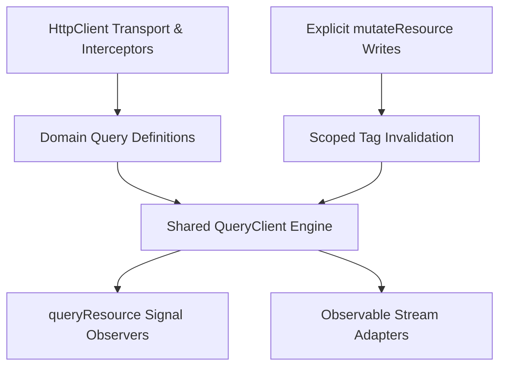

# Design Specification: `queryResource` & `QueryClient`

**Status**: Implemented; package publication readiness is assessed separately.  
**Module**: `libs/ngx-lift/src/lib/query/query-resource.ts`, `query-client.ts`, `query-observable.ts`,
`query-client.token.ts`  
**Tests**: `libs/ngx-lift/src/lib/query/query-resource.spec.ts`, `query-client.spec.ts`, `query-normalizer.spec.ts`,
`query-observable.spec.ts`, and `query-definition.spec.ts`.

---

## 1. Vision & Architecture

While `resourceAsync` manages component-scoped asynchronous lifecycles, **`queryResource`** connects to an
application-scoped **`QueryClient`** cache. It provides coordinated cross-component caching, deterministic query-key
normalization, scoped tag invalidation, deduplication across concurrent observers, background data retention, and smart
coordinated background polling.



### Core Architecture Highlights

- **Pure TypeScript Engine**: `QueryClient` is a framework-agnostic TypeScript class managing cache entries, generation
  counters, deduplication, garbage collection, and polling timers.
- **Angular Integration Layer**: Adapters bridge `QueryClient` into Angular Signals (`queryResource`) and Observables
  (`observeQueryObservable`, `fetchQueryObservable`), while integrating with Angular Dependency Injection
  (`QUERY_CLIENT`), the browser visibility API, and component lifecycles (`DestroyRef`).
- **Single Source of Truth**: Each unique query key maps to exactly one cache entry storing the latest successful data,
  error state, in-flight Promise, generation counter, active observers, and scheduling state.

---

## 2. API Contract & Core Capabilities

### 2.1 Basic Usage Pattern

```typescript
import {inject, signal} from '@angular/core';
import {HttpClient} from '@angular/common/http';
import {queryResource} from 'ngx-lift';

interface Pod {
  name: string;
}

const http = inject(HttpClient);
const tenant = signal('tenant-a');

const pods = queryResource(
  () => {
    const scope = tenant();
    if (!scope) return undefined; // An undefined definition disables the query
    return {
      key: ['pods', scope],
      loader: () => http.get<Pod[]>(`/api/tenants/${scope}/pods`),
      tags: [{type: 'Pods', scope}],
      staleTime: 30_000,
    };
  },
  {pollInterval: 60_000},
);

await pods.execute();
```

### 2.2 Observable and Promise Loaders

All query entry points accept `QueryDefinition<T>` loaders returning `Observable<T> | PromiseLike<T>` directly.
`QueryResourceDefinition<T>` names the same definition type for signal resources. The internal normalizer resolves
Observable reads on the first value and unsubscribes; empty completion rejects with `EmptyError`. Promise-like results
are assimilated with `Promise.resolve`. The scheduler remains Promise-based without requiring public adapters. If
teardown throws, the request still settles: original errors are retained; teardown failure after a value rejects the
attempt and allows a subsequent read to retry.

`fetchQueryObservable` exposes one finite result. `observeQueryObservable` exposes ongoing snapshots and completes on
explicit removal. Use the latter or `queryResource` when mutation invalidation must update a mounted view.
`QueryResourceRef` includes `isInitialLoading` and `isRefreshing` in addition to the aggregate `isLoading` signal.

Cancellation follows the shared cache policy. Destroying, disabling, or changing the key of a resource detaches its
observer. The underlying request is aborted only when the last observer leaves and `cancelOnNoObservers: true` is
enabled. The default allows finite shared reads to finish and populate the cache. When the engine aborts an
Observable-backed request, the adapter unsubscribes, preserving HttpClient cancellation and interceptors. Promise
loaders should forward `context.abortSignal` to transports such as `fetch` when cancellation is needed.

### 2.3 Immediate Cache Reads and Shared Definition Policies

Before observer attachment, `queryResource` exposes existing successful data for the requested key synchronously,
including stale data. Stale snapshots report `reloading` while the observer attaches and starts revalidation; missing
data reports `loading`. This also applies to the default `staleTime: 0`. Disabled queries remain idle, and a key change
never displays the previous key's value. Synchronous destruction during initial attachment or manual recovery disposes
the observer handle, including handles returned after teardown has already run.

Policies reconcile conservatively for the lifetime of a cache entry: minimum `staleTime`, maximum `gcTime`, and
`cancelOnNoObservers` enabled only if every registered definition opts in. Detaching a reader does not reverse those
choices. A temporary reader opting out of cancellation consequently disables it for later requests until eviction. This
is a bandwidth/lifecycle tradeoff, and consumers should centralize consistent same-key definitions. The latest
registered definition supplies the loader, including definitions registered through imperative `fetchQuery`; loaders
sharing a key must describe interchangeable reads and capture stable parameters. Polling intervals, in contrast, are
aggregated across active observers. Active-observer-only freshness, cancellation, and loader ownership would require a
separate design that also accounts for imperative callers and requests already in flight.

---

## 3. Placement Guide: Component vs. Service (Point B)

`queryResource` and `mutateResource` can be defined in either **Services** or **Components**, depending on data reuse,
state lifetime, and architecture boundaries:

| Placement                        | When to Use                                                            | Advantages & Trade-offs                                                                                                                                                                                                                                                                                                     |
| :------------------------------- | :--------------------------------------------------------------------- | :-------------------------------------------------------------------------------------------------------------------------------------------------------------------------------------------------------------------------------------------------------------------------------------------------------------------------- |
| **In a Service (`@Injectable`)** | **Shared data, domain API layers, and multi-component state**          | • Centralizes API endpoints, query keys, and invalidation tags in one domain facade.<br>• Keeps components lean and focused strictly on presentation.<br>• Multiple components injecting the service join the exact same cached data stream.<br>• Query lifetime persists across route transitions if provided in `'root'`. |
| **In a Component**               | **View-specific queries, local dialogs, and tight component bindings** | • Declares queries directly alongside component Signal inputs (`input()`, `input.required()`).<br>• Observer lifecycle is cleanly bounded to the component instance via `DestroyRef`.<br>• Automatically cleans up observer handles when the component unmounts while retaining cache entries in `QueryClient`.             |

### Pattern 1: Service-Based Domain Facade (Recommended for Shared Data)

Encapsulate query definitions and shared write operations inside an `@Injectable` service:

```typescript
import {inject, Injectable, Injector} from '@angular/core';
import {HttpClient} from '@angular/common/http';
import {queryResource, mutateResource} from 'ngx-lift';

export interface User {
  id: string;
  name: string;
  email: string;
}

@Injectable({providedIn: 'root'})
export class UserService {
  private http = inject(HttpClient);

  /**
   * Returns a reactive query observer parameterized by a Signal or getter.
   */
  getUserQuery(id: () => string | undefined, injector: Injector) {
    return queryResource(
      () => {
        const userId = id();
        if (!userId) return undefined;

        return {
          key: ['users', userId],
          tags: [{type: 'User', id: userId}],
          staleTime: 60_000,
          loader: () => this.http.get<User>(`/api/users/${userId}`),
        };
      },
      {injector},
    );
  }

  /**
   * Explicit write operation that invalidates the corresponding user tag upon success.
   */
  readonly updateUser = mutateResource(
    (payload: {id: string; name: string}) => this.http.put<User>(`/api/users/${payload.id}`, payload),
    {
      invalidatesTags: (_result, payload) => [{type: 'User', id: payload.id}],
    },
  );
}
```

A service method does not create an injection context just because its class is injectable. Pass the caller injector
when creating a view-owned observer, including calls made later from event handlers:

```typescript
private injector = inject(Injector);
private users = inject(UserService);
readonly userQuery = this.users.getUserQuery(() => this.userId(), this.injector);
```

This shares cached data through the application `QueryClient` while destroying the observer with the component. A
service field uses its own provider injector instead; a root service field can live until application teardown.
`resourceAsync` follows the same `{injector}` and `DestroyRef` rules, but does not share a cache automatically. Service
placement is therefore supported for all three APIs; placement and lifecycle ownership are separate decisions.

### Pattern 2: Component-Direct Binding (Recommended for View-Specific Queries)

Declare queries directly as component fields when data is local to a specific view or depends directly on component
signal inputs:

```typescript
import {Component, ChangeDetectionStrategy, inject, input} from '@angular/core';
import {HttpClient} from '@angular/common/http';
import {queryResource, mutateResource} from 'ngx-lift';

@Component({
  selector: 'app-user-profile',
  standalone: true,
  changeDetection: ChangeDetectionStrategy.OnPush,
  template: `
    @if (userQuery.isLoading()) {
      <span class="spinner">Loading...</span>
    }
    @if (userQuery.error(); as err) {
      <div class="alert alert-danger">{{ err }}</div>
    }
    @if (userQuery.value(); as user) {
      <h2>{{ user.name }}</h2>
      <button class="btn btn-primary" [disabled]="saveMutation.isLoading()" (click)="save(user.id)">Save</button>
    }
  `,
})
export class UserProfileComponent {
  private http = inject(HttpClient);
  readonly userId = input.required<string>();

  // Defined directly in the component, capturing userId() reactively
  readonly userQuery = queryResource(
    () => {
      const id = this.userId();
      return {
        key: ['users', id],
        tags: [{type: 'User', id}],
        loader: () => this.http.get<User>(`/api/users/${id}`),
      };
    },
    {pollInterval: 30_000},
  );

  readonly saveMutation = mutateResource((id: string) => this.http.patch(`/api/users/${id}`, {active: true}), {
    invalidatesTags: (_res, id) => [{type: 'User', id}],
  });

  save(id: string): void {
    this.saveMutation.mutate(id);
  }
}
```

> **Note on Injection Context**: `resourceAsync` and both `queryResource` and `mutateResource` use `inject(Injector)`
> internally to resolve `QUERY_CLIENT`. Therefore, they must be called during component/service instantiation (property
> initializers or constructors), or passed an explicit `{ injector }` option.

---

## 4. Consumer App Dependency Injection & Setup

### Do we need to register `QUERY_CLIENT` in the consumer app?

**No. In standard Angular applications, zero registration is required.**

`QUERY_CLIENT` is defined with `providedIn: 'root'`:

```typescript
export const QUERY_CLIENT = new InjectionToken<QueryClient>('QUERY_CLIENT', {
  providedIn: 'root',
  factory: () => {
    const document = inject(DOCUMENT);
    const client = new QueryClient({
      isVisible: () => !!document.defaultView && document.visibilityState !== 'hidden',
      subscribeVisibility: (listener) => {
        if (!document.defaultView) return () => undefined;
        document.addEventListener('visibilitychange', listener);
        return () => document.removeEventListener('visibilitychange', listener);
      },
    });
    inject(DestroyRef).onDestroy(() => client.destroy());
    return client;
  },
});
```

- When you call `queryResource()` or `mutateResource()` without options, they automatically inject the root singleton
  `QueryClient`.
- The factory automatically connects browser visibility tracking (pausing background poll schedules when the tab is
  hidden) and tears down the client on application destruction.

### When should you provide a custom `QueryClient`?

You only need custom registration in specific architectural scenarios:

1. **Custom Global Options** (e.g. customized polling clock, capacity limits):
   ```typescript
   // app.config.ts
   export const appConfig: ApplicationConfig = {
     providers: [
       {
         provide: QUERY_CLIENT,
         useFactory: () => new QueryClient({maxEntries: 200}),
       },
     ],
   };
   ```
2. **Server-Side Rendering (SSR)**:
   - Provide an isolated `QueryClient` per server request so concurrent requests do not cross-contaminate cache state.
3. **Unit Testing**:
   - Provide an isolated `new QueryClient()` per test suite or pass `{ client: testClient }` in `QueryResourceOptions`.

---

## 5. Architectural Contracts & Operational Guarantees

| Concern                        | Operational Contract                                                                                                                                                                                                                                     |
| :----------------------------- | :------------------------------------------------------------------------------------------------------------------------------------------------------------------------------------------------------------------------------------------------------- |
| **Key Identity**               | Readonly JSON-compatible tuple keys (`['entity', id]`). Plain object properties are canonicalized recursively so `{ a: 1, b: 2 }` and `{ b: 2, a: 1 }` map to the identical cache entry. Functions, circular structures, and sparse arrays are rejected. |
| **Pending Read Joining**       | Ordinary reads, explicit refreshes (`reload()`, `execute()`), and scheduled background polls join the current active in-flight request, preventing duplicate HTTP requests.                                                                              |
| **Freshness (`staleTime`)**    | Freshness timer begins at request completion. Within `staleTime`, reads return immediately from cache without re-fetching. Failed requests remain immediately retryable.                                                                                 |
| **Retention (`gcTime`)**       | `gcTime` controls how long unused entries linger in memory after their last observer detaches (default: 5 minutes). Eviction protects active observers and in-flight requests.                                                                           |
| **Bypass Refresh**             | `reload()` or `execute()` bypasses completed cached data while still coalescing with any valid pending in-flight request.                                                                                                                                |
| **Generation Isolation**       | Tag invalidation increments the cache entry's generation counter and detaches obsolete generations before refetching. In-flight requests initiated prior to invalidation are cleanly discarded and cannot overwrite newer state.                         |
| **Race Protection**            | Obsolete responses/errors and reentrant notification batches cannot overwrite newer state. Removed or detached observers do not receive earlier snapshots.                                                                                               |
| **Error Resilience**           | A background revalidation failure preserves the last successful cached data in `.value()` while exposing the error in `.error()`. Initial fetch failures have `undefined` value.                                                                         |
| **Context Switching**          | Changing the query key immediately sets previous data to `undefined` on the observer, guaranteeing stale or cross-tenant data is never displayed while the new key loads.                                                                                |
| **Coordinated Polling**        | Only one background timer runs per unique key, synchronized to the minimum active observer interval. Polling automatically pauses when the browser tab is hidden and resumes when visible. SSR never runs background polling.                            |
| **Dynamic Interval Callbacks** | `pollInterval` accepts a reactive function (e.g. `() => isModalOpen() ? undefined : 30_000`) allowing dynamic pause/resume without recreating observers.                                                                                                 |
| **Observer Teardown**          | An observer unsubscribing unbinds cleanly without aborting shared background work needed by other active sibling observers.                                                                                                                              |

---

## 6. Code vs. Spec Gap Analysis

| Requirement / Spec Item            | Implementation in Code                                 | Gap / Finding                                                    | Assessment           |
| :--------------------------------- | :----------------------------------------------------- | :--------------------------------------------------------------- | :------------------- |
| **Deterministic Key Hashing**      | `hashQueryKey` & `normalizeQueryKey`                   | None. Recursively canonicalizes object keys.                     | ✅ Exact match       |
| **Multi-Observer Deduplication**   | Snapshot stream in `QueryClient`                       | None. Concurrent reads share a single in-flight Promise.         | ✅ Exact match       |
| **Generation Isolation on Tags**   | Generation counter per cache entry                     | None. Obsolete in-flight responses are dropped.                  | ✅ Exact match       |
| **Coordinated Background Polling** | Reference counting + fastest interval                  | None. Pauses on document hidden, disabled in SSR.                | ✅ Exact match       |
| **Dynamic Poll Callback**          | `pollInterval?: number \| (() => number \| undefined)` | None. Recalculates timer dynamically.                            | ✅ Exact match       |
| **Observable Adapter**             | Internal normalization & `observeQueryObservable`      | None. Handles synchronous emission and teardown.                 | ✅ Exact match       |
| **Automatic DI Root Token**        | `QUERY_CLIENT` with `providedIn: 'root'`               | None. Zero-config root client.                                   | ✅ Exact match       |
| **Offline Cache Persistence**      | In-memory only                                         | Offline storage plugin (LocalStorage / IndexedDB) not built yet. | ⚠️ Planned next step |

---

## 7. Evolutionary Roadmap & Next Steps

1. **Persistent Cache Adapter**:
   - Provide an optional `QueryClientStorage` interface for synchronizing cache snapshots with browser storage.
2. **Infinite Query (`infiniteQueryResource`)**:
   - Introduce cursor-based / paginated query management for infinite scrolling lists.
3. **Pre-fetching API**:
   - Provide `queryClient.prefetchQuery(options)` for router preload strategies.
